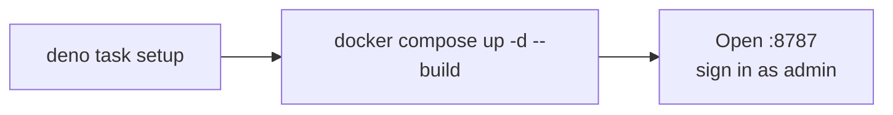

# Quick start



## Docker Compose (recommended)

**Needs:** Docker with Compose v2, and Deno 2.9 for the one-time setup.

```sh
deno task setup
docker compose up -d --build
```

On an AppArmor host (Ubuntu, Debian), `setup` also installs the coding sandbox's AppArmor profile through `sudo`, which
asks for your password. If it cannot, it exits with the two commands to run by hand
([Docker](docs/reference/docker-reference.md#coding-sandbox)).

`setup` prints the admin password and an API key **once** (only hashes are stored), and writes every file the stack
mounts into `secrets/` (private to you: the folder is `0700`), plus `.env`. The ones to know:

| File                          | Purpose                                                                                    |
| ----------------------------- | ------------------------------------------------------------------------------------------ |
| `secrets/ttk_db_key`          | Encrypts every stored secret. **Back it up separately from the data volume.**              |
| `secrets/ttk_admin_user.json` | The first administrator (`admin`).                                                         |
| `secrets/ttk_api_keys.json`   | One API key, id `client`, with every scope the stack's features need.                      |
| `secrets/ttk_peer_*`          | The bundled A2A peer's token and key.                                                      |
| `.env`                        | Host settings: bind address, public URL, allowlists, memory (same text as `.env.example`). |

The full list, with rotation and every option: [secrets/README.md](secrets/README.md). Existing files are never replaced
without `--force`; running `setup` again is always safe.

The stack: the gateway (browser, live view, web app, MCP, A2A, A2UI, memory, the SlopLord coding agent), the private
coding sandbox, and an A2A peer the gateway can delegate to. Only the gateway publishes a port.

**Check**

```sh
docker compose ps                        # tykotech-mcp, sandbox and a2a-peer: healthy
curl -s http://127.0.0.1:8787/healthz    # {"status":"ok",...}
```

**Use**

| What           | Where                                                                                                   |
| -------------- | ------------------------------------------------------------------------------------------------------- |
| Web app        | <http://127.0.0.1:8787/>: sign in as `admin` with the printed password ([tour](docs/guides/web-app.md)) |
| MCP endpoint   | `http://127.0.0.1:8787/mcp` with `Authorization: Bearer <printed key>`                                  |
| A2A            | `http://127.0.0.1:8787/a2a` with the same key; card at `/.well-known/agent-card.json`                   |
| Model provider | Web app › System › Agents › **Add provider** (optional; enables the built-in agent and SlopLord)        |

**Common changes**

| Goal                  | Do                                                                                                              |
| --------------------- | --------------------------------------------------------------------------------------------------------------- |
| Reach it from the LAN | In `.env`: `TTK_BIND=0.0.0.0` and `TTK_PUBLIC_URL=http://<host address>:8787`, then `docker compose up -d`      |
| Behind a domain       | `TTK_PUBLIC_URL=https://mcp.example.com`; see [Deploying to production](docs/guides/deploying-to-production.md) |
| More API keys         | `deno task doctor --new-key <id> --scopes <list> --save` (the running gateway picks it up)                      |
| Without the A2A peer  | `docker compose up -d tykotech-mcp sandbox`                                                                     |
| Diagnose              | `docker compose run --rm --no-deps tykotech-mcp ttk doctor`                                                     |
| Stop / remove         | `docker compose down` (keeps data) / `docker compose down -v` (deletes all data)                                |

Optional overlays, each needing nothing beyond `setup`: model providers from a file, the ACP agent runner, an
operator-held sandbox token, one Docker container per workspace ([Docker](docs/reference/docker-reference.md#overlays)).

## Local Deno

**Needs:** Deno 2.9 and Chrome, Edge or Chromium (found automatically).

```sh
deno task setup
deno task build:web
export TTK_DATA_DIR=data TTK_DB_KEY_FILE=secrets/ttk_db_key TTK_API_KEYS_FILE=secrets/ttk_api_keys.json
deno task dev
```

Open <http://127.0.0.1:8787/> and sign in as `admin`. `dev` grants loopback network only, so a local model server works
and a cloud provider does not; use Compose for those. `deno task` lists every task. More:
[Development](docs/guides/development.md).

## stdio for local agents

stdio opens no port and needs no credential. It reads the same `ttk.db` as `dev`:

```json
{
	"mcpServers": {
		"multi-mcp": {
			"command": "deno",
			"args": ["task", "--cwd", "/absolute/path/to/multi-mcp", "stdio"],
			"env": { "TTK_DATA_DIR": "data", "TTK_DB_KEY_FILE": "secrets/ttk_db_key" }
		}
	}
}
```

stdio callers hold `TTK_ANON_SCOPES` (default `mcp:invoke,view:watch,view:control,files:read`). Add `files:write` to let
an agent save memory. See [Connecting clients](docs/guides/connecting-clients.md#stdio).
