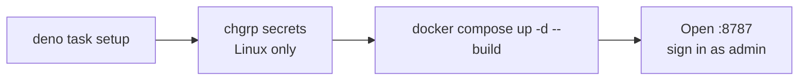

# Quick start



## Docker Compose (recommended)

**Needs:** Docker with Compose v2, and Deno 2.9 for the one-time setup.

```sh
deno task setup
sudo chgrp 1993 secrets/ttk_* && chmod 0440 secrets/ttk_*   # Linux / WSL only
docker compose up -d --build
```

`setup` prints the admin password and an API key **once** (only hashes are stored), and writes:

| File                          | Purpose                                                                            |
| ----------------------------- | ---------------------------------------------------------------------------------- |
| `secrets/ttk_db_key`          | Encrypts every stored secret. **Back it up separately from the data volume.**      |
| `secrets/ttk_admin_user.json` | The first administrator (`admin`).                                                 |
| `secrets/ttk_api_keys.json`   | One API key, id `client`, default scopes.                                          |
| `.env`                        | `TTK_BIND=127.0.0.1`, `TTK_PUBLIC_URL=http://127.0.0.1:8787` (see `.env.example`). |

Existing files are never replaced without `--force`. The containers run as uid/gid 1993 and read the secrets through
bind mounts, hence the `chgrp` on Linux. Without sudo:
`docker run --rm -v "$PWD/secrets:/s" busybox sh -c 'chgrp 1993 /s/ttk_* && chmod 0440 /s/ttk_*'`.

**Check**

```sh
docker compose ps                        # tykotech-mcp and sandbox: healthy
curl -s http://127.0.0.1:8787/healthz    # {"status":"ok",...}
```

**Use**

| What           | Where                                                                                                   |
| -------------- | ------------------------------------------------------------------------------------------------------- |
| Web app        | <http://127.0.0.1:8787/>: sign in as `admin` with the printed password ([tour](docs/guides/web-app.md)) |
| MCP endpoint   | `http://127.0.0.1:8787/mcp` with `Authorization: Bearer <printed key>`                                  |
| Model provider | Web app › System › Agents › **Add provider** (optional; enables the built-in agent and SlopLord)        |

**Common changes**

| Goal                  | Do                                                                                                              |
| --------------------- | --------------------------------------------------------------------------------------------------------------- |
| Reach it from the LAN | In `.env`: `TTK_BIND=0.0.0.0` and `TTK_PUBLIC_URL=http://<host address>:8787`, then `docker compose up -d`      |
| Behind a domain       | `TTK_PUBLIC_URL=https://mcp.example.com`; see [Deploying to production](docs/guides/deploying-to-production.md) |
| More API keys         | `deno task doctor --new-key <id> --scopes <list>`; append the record to `secrets/ttk_api_keys.json`             |
| Diagnose              | `docker compose run --rm --no-deps tykotech-mcp ttk doctor`                                                     |
| Stop / remove         | `docker compose down` (keeps data) / `docker compose down -v` (deletes all data)                                |

## Local Deno

**Needs:** Deno 2.9 and Chrome, Edge or Chromium (found automatically).

```sh
deno task setup
deno task build:web
export TTK_DATA_DIR=data TTK_DB_KEY_FILE=secrets/ttk_db_key TTK_API_KEYS_FILE=secrets/ttk_api_keys.json
deno task dev
```

Open <http://127.0.0.1:8787/> and sign in as `admin`. `dev` grants loopback network only, so a local model server works
and a cloud provider does not; use Compose for those. More: [Development](docs/guides/development.md).

## stdio for local agents

stdio opens no port and needs no credential. It reads the same `ttk.db` as `dev`:

```json
{
	"mcpServers": {
		"multi-mcp": {
			"command": "deno",
			"args": ["task", "--cwd", "/absolute/path/to/multi-mcp", "stdio"],
			"env": { "TTK_DATA_DIR": "data", "TTK_DB_KEY_FILE": "secrets/ttk_db_key" }
		}
	}
}
```

stdio callers hold `TTK_ANON_SCOPES` (default `mcp:invoke,view:watch,view:control,files:read`). Add `files:write` to let
an agent save memory. See [Connecting clients](docs/guides/connecting-clients.md#stdio).
