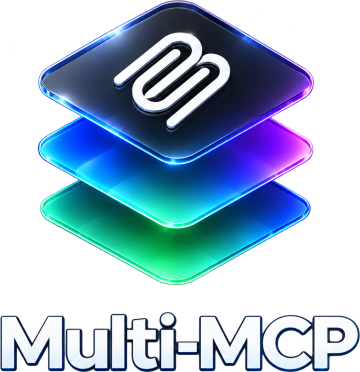
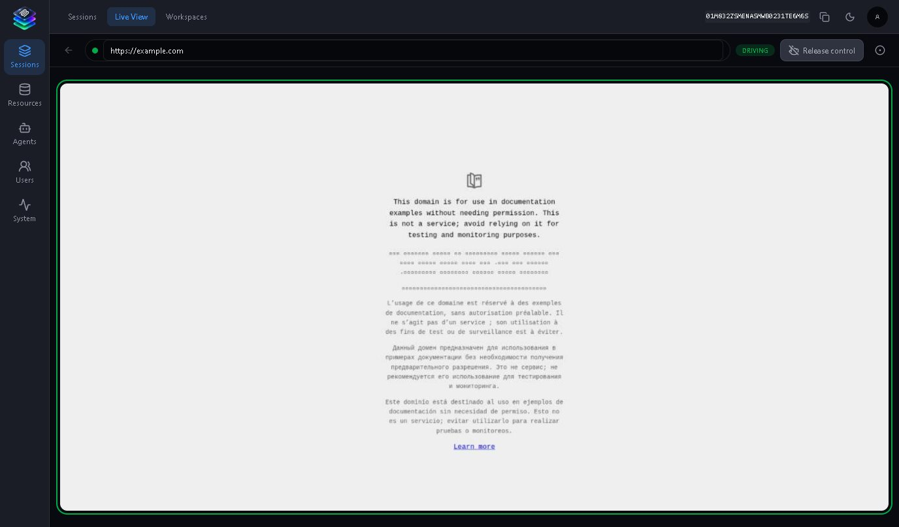

<p align="center"></p>

<p align="center"><b>An MCP server with a real, sandboxed browser inside it.</b></p>

<p align="center">


</p>

Multi-MCP (`tykotech-mcp`) gives AI assistants a server-side Chromium they drive through MCP tools, and gives people a
live view of the same browser where they can take over. A private coding sandbox, agents and an encrypted state database
come with it. Built on Deno 2.9 and the MCP TypeScript SDK v2.



| Area       | Included                                                                                                                                                                        |
| ---------- | ------------------------------------------------------------------------------------------------------------------------------------------------------------------------------- |
| Browser    | **57 browser tools**: navigate, click, type, state with stable element indices, frames, screenshots, PDF, downloads, network and console logs, accessibility tree, performance. |
| Live view  | Screencast in the web app, mouse and keyboard, an exclusive takeover lock, model-to-human handoff, recording.                                                                   |
| Library    | File share, skills and prompt templates, served as tools, resources and MCP prompts.                                                                                            |
| Sandbox    | Private coding workspaces: one bubblewrap cage per command, no network by default, git clone, live shell.                                                                       |
| Agents     | Built-in model agent (OpenAI-compatible or Anthropic providers), SlopLord coding agent, vector memory, A2A 1.0, A2UI surfaces.                                                  |
| Access     | Hashed API keys, password accounts, 14 scopes, per-owner isolation.                                                                                                             |
| State      | One SQLite database; every stored secret sealed with AES-256-GCM.                                                                                                               |
| Transports | Streamable HTTP (`/mcp`) and stdio.                                                                                                                                             |

## Run it

You need [Docker Desktop](https://docs.docker.com/get-started/get-docker/) (Windows, macOS) or Docker Engine with the
Compose and Buildx plugins (Linux). Download this repository, then in its folder double-click **`start.cmd`** (Windows)
or run `./start.sh` (macOS, Linux). The script builds everything, creates your secrets and opens
<http://127.0.0.1:8787/>. **The first run prints the administrator password and an API key once: save them.** Sign in as
`admin`.

Step by step, settings and troubleshooting: [QUICK-START.md](QUICK-START.md).

## Connect a client

```sh
claude mcp add --transport http multi-mcp http://127.0.0.1:8787/mcp --header "Authorization: Bearer ttk_<key>"
```

Other clients and stdio: [Guide › Connecting clients](docs/guide.md#connecting-clients).

## Documentation

| Page                                                             | For                                                                              |
| ---------------------------------------------------------------- | -------------------------------------------------------------------------------- |
| [Quick start](QUICK-START.md)                                    | Installing and starting it, day-to-day commands, troubleshooting.                |
| [Guide](docs/guide.md)                                           | The web app, clients, access, the sandbox and agents, production, monitoring.    |
| [Security](docs/security.md)                                     | What guards each boundary, how secrets are kept.                                 |
| [Development](docs/development.md)                               | Architecture, running from source, rules, tests, commands, contributing.         |
| [MCP reference](docs/reference/mcp.md)                           | Every tool, browser sessions, resources, errors, MCP Apps, the live-view socket. |
| [HTTP API, data and Docker](docs/reference/api.md)               | REST routes, problem documents, the data directory, images and Compose.          |
| [Environment variables](docs/reference/environment-variables.md) | Every setting.                                                                   |

[CONTRIBUTING.md](CONTRIBUTING.md) · [Code of Conduct](CONDUCT.md) · report vulnerabilities privately via
[SECURITY.md](SECURITY.md) · [CHANGELOG.md](CHANGELOG.md) · [MIT License](LICENSE)
