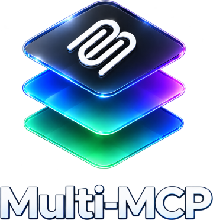
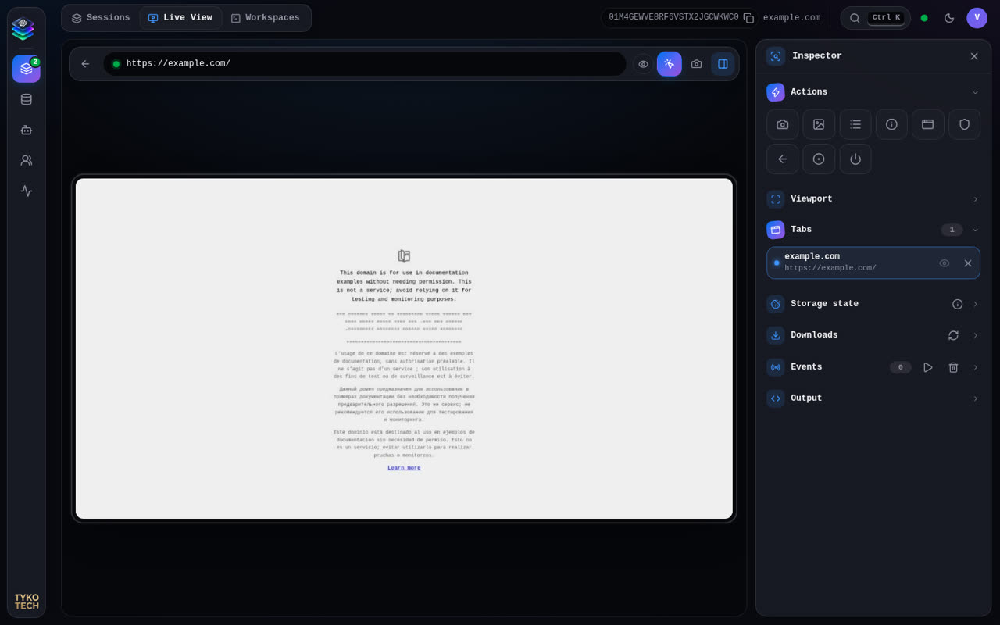
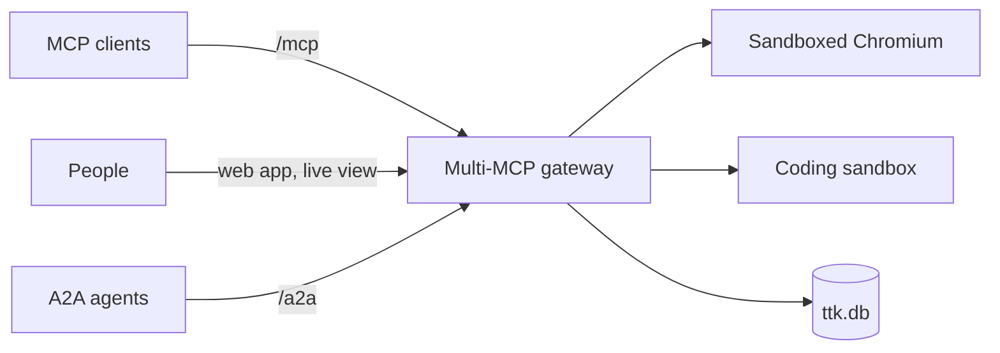

<p align="center"></p>

<p align="center"><b>An MCP server with a real, sandboxed browser inside it.</b></p>

<p align="center">


</p>

Multi-MCP (`tykotech-mcp`) gives MCP clients a server-side Chromium as deterministic tools, and gives people a live view
of the same browser where they can take control. A private coding sandbox, agents and an encrypted state database come
with it. Built on Deno 2.9 and the MCP TypeScript SDK v2.



## What you get

| Area       | Included                                                                                                                                                                        |
| ---------- | ------------------------------------------------------------------------------------------------------------------------------------------------------------------------------- |
| Browser    | **57 browser tools**: navigate, click, type, state with stable element indices, frames, screenshots, PDF, downloads, network and console logs, accessibility tree, performance. |
| Live view  | JPEG screencast over WebSocket, mouse/keyboard input, an exclusive takeover lock, model-to-human handoff.                                                                       |
| Library    | File share, skills and prompt templates, served as tools, resources and MCP prompts.                                                                                            |
| Sandbox    | Private coding workspaces: one bubblewrap cage per command, no network by default, git clone, live shell.                                                                       |
| Agents     | Built-in model agent (OpenAI-compatible or Anthropic providers), SlopLord coding agent, vector memory, A2A 1.0, ACP bridge, A2UI surfaces.                                      |
| Access     | Hashed API keys, password accounts, OAuth 2.1 resource server, 14 scopes, per-owner isolation.                                                                                  |
| State      | One SQLite database; every stored secret sealed with AES-256-GCM.                                                                                                               |
| Transports | Streamable HTTP (`/mcp`) and stdio.                                                                                                                                             |



## Run it

Needs Docker with Compose v2 and Deno 2.9 (for the one-time setup).

```sh
deno task setup                                             # secrets/ and .env; prints the admin password and API key once
sudo chgrp 1993 secrets/ttk_* && chmod 0440 secrets/ttk_*   # Linux only
docker compose up -d --build
```

Open <http://127.0.0.1:8787/> and sign in as `admin`. Full walkthrough, LAN access and local development:
[QUICK-START.md](QUICK-START.md).

## Connect a client

```sh
claude mcp add --transport http multi-mcp http://127.0.0.1:8787/mcp --header "Authorization: Bearer ttk_<key>"
```

Other clients and stdio: [Connecting clients](docs/guides/connecting-clients.md).

## Documentation

| Start                                                   | Operate                                                           | Reference                                                        |
| ------------------------------------------------------- | ----------------------------------------------------------------- | ---------------------------------------------------------------- |
| [Quick start](QUICK-START.md)                           | [Deploying to production](docs/guides/deploying-to-production.md) | [MCP tools](docs/reference/mcp-tools.md)                         |
| [Web app](docs/guides/web-app.md)                       | [Managing access](docs/guides/managing-access.md)                 | [Environment variables](docs/reference/environment-variables.md) |
| [Architecture](docs/concepts/architectural-overview.md) | [Agents and sandbox](docs/guides/coding-and-agents.md)            | [HTTP API](docs/reference/api-endpoints.md)                      |
| [Security model](docs/concepts/security-model.md)       | [Monitoring](docs/guides/setting-up-monitoring.md)                | [All docs](docs/index.md)                                        |

## Contributing

[CONTRIBUTING.md](CONTRIBUTING.md) · [Code of Conduct](CONDUCT.md) · report vulnerabilities privately via
[SECURITY.md](SECURITY.md) · [CHANGELOG.md](CHANGELOG.md)

## License

[MIT](LICENSE)
