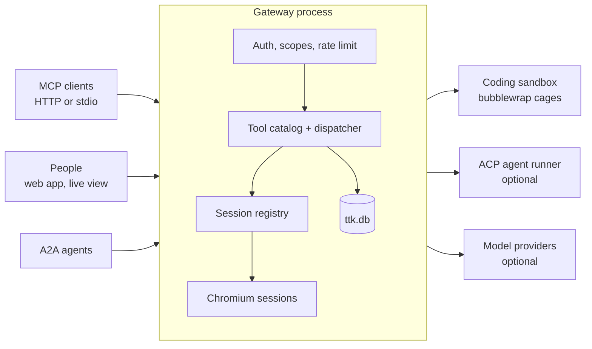
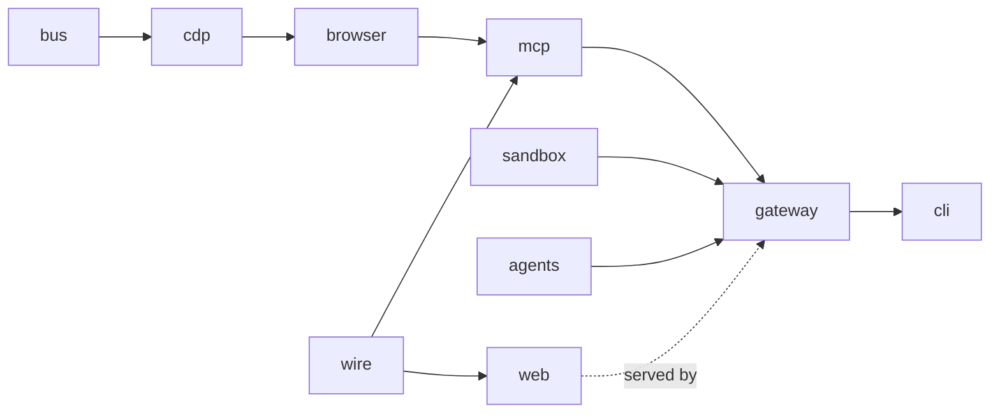
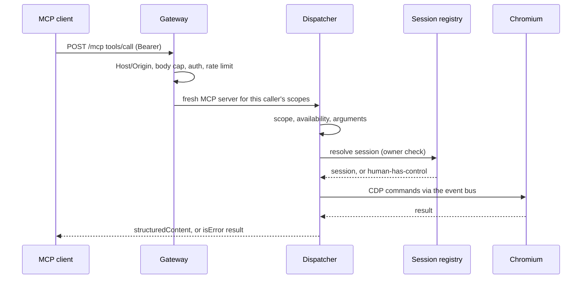

# Architecture

One Deno process (the gateway) owns a pool of sandboxed Chromium browsers and exposes them as MCP tools for models, a
live view for people, and REST and A2A APIs for operators and agents. The coding sandbox and the optional ACP agent
runner are separate private services.

## Packages

Each package exposes only `mod.ts`; dependencies point downward.

| Package   | Role                                                                                                               |
| --------- | ------------------------------------------------------------------------------------------------------------------ |
| `bus`     | Typed async event bus (vendored).                                                                                  |
| `cdp`     | Chrome DevTools Protocol client and Chromium launcher (vendored).                                                  |
| `browser` | Sessions, tabs, watchdogs and the DOM serializer that indexes elements (vendored).                                 |
| `wire`    | Live-view message contract and A2UI schemas, shared with the web UI.                                               |
| `mcp`     | Tool catalog, handlers, dispatcher, session registry, resources, capability block, library.                        |
| `sandbox` | The coding-sandbox service and the client the gateway uses.                                                        |
| `agents`  | Task runtime, A2A server and peer client, ACP client, the built-in model agent.                                    |
| `gateway` | Hono app: auth, `/mcp`, REST, live view, recorder, event streams, users, `ttk.db`, vault, memory, cluster routing. |
| `web`     | The control-plane single-page app and the three MCP Apps embeds (live view, surface, terminal).                    |
| `cli`     | Composition root: `serve`, `stdio`, `acp`, `setup`, `seed`, `doctor`, `healthcheck`, `version`.                    |

## A tool call

- **Stateless MCP.** Each request builds its own server from the caller's scopes and the deployment's live state, so
  `tools/list` shows exactly what the caller can do now. Browser state lives in the registry, addressed by `session_id`;
  clustering is routing.
- **One owner of browser state.** Only the registry creates, locks and closes browsers. It closes idle sessions every
  minute.
- **Results, not exceptions.** Every failure a model can act on is a tool result with a stable code.
- **Background loops.** A 30 s probe toggles the sandbox and agent tools; progress heartbeats run once a second.

## Where state lives

| State                                                      | Where                                       |
| ---------------------------------------------------------- | ------------------------------------------- |
| Model providers, sealed secrets, agent memory              | `<TTK_DATA_DIR>/ttk.db`                     |
| Accounts, sign-ins, per-credential origins                 | `users.json`, `logins.json`, `origins.json` |
| Profiles, storage states, downloads, recordings            | Plain files under `TTK_DATA_DIR`            |
| File share, skills, prompts                                | `share/`, `skills/`, `prompts/`             |
| Agent tasks, A2UI surfaces                                 | `agents/*.json`                             |
| Sessions, tickets, event rings, request logs, audit ledger | Memory                                      |

Details: [Data model](../reference/data-model.md).

## Design choices

- **No server-side model needed for browsing.** `browser_extract_content` and `browser_run_task` borrow the client's
  model through sampling. The built-in model agent calls a configured provider only for callers with `model:invoke`.
- **Least privilege.** Every task, image and binary names its Deno permissions with `--deny-ffi` first; non-default
  features need explicit scopes; secrets at rest are sealed.
- **Separate trust zones.** Untrusted pages run in Chromium's sandbox; untrusted code runs in the sandbox service's
  cages, in another container with no network by default.
