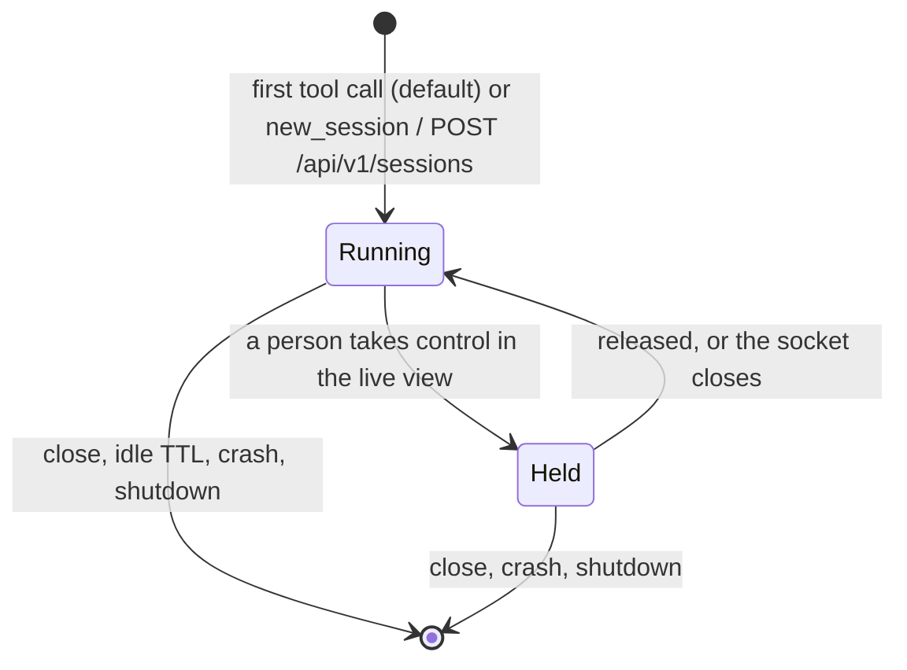
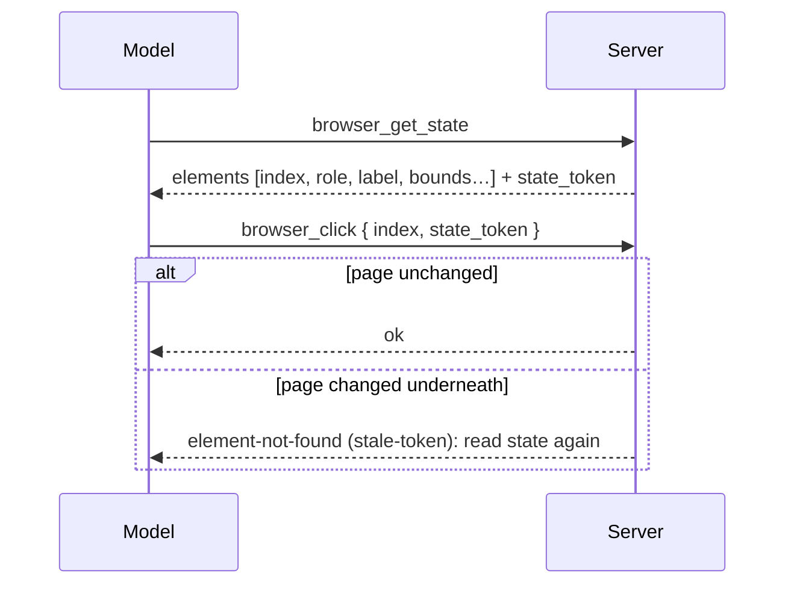

# Browser sessions

A session is one Chromium process and its tabs, owned by the session registry. Browser tools, the live view and the
session routes all act on sessions.

## Lifecycle

| Event      | Behaviour                                                                                                                       |
| ---------- | ------------------------------------------------------------------------------------------------------------------------------- |
| First use  | A tool without `session_id` uses your `default` session, created on first use.                                                  |
| New        | `browser_navigate { new_session: true }` or `POST /api/v1/sessions`. Unknown ids are never created implicitly.                  |
| Limit      | `TTK_MAX_SESSIONS` (default 8).                                                                                                 |
| Idle close | After `TTK_SESSION_TTL_S` (default 1800 s); never while a viewer is watching.                                                   |
| Close      | `browser_close_session`, `browser_close_all` (admin), `DELETE /api/v1/sessions/{id}`, crash or shutdown. Downloads are deleted. |

**Ownership** (`TTK_SESSION_OWNERSHIP`): `owner` (single-node default) binds a session to its creator; others get
`unknown-session`; `admin` reaches all. `shared` (cluster default) lets every `mcp:invoke` holder reach every session.

## Perceive, then act

- `browser_get_state` merges the DOM, layout and accessibility tree and numbers each interactive element. `fields`
  chooses detail: `minimal`, `core` (default: bounds, visible, enabled, focused, frame_id), `full`, or single fields
  (`input`, `attrs`, `text`, `locators`, …). `include_hidden` adds off-screen elements.
- Pass the `state_token` back with an index. A changed table answers `element-not-found` instead of clicking the wrong
  element. `browser_wait_for { state_token_changes }` waits for a change.
- Password values are never reported. Secrets are typed by name (`<secret>name</secret>` or `browser_fill_secret`).
- Other views: `browser_find`, `browser_element_at`, `browser_get_frames`, `browser_accessibility_snapshot`,
  `browser_screenshot`, `browser_get_html`, `browser_performance`.

## Dialogs

JavaScript dialogs are answered automatically (prompts dismissed) unless something subscribes to `dialog` events. Then
the dialog is held for up to 20 s, mutating tools answer `dialog-open`, and `browser_handle_dialog` answers it.

## Human handoff

`browser_request_human` asks a person to solve a CAPTCHA, sign in or decide something. It hands out
`<TTK_PUBLIC_URL>/#/view/<session>`; the person signs in and takes control. While they hold the lock, mutating tools
answer `human-has-control`, read-only tools keep working.

## Navigation allowlist

`TTK_ALLOWED_DOMAINS` (a host matches itself and its subdomains) is enforced by the server and inside Chromium: an
off-list document request is refused before it is sent, off-list pop-ups are closed, and the blocked attempt is logged
as a `navigation` event with `blocked: true`. `TTK_ALLOWED_DOMAINS_SCOPE=all` extends this to every request. It is not a
network boundary; use network policy for that.

## Files

| Item   | Rule                                                                                           |
| ------ | ---------------------------------------------------------------------------------------------- |
| Start  | `browser_download`, or any download a page starts.                                             |
| Limits | 100 MB per file, 500 MB and 100 files per session, 5 min per transfer (`browser_file_policy`). |
| Read   | `browser_get_file`: inline ≤1 MiB, resource link, or HTTP stream with `Range`.                 |
| Share  | `browser_file_link` mints a no-bearer URL (10–3600 s) when signed links are on.                |
| Keep   | Files die with the session; `browser_save_to_share` copies one into the file share.            |
| Upload | `browser_upload_file` puts a downloaded file on a file input; arbitrary paths are refused.     |

## Persistence

With `TTK_DATA_DIR`: named **profiles** keep a Chromium user-data directory across restarts (one live session each);
**storage states** save and load cookies and origin storage by name; **recordings** (`browser_record`, needs
`TTK_FFMPEG`) encode the screencast to WebM. Profiles and storage states are plain files: protect the volume.

## Events and logs

Each session keeps a ring of 512 events, readable over SSE (`/api/v1/sessions/{id}/events`) or the live-view socket:
`navigation`, `dom.settled`, `network.idle`, `focus`, `input`, `download.*`, `dialog`, `console`, `tab`, `control`.
`browser_network_log` and `browser_har_export` read the last 500 requests (credential headers redacted; full URLs and
bodies need `network:read`); `browser_console_log` reads console output.
