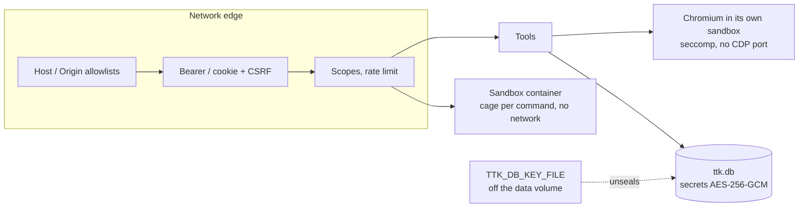

# Security model

The server loads untrusted pages for a model, lets a person take over the same browser, runs code in workspaces, and
keeps credentials at rest. This page lists what guards each boundary and where the guard ends.

## Threats and defences

| Threat                               | Defences                                                                                                                                                                                      |
| ------------------------------------ | --------------------------------------------------------------------------------------------------------------------------------------------------------------------------------------------- |
| Unauthenticated network callers      | A non-loopback bind refuses to start without API keys, OAuth or an account. Every non-public route needs a credential.                                                                        |
| A malicious page                     | Chromium's sandbox in a hardened container; CDP bound to loopback, never published; password values never reported.                                                                           |
| A model or client exceeding its role | Per-credential scopes; explicit-only scopes for administration, code, agents, writes, evaluation, models and full request data; owner-bound sessions, workspaces, tasks, surfaces and memory. |
| DNS rebinding, cross-site requests   | `Host` and `Origin` allowlists; no CORS headers; one `SameSite=Strict` HttpOnly cookie plus CSRF on changes.                                                                                  |
| Credential leakage                   | Keys and passwords hashed; stored secrets sealed; secrets never in the process environment; tickets, not tokens, in URLs; values never logged.                                                |
| A stolen data volume                 | Sealed secrets need `TTK_DB_KEY_FILE`, kept off the volume.                                                                                                                                   |
| Code run in a workspace              | Separate container; a fresh bubblewrap cage per command; no network by default; disk budgets.                                                                                                 |
| A revoked credential lingering       | Sessions, tasks, delegated tokens and streams are re-checked and end when the credential is revoked.                                                                                          |

## Authentication

| Credential                | Rules                                                                                        |
| ------------------------- | -------------------------------------------------------------------------------------------- |
| API key (`ttk_`)          | Stored as SHA-256, compared in constant time. The key file reloads on change.                |
| Password account          | PBKDF2-SHA256, 100 000 iterations. Equal-time failures; per-source and per-username backoff. |
| Sign-in session (`ttks_`) | Hashed; expires after `TTK_LOGIN_TTL_S`; scopes re-derived on every request.                 |
| OAuth access token        | Verified against the issuer's JWKS and audience. Resource server only.                       |
| Delegated (`ttkd_`)       | For ACP agents: ≤120 s, `/mcp` only, never `agent:invoke`, `task` or `admin`.                |
| Anonymous                 | Only on a loopback bind with no credentials configured, with `TTK_ANON_SCOPES`.              |

The web UI's cookie is `HttpOnly; SameSite=Strict` (`__Host-` and `Secure` on https), set only by a JSON sign-in from
the server's own origin, read only without an `Authorization` header, and never on the live-view socket. Every
cookie-authenticated change needs the own origin and `x-ttk-csrf`.

## Authorization

14 scopes. Default grant: `mcp:invoke`, `view:watch`, `view:control`, `files:read`. Held only when named: `admin`,
`files:write`, `evaluate`, `task`, `sandbox:execute`, `agent:invoke`, `a2ui:publish`, `model:invoke`, `metrics:read`,
`network:read`. A tool outside the caller's scopes is not registered and is listed as withheld; REST routes answer
`403 forbidden-scope`. Details: [Managing access](../guides/managing-access.md#scopes).

## Network posture

- Binds `127.0.0.1` by default; Compose publishes on loopback unless `TTK_BIND` says otherwise.
- Foreign `Host`: `400`. Foreign `Origin`: `403`. No CORS. TLS is the reverse proxy's job.
- The web UI is served with a strict CSP, `frame-ancestors 'none'` and `X-Frame-Options: DENY`.
- Bodies are capped before parsing and auth; non-canonical paths are refused before routing.

## The browser

- **Sandbox.** Chromium needs its setuid helper, the shipped seccomp profile, 1 GB shared memory and **no**
  `no-new-privileges`. `--no-sandbox` is possible only with `TTK_CHROMIUM_NO_SANDBOX=true` (never set in the images;
  loud warning). `TTK_BROWSER_ARGS` refuses sandbox-weakening or program-running switches.
- **What reaches the model.** Password values are masked and excluded from the state token. Secrets are substituted by
  name inside the server, checked against the origin of the frame receiving them, and audited. Storage-state documents
  never leave the server. Request logs redact credential headers and keep no bodies (full URLs and bodies need
  `network:read`).
- **Allowlist.** `TTK_ALLOWED_DOMAINS` is enforced by the server and inside Chromium (off-list document requests are
  refused before they are sent). `TTK_ALLOWED_DOMAINS_SCOPE=all` covers every request. It is not a network boundary: for
  one, use a network that reaches only allowed sites.
- **Page JavaScript.** `browser_evaluate` needs `evaluate`; 1 s budget, 64 KiB result, audited by size and digest.
- **Server-side requests.** `browser_head` sends cookie-less `HEAD` requests hop by hop, refusing private, loopback and
  link-local literals; it does not resolve names for that check, so set `TTK_ALLOWED_DOMAINS` on networks with internal
  services. A2A push goes only to `TTK_A2A_PUSH_ALLOWED_HOSTS`, never to private addresses.

## Live view and MCP Apps

Sockets open with single-use tickets bound to principal, session and mode. Watching and controlling are separate scopes;
input needs the takeover lock. Viewers per session and long-lived connections per principal are capped. MCP Apps embeds
are hash-pinned documents whose only connect source is the gateway's socket origin.

## Coding workspaces

The sandbox is another container on an internal network, reached with a token it generates into a volume only it and the
gateway mount. Each command runs in a fresh cage: new namespaces, no capabilities, read-only root and `.git`, 200
processes, empty environment, no network unless it asks for package registries (HTTPS `CONNECT` to a fixed list on
public addresses only). Git credentials never enter a cage. Disk is budgeted per workspace and owner. The opt-in Docker
backend gives the sandbox service, never the gateway, the Docker socket, which is root-equivalent on the host.

## Agents

Tasks run with the caller's current scopes, re-checked before every tool call. No task may run the confirmation set, the
sampling tools, the handoff, the live-view tools or `browser_file_link`. Model providers are named only by the operator
(seed file) or an administrator; the gateway dials only their `base_url`, without redirects; a provider key is sealed,
bound to its host, never returned and redacted from task output. The ACP runner is a separate read-only container; its
agent reaches this server only with a short-lived delegated token.

## Process permissions

Every launcher names its Deno permissions with `--deny-ffi` first. Both images grant unscoped `--allow-net` (bounded by
the code that dials, above); the bundled image can be narrowed with a Compose `command:` override, the slim binary
cannot. Local `deno task`s grant loopback only. Chromium and ffmpeg start with the inline secret variables, the
OpenTelemetry exporter variables and `ANTHROPIC_API_KEY`, `OPENAI_API_KEY` and `TTK_MODEL_API_KEY` set empty; the server
never reads those three. With `OTEL_DENO=true` the process refuses to start unless every collector origin is listed in
`TTK_OTEL_ENDPOINTS`.

## Data at rest

| Data                                                     | Protection                                                    |
| -------------------------------------------------------- | ------------------------------------------------------------- |
| Provider keys, browser secrets, generated link key       | Sealed in `ttk.db` (AES-256-GCM, key from `TTK_DB_KEY_FILE`). |
| API keys, passwords, sign-ins                            | SHA-256 / PBKDF2 hashes.                                      |
| Profiles, storage states, file share, memory, task files | Plain files. **Not encrypted.**                               |

Back up `TTK_DB_KEY_FILE` apart from `/data`: losing or replacing it loses every stored secret, and there is no rotation
command. A backup of `/data` holds cookies, files and memory in the clear.

## Known limits

- In a cluster, or with `TTK_SESSION_OWNERSHIP=shared`, sessions are shared among `mcp:invoke` holders; named profiles
  are shared in every mode.
- `ttk.db` is node-local in a cluster.
- A signed link is a bearer credential until it expires (≤3600 s).
- With OpenTelemetry on, collectors receive request URLs (tickets, link tokens) unless they redact them.
- The domain allowlist is not a network boundary.
- Behind a reverse proxy, per-source sign-in backoff sees the proxy's address.
- The audit ledger lives in memory, per session.
