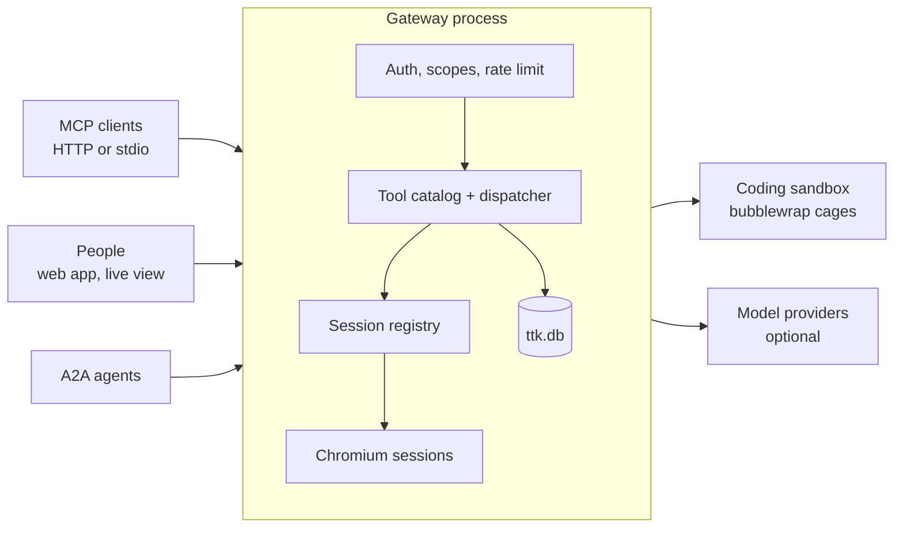

# Development

How Multi-MCP is built, how to run it from source, the rules a change follows, and the tests that prove it. The rules
for AI agents and the project's non-negotiables are in [AGENTS.md](../AGENTS.md).

## Architecture

One Deno process, the gateway, owns a pool of sandboxed Chromium browsers and exposes them as MCP tools for models, a
live view for people, and REST and A2A APIs for operators and agents. The coding sandbox is a separate private service.



A tool call: `POST /mcp` passes the request pipeline (drain → Host/Origin → path and body caps → request id → auth →
per-credential origins → rate limit); the gateway builds a fresh MCP server from the caller's scopes; the dispatcher
checks scope, availability and arguments, resolves the session through the registry (owner check, takeover lock), sends
CDP commands over the event bus, and returns `structuredContent` or an `isError` result.

- **Stateless MCP.** Each request builds its own server from the caller's scopes and the deployment's live state, so
  `tools/list` shows exactly what the caller can do now. A 2025-era client that needs an `Mcp-Session-Id` keeps one
  server per session instead (`TTK_MCP_STATEFUL`, on by default), rebuilt when its credential changes. Browser state
  lives in the registry, addressed by `session_id`.
- **One owner of browser state.** Only the session registry (`packages/mcp/src/registry.ts`) creates, locks and closes
  browsers; it serializes creation per id and closes idle sessions every minute.
- **Results, not exceptions.** Every failure a model can act on is a tool result with a stable code.
- **No server-side model needed for browsing.** `browser_extract_content` and `browser_run_task` borrow the client's
  model through sampling; the built-in model agent calls a configured provider only for callers with `model:invoke`.
- **Background loops.** A 30 s probe toggles the sandbox tools; progress heartbeats run once a second.

### Packages

Each package exposes only `mod.ts`; dependencies point downward: `bus`/`cdp`/`wire` → `browser` → `mcp` → `gateway` →
`cli`, with `sandbox` and `agents` used by `gateway`.

| Package   | Role                                                                                                                |
| --------- | ------------------------------------------------------------------------------------------------------------------- |
| `bus`     | Typed async event bus (vendored).                                                                                   |
| `cdp`     | Chrome DevTools Protocol client and Chromium launcher (vendored).                                                   |
| `browser` | Sessions, tabs, watchdogs and the DOM serializer that indexes elements (vendored).                                  |
| `wire`    | Live-view message contract and A2UI schemas, shared with the web app.                                               |
| `mcp`     | Tool catalog (`catalog/`), handlers (`tools/`), dispatcher, session registry, resources, capability block, library. |
| `sandbox` | The coding-sandbox service and the client the gateway uses.                                                         |
| `agents`  | Task runtime, A2A server and peer client (`a2a.ts`), the built-in model agent (`model/`), agent settings.           |
| `gateway` | Hono app: auth, `/mcp`, REST, live view, recorder, event streams, users, `ttk.db`, vault, memory.                   |
| `web`     | The control-plane single-page app and the three MCP Apps embeds (live view, surface, terminal).                     |
| `cli`     | Composition root: `serve`, `stdio`, `setup`, `seed`, `doctor`, `healthcheck`, `version`.                            |

`bus`, `cdp` and `browser` are vendored (each package's `VENDOR.md` says from where): change them only when necessary,
and say why at the changed site.

```
packages/             the packages above
scripts/              gates, coverage, health checks, grant resolvers
docker/               sandbox and workspace images; seccomp and AppArmor profiles; ttk
tests/                unit, e2e (browser), stdio, container, sandbox, agents, fixtures, support
secrets/              git-ignored file secrets setup writes
docs/                 this documentation
```

Where state lives at run time: [HTTP API › Data](reference/api.md#data).

## Set up and run

Needs Deno 2.9.x and a Chromium-family browser (Chrome, Chromium, Edge or Brave, found automatically; `TTK_BROWSER_PATH`
pins one). ffmpeg is optional (recordings). Docker is needed only for the container, sandbox and Compose tiers.

```sh
deno install --frozen        # dependencies from the lockfile
deno task setup              # every file in secrets/, and .env (secrets/README.md)
deno task build:web          # web app bundle
deno task ok                 # fmt, lint, types, gates, unit tests
deno task dev                # http://127.0.0.1:8787, with file watching
```

- `dev`, `stdio`, `doctor` and `seed` pass `--local-defaults`, so they find `setup`'s files without exports
  ([Security › Secrets](security.md#secrets)). State lands in `./data` (git-ignored).
- `dev` grants network to `127.0.0.1` only: `browser_head` is withheld and only local model servers are reachable.
- With no credentials at all, loopback requests run anonymously with `TTK_ANON_SCOPES`.
- `deno task stdio` runs MCP over stdio with the same grants and the same `ttk.db`.
- The web app is served with `Cache-Control: no-cache`: rebuild (`build:web`) and reload; no restart needed.

## Rules

| Rule                                                                                                                | Enforced by        |
| ------------------------------------------------------------------------------------------------------------------- | ------------------ |
| Tabs, single quotes, 120 columns                                                                                    | `deno fmt --check` |
| Recommended lint plus `no-external-import`, `no-sync-fn-in-async-fn`, `no-throw-literal`                            | `deno lint`        |
| `strict`, `noUncheckedIndexedAccess`, `noImplicitOverride`; every function typed                                    | `deno check`       |
| Packages expose only `mod.ts`; layers point downward                                                                | review             |
| Tool failures are results (`ToolError`), never JSON-RPC errors                                                      | dispatcher         |
| Every task names exact permissions, `--deny-ffi` first, absolute `--allow-run`                                      | `gate:tasks`       |
| Frozen once released: tool names and parameters, live-view message types, problem slugs, error codes, `TTK_*` names | review             |
| No secret in `Deno.env` or in plaintext at rest; resolve from `*_FILE`, seal with the vault                         | review, tests      |
| Comments explain constraints the code cannot show; JSDoc on public symbols                                          | review             |
| A change to behaviour, a tool, a route or a `TTK_*` variable updates `docs/` in the same change                     | review, tests      |

### Adding a browser tool

1. Handler in `packages/mcp/src/tools/`, output schema in `OUTPUT` in `packages/mcp/src/schemas.ts`.
2. Catalog entry (`def({…})`) in `packages/mcp/src/catalog/*.ts`: name, title, description, Zod input schema, `mutates`,
   `outputSchema`, `handler`; optional `hints`, `scope` and `available`.
3. Pin it where the unit tier lists every tool: the names and the annotation `TABLE` in
   `packages/mcp/src/catalog_test.ts`, the output-schema proof in `schemas_test.ts`; and the browser counts in
   `tests/stdio/stdio_e2e_test.ts`. Add a browser-tier test in `tests/e2e/`.
4. Add it to [MCP reference](reference/mcp.md#tools) and update the stated counts there, in `README.md` and in
   `AGENTS.md` (`tests/unit/docs_claims_test.ts` checks the docs).

## Test tiers

Pick the lowest tier that proves the change. Every tier denies FFI first; Grants is what it allows.

| Tier      | Command                            | Runs and proves                                                                                                                                            | Grants                                                                                                             | Needs                                            |
| --------- | ---------------------------------- | ---------------------------------------------------------------------------------------------------------------------------------------------------------- | ------------------------------------------------------------------------------------------------------------------ | ------------------------------------------------ |
| Gate      | `deno task ok`                     | `fmt:check`, `lint`, `check`, `gate:tasks`, `gate:lock`, then the unit tier                                                                                | The unit tier's                                                                                                    | —                                                |
| Unit      | `deno task test:unit`              | Every package (not `packages/cdp/tests/`), `tests/unit/`, `tests/agents/a2a_test.ts` and `runtime_test.ts`                                                 | Net `127.0.0.1,localhost`; bare read and write; env `TTK_*` and the test names                                     | —                                                |
| Browser   | `deno task test:browser`           | `tests/e2e/` and `packages/cdp/tests/`: every catalog tool, live view, events, files, the web app, the CDP launcher on a real browser                      | Computed by `resolve:chromium` and `tier:paths`: that browser and ffmpeg, temp directories, loopback, a model host | Chromium, `build:web` (ffmpeg for recording)     |
| stdio     | `deno task test:stdio`             | `tests/stdio/`: the CLI over pipes, grouped and flat tool lists, confirmations                                                                             | Bare run and env (the children it spawns), read `.`, net `127.0.0.1`                                               | —                                                |
| Container | `deno task test:container [<tag>]` | `tests/container/verify_container.ts`: the image from outside (tool set, Chromium sandbox flags, allowlist, signed links)                                  | `docker` by name, unscoped net and env, read `.`                                                                   | Docker, the image (default `tykotech-mcp:0.2.0`) |
| Sandbox   | `deno task test:sandbox`           | `tests/sandbox/verify_sandbox.ts`: builds the sandbox image, runs `cages_test.ts` and `runner_test.ts` in it, probes the service under production settings | The resolved `docker`, read `.`, write `tests/.scratch`, loopback, env `TTK_*,PATH`                                | Docker on Linux                                  |
| Compose   | `deno task test:compose --tag <t>` | `tests/sandbox/verify_compose.ts`: the default stack (gateway, sandbox) on scratch secrets, the built-in agent on a scripted model                         | As sandbox                                                                                                         | `tykotech-mcp:<t>`, `tykotech-sandbox:<t>`       |
| Agents    | `deno task test:agents`            | `tests/agents/`: A2A, peers, the task runtime, the model loop and provider clients, SlopLord, on loopback fakes                                            | Read `.`, write `tests/.scratch`, loopback                                                                         | —                                                |
| Coverage  | `deno task cov`                    | `cov:unit`, `cov:agents`, `cov:browser`, merged by `scripts/coverage.ts`: line coverage ≥60% of `packages/mcp/src` and `packages/gateway/src`              | Each tier's; `-A` for the merge                                                                                    | As browser                                       |

Anything touching a Dockerfile, `docker/ttk`, the compose files, the start scripts or a tool's availability must pass
the container tier:

```sh
docker compose build && deno task test:container
docker tag tykotech-mcp:0.2.0 tykotech-mcp:verify && docker tag tykotech-sandbox:0.2.0 tykotech-sandbox:verify
deno task test:compose --tag verify
```

The Compose tier refuses deployed tags, never pulls, and uses scratch secrets only. The browser tier skips without a
browser unless `BUA_REQUIRE_BROWSER=1` (`BUA_TEST_CHROMIUM` pins one); its sampling tests also run against a real model
when `TTK_MODEL_BASE_URL`, an `openai_compatible_api` file or `ANTHROPIC_API_KEY` names one
(`scripts/model_endpoint.ts`). Two tests pin the docs to the code: `tests/unit/docs_claims_test.ts` (every tool named
under `docs/`, every stated tool count) and `packages/web/src/config_catalog_test.ts`
([environment variables](reference/environment-variables.md) against the settings catalogue).

**Windows.** Deno's kill (SIGTERM is TerminateProcess) stops only the process it started, so `LaunchedBrowser.close`
first asks the browser to shut down its whole process tree over CDP `Browser.close` (`closeOverCdp` in
`packages/cdp/src/launch.ts`). A launch that fails before its debug port opens has no CDP connection to close, so that
browser keeps running. The gateway always picks a free debug port itself (`pickFreePort`), so only the browser-tier test
"launch: a busy debug port exhausts the retry budget within the given cap" (`packages/cdp/tests/launch_test.ts`) hits
this: it occupies the port on purpose, and each Windows run of `test:browser` leaves a headless Edge per launch attempt
behind (three, about 24 processes). Linux (the image, CI) is not affected. Cleaning up from the test would need a
`taskkill` grant, which the project does not take. After a test run, with no local gateway running (its own browsers use
`bua-tmp-` profiles too), stop them in PowerShell; the filter matches the test's profile prefixes, `bua-portbusy-` and
`bua-tmp-` (retries):

```powershell
Get-CimInstance Win32_Process -Filter "Name = 'msedge.exe' OR Name = 'chrome.exe'" |
	Where-Object { $_.CommandLine -like '*bua-portbusy-*' -or $_.CommandLine -like '*bua-tmp-*' } |
	ForEach-Object { Stop-Process -Id $_.ProcessId -Force }
```

CI (`.github/workflows/ci.yml`) runs the gate on Linux, Windows and macOS, the browser and stdio tiers, coverage, the
container tier and `deno audit`.

## Commands

Entry point `packages/cli/mod.ts`; in the image also `ttk` (`docker compose run --rm --no-deps tykotech-mcp ttk <cmd>`;
no network or subprocess, writes only `/data`). `-Force` equals `--force`. Operator errors print one `error: …` line and
exit 1.

| Command                                                                     | Does                                                                                                                                                                                                                 |
| --------------------------------------------------------------------------- | -------------------------------------------------------------------------------------------------------------------------------------------------------------------------------------------------------------------- |
| `serve [--host] [--port]`                                                   | The HTTP gateway. First SIGINT/SIGTERM drains (new work gets `503`; running agent tasks stop and, on the next start, read `interrupted by restart`); a second exits.                                                 |
| `stdio`                                                                     | MCP over stdin/stdout for a local client; logs to stderr.                                                                                                                                                            |
| `setup [--only <l>] [--force] [--admin <u>] [--key-id <id>] [--scopes <l>]` | Create every missing file the compose files mount and `.env`; repair modes; print the admin password and API key once; on an AppArmor host, install the sandbox profile ([secrets/README.md](../secrets/README.md)). |
| `seed [--force] [--only providers,secrets]`                                 | Copy the providers file and browser secrets into `ttk.db`. Without `--force`, only into an empty, never-seeded database. Restart the gateway after.                                                                  |
| `doctor`                                                                    | Print the parsed configuration and warnings, and the database summary; exit 1 on a configuration error.                                                                                                              |
| `doctor --new-key <id> [--scopes <l>] [--save]`                             | Mint an API key: the raw key once, and the hashed record; `--save` writes it into `secrets/ttk_api_keys.json` in place.                                                                                              |
| `doctor --new-key-set <prefix>`                                             | One single-scope key per scope.                                                                                                                                                                                      |
| `doctor --new-admin <u> [--password] [--scopes] [--force]`                  | Write a new admin account record; a generated password is shown once.                                                                                                                                                |
| `doctor --new-db-key [--force]`                                             | Write a new database key (`--force` orphans every stored secret).                                                                                                                                                    |
| `doctor --grant <u> --scopes <l> [--data-dir]`                              | Set an account's scopes offline (gateway stopped) in `users.json`, to recover administration.                                                                                                                        |
| `healthcheck`                                                               | Probe `127.0.0.1:<TTK_PORT>/healthz`; exit 0 when healthy.                                                                                                                                                           |
| `version`                                                                   | Print the version.                                                                                                                                                                                                   |

### Tasks

`deno task` lists every task with its description, grouped run → build → quality → tests → grant helpers.

| Task                                           | Does                                                                                                                      |
| ---------------------------------------------- | ------------------------------------------------------------------------------------------------------------------------- |
| `setup`, `seed`, `doctor`                      | The CLI commands above; `seed` and `doctor` pass `--local-defaults`, and `seed` writes `data/ttk.db`.                     |
| `dev`                                          | `serve` with file watching, loopback network only, the host's Chromium.                                                   |
| `stdio`                                        | `stdio` with `dev`'s grants.                                                                                              |
| `build:web`                                    | Bundle the web app and the three MCP Apps embeds into `packages/web/dist`.                                                |
| `build:image`                                  | Build the gateway image `tykotech-mcp:0.2.0` (`docker compose build` builds both images).                                 |
| `ok`                                           | Pre-commit gate: `fmt:check`, `lint`, `check`, `gate:tasks`, `gate:lock`, `test:unit`.                                    |
| `fmt`, `fmt:check`, `lint`, `check`            | Formatting, lint, type-check.                                                                                             |
| `gate:tasks`, `gate:lock`, `audit`             | Task-table lint, frozen lockfile (`deno install --frozen`), dependency advisories (`deno audit`).                         |
| `test:<tier>`                                  | The test tiers (above).                                                                                                   |
| `cov`, `cov:unit`, `cov:agents`, `cov:browser` | Each `cov:<tier>` is `test:<tier>` with `--coverage`, so a tier and its coverage run share one matrix; `cov` merges them. |
| `resolve:chromium`, `chromium:read`            | Helpers: the Chromium the tasks and tiers grant and launch; the read grant its discovery needs.                           |
| `tier:paths`, `paths:serve`                    | Helpers: temp, ffmpeg and model-endpoint grants for the tiers; the temp and ffmpeg grants of `dev` and `stdio`.           |
| `resolve:docker`                               | Helper: the absolute `docker` path the sandbox and Compose tiers grant.                                                   |

`gate:tasks` (`scripts/check_tasks.ts`) enforces, for every task: no bare parentheses (T1), no interpolated grant lists
(T2), no unscoped grants (T3), `--deny-ffi` first (T4), absolute `--allow-run` paths (T7). For the shipped tasks (`dev`,
`stdio`, `doctor`, `setup`, `seed`) T6 requires an env grant that covers `TTK_MODEL_PROVIDERS_FILE`, and neither they
nor a helper they reach may grant or set a provider-key variable. `MATRIX_EXEMPTIONS` excuses a few tooling tasks from
T3, T4 or T7, each with its reason, never a shipped task or a helper one reaches; `tests/unit/check_tasks_test.ts` fails
on an excuse that is not needed.

- `test:unit` keeps bare `--allow-read --allow-write`: Deno 2.9's `Deno.symlink` refuses path-scoped grants, and unit
  tests in the gateway, mcp and sandbox packages make links.
- `dev` and `stdio` compute their grants in the task line through `resolve:chromium` and `paths:serve`, where the gate
  can see them; a launcher that built flags at run time would hide them.

| Script                                                              | Purpose                                                                                     |
| ------------------------------------------------------------------- | ------------------------------------------------------------------------------------------- |
| `scripts/check_tasks.ts`                                            | The `gate:tasks` lint.                                                                      |
| `scripts/coverage.ts`                                               | Merge coverage; gate line coverage ≥60% over `packages/mcp/src` and `packages/gateway/src`. |
| `scripts/build_icons.ts`, `scripts/build_embed.ts`                  | Icon sprite; self-contained MCP Apps embed documents.                                       |
| `scripts/healthcheck.ts`, `sandbox_healthcheck.ts`                  | Container health probes.                                                                    |
| `scripts/sandbox_seccomp.ts`                                        | Regenerate `docker/seccomp-sandbox.json`.                                                   |
| `scripts/resolve_chromium.ts`, `tier_paths.ts`, `resolve_docker.ts` | Permission grants for tasks and tests.                                                      |
| `scripts/model_endpoint.ts`                                         | Optional real model for the sampling test leg.                                              |

## Contributing

1. Open an issue first for anything beyond a small fix ([bug](../.github/ISSUE_TEMPLATE/bug_report.md),
   [feature](../.github/ISSUE_TEMPLATE/feature_request.md)); include `deno task doctor` output for a bug.
2. Branch `feature/…` or `bugfix/…`. Read the code you change and its tests first.
3. Keep `deno task ok` and the affected tiers green; add tests at the lowest tier that proves the change; update
   `docs/`.
4. [Conventional Commits](https://www.conventionalcommits.org/); fill in the
   [pull request template](../.github/PULL_REQUEST_TEMPLATE.md) and link the issue.

Adding a dependency needs explicit approval. Report vulnerabilities privately ([SECURITY.md](../SECURITY.md)).
