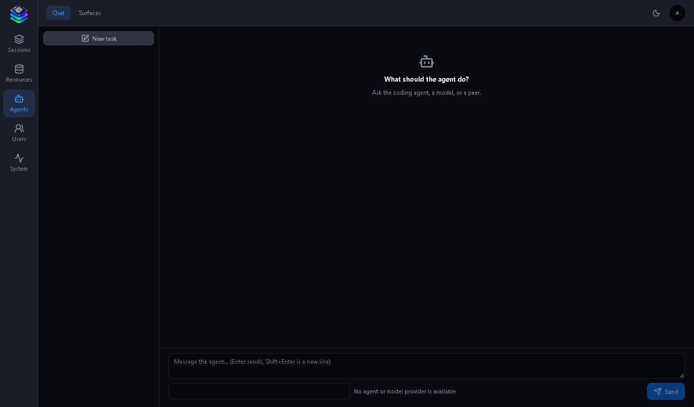
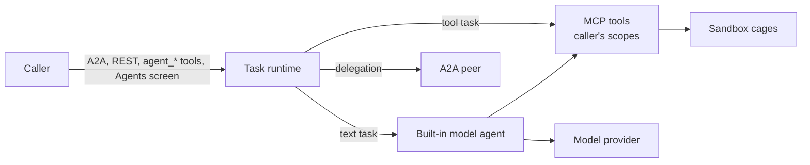
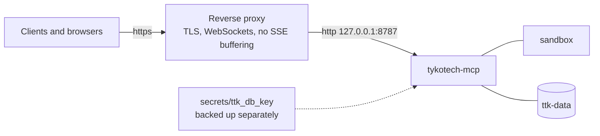

# Guide

Using Multi-MCP once it runs: the web app, connecting MCP clients, giving people and programs access, the coding sandbox
and agents, running it in production, and keeping an eye on it. To install and start it, see
[QUICK-START.md](../QUICK-START.md). Exact tools, routes and settings are in the reference pages:
[MCP](reference/mcp.md), [HTTP API](reference/api.md), [environment variables](reference/environment-variables.md).

## The web app

The control plane at the server's address (`http://127.0.0.1:8787/` by default). It uses the same API and live-view
socket as any client; what you see follows your scopes.

**Sign in** with a username and password, or paste an API key (`ttk_…`) into the first field. A sign-in lasts
`TTK_LOGIN_TTL_S` (7 days).

**Layout.** The rail on the left holds the five sections: **Sessions**, **Resources**, **Agents**, **Users** and
**System**. The bar along the top holds the section's tabs, the screen's buttons, the theme switch and the account menu
(who you are, how you signed in, your scopes, **Change password** and **Sign out**).

### Sessions, Live View and Workspaces

The Sessions section has three tabs.

- **Sessions** (needs `admin`; without it, Live View opens your `default` session) lists every browser session you can
  reach as a card: viewers, tabs, when it was last used, its browser's memory and, when nobody watches it, when the idle
  timer closes it. **Watch** opens it in Live View; **Close** closes it; **New session** starts one. Above the cards,
  three memory meters (the container, the browser sessions, the gateway heap, each against its limit) and **Close all
  sessions**.
- **Live View** streams the selected session. Type an address and press Enter to go there, or use the back button; while
  you hold control the tab picker switches tabs. **Take control** gives you the mouse and keyboard: while you hold it,
  the model's changing tools wait with `human-has-control` until you release it. **Record** starts a WebM recording and
  **Stop recording** downloads it (needs ffmpeg and a data directory). A model's `browser_request_human` link opens this
  view directly (`#/view/<session>`). A dropped view keeps reconnecting for up to ten minutes.
- **Workspaces** lists your coding workspaces (needs `sandbox:execute`); **New workspace** creates one. An open
  workspace shows its file tree and an editor beside a live shell: click a file to open it, or type a path and save to
  create one; choose **No network** or **Package registries** before opening the shell. **Diff** shows the changes since
  the workspace was created; **Delete workspace** removes it. The tree follows saves, shell commands and files an agent
  adds.

### Resources

The file share (`<TTK_DATA_DIR>/share`), one folder at a time, with a path of crumbs above it. **Upload** (or drop files
on the list), **New folder**, **New file**, rename, delete and download. A text file up to 1 MiB opens in an editor;
larger files download. Changing anything needs `files:write`.

### Agents



Two tabs: **Chat** and **Surfaces**. Every route needs `agent:invoke`; an administrator signed in to an account without
it is offered **Grant agent scopes to my account**.

- **Chat**: your tasks are listed beside the conversation. Type a message, choose a target — **SlopLord (coding)**, a
  model provider and model, or an A2A peer — and **Send**. Every send starts a new task, and the chat moves to it
  (`#/agents/chat/<task>`) and follows it until it ends; **Cancel task** stops it and **New task** clears the chat.
  Tasks are kept for a day.
- **Surfaces**: the A2UI surfaces agents published, rendered live, with **Delete** for each.

### Users

Every password account in a list (needs `admin`). **Add user** creates one; clicking an account opens one dialog with
its scopes, its API keys (issue and revoke; a new key is shown once), its password and sign-ins (reset the password,
sign out everywhere) and its state (disable, delete).

### System

Needs `admin`. Three tabs:

- **Overview**: every capability on or off, what it does, and while off the setting that turns it on.
- **Agents**: the model providers the built-in agent runs on. **Add provider** starts from a preset (OpenAI, Anthropic,
  Ollama, OpenRouter) or a custom one; **Fetch models** lists the models its host serves; **Make default**, **Edit** and
  remove. A key typed here is sealed in the database (needs `TTK_DB_KEY_FILE`) and never shown again.
- **Configuration**: every setting with its running value and where it came from.

Three settings have no screen and are changed through the API by an administrator: the browser origins accepted for your
own credential (`PUT /api/v1/live/origins`), each agent's default model and A2A, A2UI and memory switches
(`PUT /api/v1/system/agents`), and the embedder new memory collections use (`PUT /api/v1/system/memory`)
([routes](reference/api.md#routes)).

## Connecting clients

| Transport            | Endpoint                                 | Credential                           |
| -------------------- | ---------------------------------------- | ------------------------------------ |
| MCP, Streamable HTTP | `http://<host>:8787/mcp`                 | `Authorization: Bearer ttk_…`        |
| MCP, stdio           | `deno task stdio` / `tykotech-mcp stdio` | none (scopes from `TTK_ANON_SCOPES`) |
| A2A 1.0              | `/a2a` (JSON-RPC), `/a2a/v1` (HTTP+JSON) | Bearer key with `agent:invoke`       |

### HTTP

The `client` key `setup` printed holds every scope the stack's features need. Give each client its own key with the
scopes it needs; `--save` adds it to `secrets/ttk_api_keys.json`, which the gateway reloads live:

```sh
deno task doctor --new-key my-client --scopes mcp:invoke,view:watch --save
```

**Claude Code**

```sh
claude mcp add --transport http multi-mcp http://127.0.0.1:8787/mcp --header "Authorization: Bearer ttk_<key>"
```

**Any Streamable HTTP client**

```json
{
	"mcpServers": {
		"multi-mcp": {
			"type": "http",
			"url": "http://127.0.0.1:8787/mcp",
			"headers": { "Authorization": "Bearer ttk_<key>" }
		}
	}
}
```

2025-era clients get a session that is told to re-list its tools after a deploy or a scope change
(`TTK_MCP_STATEFUL=false` turns sessions off). On those sessions and on stdio the list starts with one entry tool per
group (`use_browser`, `use_library`, `use_sandbox`, `use_agent`, `use_memory`, `use_a2ui`); calling one adds that
group's tools ([tool groups](reference/mcp.md#tool-groups)). A client that does not re-list on `tools/list_changed`
needs `TTK_MCP_TOOL_GROUPS=false`.

### stdio

The client starts the server as a subprocess. `deno task stdio` opens the same `ttk.db` as `deno task dev` (providers,
sealed keys, browser secrets, memory), read once at start. Nobody authenticates on stdio.

```sh
claude mcp add multi-mcp -- deno task --cwd /absolute/path/to/multi-mcp stdio
```

```json
{
	"mcpServers": {
		"multi-mcp": { "command": "deno", "args": ["task", "--cwd", "/absolute/path/to/multi-mcp", "stdio"] }
	}
}
```

stdio callers hold `TTK_ANON_SCOPES` (default `mcp:invoke,view:watch,view:control,files:read`). Add what you need:

| Add                            | For                                                         |
| ------------------------------ | ----------------------------------------------------------- |
| `files:write`                  | Memory and library writes                                   |
| `agent:invoke`, `model:invoke` | The built-in model agent                                    |
| `sandbox:execute`              | Coding workspaces (needs `TTK_SANDBOX_URL`)                 |
| `task`, `evaluate`, `admin`    | `browser_run_task`, `browser_evaluate`, `browser_close_all` |

Not on stdio: live view, MCP Apps, event streams, recording, signed links, `browser_request_human`. The task grants
loopback network only, so `browser_head` is withheld and only local model providers are reachable. stdio reads
`secrets/` as your user ([permissions](../secrets/README.md#permissions)).

### First calls

1. `tools/list`, then read `ttk://capabilities`: what is withheld and why. On a grouped connection, call `use_browser`.
2. `browser_navigate`, then `browser_get_state`. Pass element `index` and `state_token` to interaction tools.
3. After the page changes, read state again; a stale token answers `element-not-found`.
4. Wait with `browser_wait_for`, not by polling.

How sessions, files and the allowlist behave: [Browser sessions](reference/mcp.md#browser-sessions).

| Client declares  | Effect                                                                                            |
| ---------------- | ------------------------------------------------------------------------------------------------- |
| Sampling         | `browser_extract_content` and `browser_run_task` run on your model (`sampling.tools` gets tools). |
| Form elicitation | The seven destructive tools ask for confirmation; `browser_fill_secret` offers permitted secrets. |
| URL elicitation  | `browser_request_human` shows the live-view link to the user.                                     |
| MCP Apps         | `browser_live_view`, `a2ui_publish` and `sandbox_session_open` render live inside the host.       |

For MCP Apps, add the host's sandbox hostname to `TTK_ALLOWED_ORIGINS` and serve the gateway on an `https`
`TTK_PUBLIC_URL` the host can reach.

## Access

| Prefix  | Credential      | Source                                                                               |
| ------- | --------------- | ------------------------------------------------------------------------------------ |
| `ttk_`  | API key         | `deno task setup`, `doctor --new-key`, or an account's key (Users screen).           |
| `ttks_` | Sign-in session | `POST /api/v1/auth/login` with a password or an API key (the web app uses a cookie). |

With no credential configured, a loopback bind serves anonymous requests with `TTK_ANON_SCOPES` (and warns). Any other
bind refuses to start without an API key or an account.

### Scopes

| Scope             | Default | Allows                                                                                                           |
| ----------------- | ------- | ---------------------------------------------------------------------------------------------------------------- |
| `mcp:invoke`      | yes     | MCP tools and resources; session events and file downloads.                                                      |
| `view:watch`      | yes     | Watch live sessions; recordings; the MCP Apps live view.                                                         |
| `view:control`    | yes     | Take over live sessions; `browser_request_human`.                                                                |
| `files:read`      | yes     | Read the file share, skills, prompts and memory.                                                                 |
| `files:write`     | no      | Change the file share, skills, prompts and memory; `browser_save_to_share`.                                      |
| `admin`           | no      | Sessions, accounts, origins, diagnostics, providers, agent and memory settings, `/metrics`, `browser_close_all`. |
| `metrics:read`    | no      | `GET /metrics` only.                                                                                             |
| `network:read`    | no      | Full URLs (and URLs inside headers) in the request log and HAR export; response bodies.                          |
| `evaluate`        | no      | `browser_evaluate`.                                                                                              |
| `task`            | no      | `browser_run_task`.                                                                                              |
| `sandbox:execute` | no      | Coding workspaces.                                                                                               |
| `agent:invoke`    | no      | A2A, agent tasks and `agent_*` tools; reading A2UI surfaces.                                                     |
| `a2ui:publish`    | no      | Publishing A2UI surfaces.                                                                                        |
| `model:invoke`    | no      | Running text tasks on a model provider. Never implied, not even by `admin`.                                      |

A credential that names no scopes gets the four defaults. Tools outside a credential's scopes are hidden and listed in
`tools_withheld`.

### API keys

`deno task doctor --new-key <id> --scopes <list> --save` prints the raw key once and adds its record to
`secrets/ttk_api_keys.json` (a record with the same id is replaced); without `--save` it prints the record
(`{ "id", "sha256", "scopes", "label"? }`) for you to add. The file is watched: an edit applies within a second, and a
removed key stops at once together with its sign-ins, tasks, streams and signed links. Under Compose the file is a bind
mount, so edit it in place (`--save` does); a replaced file reaches the container only when it is recreated
(`docker compose up -d --force-recreate tykotech-mcp`). `doctor --new-key-set <prefix>` mints one single-scope key per
scope.

### Accounts

`setup` creates the first administrator (`secrets/ttk_admin_user.json`: the stack's scopes plus `admin`), copied into
`users.json` on first start. Afterwards manage accounts on the **Users** screen or `/api/v1/users`.

- Passwords: 8–256 characters. Sign-ins last `TTK_LOGIN_TTL_S` (7 days); scope changes apply on the next request.
- An account key holds any of its account's scopes and never one the account lacks; ≤25 keys per account.
- The last enabled `admin` cannot be disabled, deleted or stripped of `admin`; nobody can disable or delete their own
  account or remove their own `admin`.
- Failed sign-ins back off per source (5 free) and per username (10 free); there is no lockout.
- Sign-ins, agent tasks and streams are bound to the credential that opened them and end as soon as the key is revoked,
  the account disabled or the user signs out.

If no enabled account holds `admin`, the server warns at start-up. To recover, stop the gateway
(`docker compose stop tykotech-mcp`), set the account's scopes offline (`--grant` replaces them), then start it again:

```sh
# Compose: on the data volume
docker compose run --rm --no-deps tykotech-mcp \
  ttk doctor --grant admin --scopes mcp:invoke,view:watch,view:control,files:read,admin
# A checkout: on ./data
deno run --deny-ffi --allow-read=.,data --allow-write=data --allow-env=TTK_* \
  packages/cli/mod.ts doctor --grant admin --scopes mcp:invoke,view:watch,view:control,files:read,admin --data-dir data
```

### Hosts and origins

| Header   | Allowed by            | Default                                                                                            | Otherwise              |
| -------- | --------------------- | -------------------------------------------------------------------------------------------------- | ---------------------- |
| `Host`   | `TTK_ALLOWED_HOSTS`   | `TTK_PUBLIC_URL`'s host, plus loopback names on a loopback or wildcard bind, else the bind address | `400 host-forbidden`   |
| `Origin` | `TTK_ALLOWED_ORIGINS` | `TTK_PUBLIC_URL`'s host, plus loopback names on a loopback bind                                    | `403 origin-forbidden` |

Both hold bare hostnames; setting one replaces its derived list.

### Browser secrets

Values the browser types without the model seeing them, in `secrets/ttk_secrets.json` (`setup` writes `{}`):

```json
{ "github_password": { "value": "…", "domains": ["github.com"] } }
```

Fill it in and restart the gateway: it is sealed into `ttk.db` on first start; after later edits run
`ttk seed --force --only secrets` ([in the container](reference/api.md#maintenance); `deno task seed` in a checkout) and
restart. A model uses it as `<secret>github_password</secret>` in `browser_type` / `browser_fill`, or with
`browser_fill_secret` (stricter: declared domains, fresh `state_token`, same-origin frames, audited). Values never
appear in results, logs or errors.

## Coding sandbox and agents

The default Compose stack runs the coding sandbox and the agents, and the `client` key and `admin` account `setup`
creates hold their scopes. A key you mint yourself needs them named:

```sh
deno task doctor --new-key coder --save \
  --scopes mcp:invoke,sandbox:execute,agent:invoke,model:invoke,a2ui:publish,files:read,files:write
```



### Coding sandbox

The `sandbox` service runs beside the gateway with no published port, reachable only on an internal network, with
workspaces in the `ttk-code` volume. Outside Compose, set `TTK_SANDBOX_URL` and `TTK_SANDBOX_TOKEN_FILE` on the gateway.
Each command runs in a fresh cage ([isolation](security.md#coding-workspaces)) with a private home where package caches
persist; `/tmp` is emptied per command and output is kept up to 1 MiB.

| Tool                            | Does                                                                                        |
| ------------------------------- | ------------------------------------------------------------------------------------------- |
| `sandbox_create`                | New git workspace from up to 64 text files (256 KiB), or from a file-share folder.          |
| `sandbox_clone`                 | Workspace from git: `url` on an allowed host, or an operator `remote` id.                   |
| `sandbox_list`                  | Your workspaces, or one workspace's files.                                                  |
| `sandbox_read`, `sandbox_write` | UTF-8 files up to 256 KiB.                                                                  |
| `sandbox_exec`                  | A shell command (default 5 min, max 15). `network: "registries"` allows package registries. |
| `sandbox_diff`                  | Patch against the initial commit, new files included.                                       |
| `sandbox_session_*`             | A live line-mode shell (one per workspace; 30 min idle, 4 h total).                         |
| `sandbox_delete`                | Delete a workspace (asks for confirmation).                                                 |

- **Network.** Cages have only loopback. Registries mode allows HTTPS to npm, JSR/Deno, PyPI, crates.io and the Go
  proxy, on public addresses only, and only when the TLS handshake names the same host.
- **Clones.** Public clones from `TTK_SANDBOX_GIT_HOSTS` (Compose: GitHub, GitLab, Bitbucket, Codeberg). Credentialed
  remotes go in `secrets/ttk_git_remotes` (`[{ "id", "url", "username"?, "token"? }]`; restart the sandbox after an
  edit); the credential never enters a cage. https only; no hooks or submodules.
- **Budgets.** 1.5 GiB per workspace, 6 GiB per owner, 1 GiB free space kept; over budget, only cleanup works.
- **Ownership.** A workspace belongs to its creator; others get not-found. 128 per principal.
- **Fair share.** One owner holds at most 2 live shells and 1 running command or diff (4 more queue); past that the
  sandbox answers `busy`.
- **Docker backend.** Hosts that forbid unprivileged user namespaces can run one hardened container per workspace with
  `docker-compose.sandbox-docker.yml` ([overlay](reference/api.md#overlays)). **It gives the sandbox service the Docker
  socket, which is root on the host.**

With MCP Apps, `sandbox_session_open` shows a terminal under the tool call: **Attach** streams the shell's output and
lets the person type lines into it.

### Agent tasks

One owner-isolated runtime serves A2A, `/api/v1/agent/tasks`, the `agent_*` tools and the Agents screen.

| Kind       | Started by                                                 | Runs                                    |
| ---------- | ---------------------------------------------------------- | --------------------------------------- |
| Tool       | A2A `data` part `{ tool, arguments }`, or `agent_run_tool` | One MCP tool with the caller's scopes.  |
| Text       | A2A `text` part, `POST /api/v1/agent/tasks`, Agents screen | The built-in model agent (or SlopLord). |
| Delegation | `agent_delegate`, or a peer chosen on the Agents screen    | A message to an A2A peer.               |

States: `SUBMITTED` → `WORKING` → `COMPLETED` / `FAILED` / `CANCELED` / `REJECTED`. Limits: 256 tasks kept (32 per
owner), 4 running (2 per owner), text and delegation tasks `TTK_AGENT_TASK_TIMEOUT_S` (600 s), finished tasks kept
`TTK_AGENT_TASK_RETENTION_S` (24 h). With `TTK_DATA_DIR` tasks persist; unfinished ones come back failed after a
restart.

### Model providers

The built-in model agent runs text tasks inside the gateway: it sends the prompt to a provider, runs each tool the model
calls with the caller's current scopes, and stops when the model answers.

| `kind`      | Request                                                                                                                                                    |
| ----------- | ---------------------------------------------------------------------------------------------------------------------------------------------------------- |
| `openai`    | `POST {base_url}/chat/completions` with `Authorization: Bearer`; `/v1` is added to a bare origin (OpenAI-compatible: OpenAI, Ollama, vLLM, OpenRouter, …). |
| `anthropic` | `POST {base_url}/messages` with `x-api-key`; `/v1` is added unless `base_url` ends in it.                                                                  |

**Add one in the web app** (System › Agents › **Add provider**). Or seed them from a file: write
`secrets/ttk_model_providers.json` and mount it with a `docker-compose.override.yml` of your own:

```yaml
services:
  tykotech-mcp:
    environment:
      TTK_MODEL_PROVIDERS_FILE: /run/secrets/ttk_model_providers
    secrets: [ttk_model_providers]
secrets:
  ttk_model_providers:
    file: ./secrets/ttk_model_providers.json
```

```json
{
	"version": 1,
	"default": "openai-main",
	"providers": [
		{
			"id": "openai-main",
			"kind": "openai",
			"base_url": "https://api.openai.com/v1",
			"models": ["gpt-4.1", "text-embedding-3-small"],
			"api_key": "sk-…",
			"max_tokens_param": "max_completion_tokens"
		},
		{ "id": "ollama", "kind": "openai", "base_url": "http://127.0.0.1:11434/v1", "models": ["llama3.1"] }
	]
}
```

The file is copied in once; afterwards the database is the source (`ttk seed --force --only providers` re-copies).

| Field                                            | Rule                                                                                                                            |
| ------------------------------------------------ | ------------------------------------------------------------------------------------------------------------------------------- |
| `id`                                             | `^[a-z][a-z0-9_-]{0,31}$`                                                                                                       |
| `kind`                                           | `openai` or `anthropic` (which needs a key)                                                                                     |
| `base_url`                                       | `https:` anywhere; `http:` to loopback; `http:` to a private host or service name with `allow_http`, a key included.            |
| `models`, `default_model`                        | 1–64 model names; default the first.                                                                                            |
| `api_key` / `api_key_file`                       | One or the other (`api_key_file` an absolute path); sealed in the database for `base_url`'s host only. Needs `TTK_DB_KEY_FILE`. |
| `headers`                                        | ≤8 non-credential headers; `host` is refused.                                                                                   |
| `max_tokens_param`                               | `max_tokens` (default) or `max_completion_tokens`.                                                                              |
| `max_steps`, `max_output_tokens`, `token_budget` | Defaults 24, 4096, 400 000.                                                                                                     |

`http:` off loopback sends the key unencrypted, and the start-up log warns; `http:` to a public or link-local address is
refused whatever the flag. A text task may name `provider` (and `model`); without one it uses the agent's own default
model, else the default provider for a caller holding `model:invoke`, else fails with `-32004`. Never put a key in the
environment: the server does not read `OPENAI_API_KEY`, `ANTHROPIC_API_KEY` or `TTK_MODEL_API_KEY`.

### SlopLord

The built-in coding agent: always present, nothing to configure. It runs on the built-in model agent with a fixed prompt
(create or reuse a workspace, write files, run commands, iterate until tests pass) and a fixed tool list (sandbox,
memory and file-share tools; `a2ui_*` too when its A2UI switch is on), each still filtered by your scopes. It needs the
coding sandbox, a reachable default model provider, and `agent:invoke`, `model:invoke`, `mcp:invoke` and
`sandbox:execute` (`files:*` for share and memory). Reach it as its own A2A agent (`/a2a/agents/sloplord`), with
`metadata: { "agent": "sloplord" }` on `/a2a`, `{ "message", "agent": "sloplord" }` on `POST /api/v1/agent/tasks`, or
**SlopLord (coding)** on the Agents screen.

### Agent memory

An owner-scoped vector store in `ttk.db` (needs `TTK_DATA_DIR`): `memory_save` (`files:write`; up to 32 items
`{ id?, text, metadata? }`, creates the collection), `memory_search` (best matches first, optional metadata filter),
`memory_list` (your collections and the default embedder) and `memory_delete` (items, or the whole collection; asks).
The default embedder `builtin:lexical-512` is offline and matches shared words. For semantic search, list an embedding
model (e.g. `text-embedding-3-small`) on an `openai`-kind provider and make it the default with
`PUT /api/v1/system/memory`. A collection keeps the embedder it was created with.

### A2A

```sh
curl -s http://127.0.0.1:8787/a2a \
  -H "Authorization: Bearer ttk_…" -H "A2A-Version: 1.0" -H "Content-Type: application/json" \
  -d '{"jsonrpc":"2.0","id":1,"method":"SendMessage","params":{"message":{"messageId":"m-1","role":"ROLE_USER",
       "parts":[{"data":{"tool":"browser_navigate","arguments":{"url":"https://example.com"}}}]}}}'
```

- Read `/.well-known/agent-card.json`, then send JSON-RPC to `/a2a` or HTTP+JSON under `/a2a/v1`
  ([routes](reference/api.md#agents-and-a2a)). A `data` part runs one MCP tool; a `text` part runs the built-in model
  agent. The extended card lists one skill per tool the caller could run.
- A repeated `messageId` returns the original task. Streams end after 30 minutes; ending a stream never cancels the
  task.
- **Push notifications** are off unless `TTK_A2A_PUSH_ALLOWED_HOSTS` lists webhook hosts (`https:` only, never private
  addresses).
- **Peers.** `TTK_AGENT_PEERS_FILE` lists other A2A agents for `agent_delegate`, `agent_peers` and the Agents screen;
  without it `agent_delegate` is absent. No peer ships with the stack: write the file, mount the peer's bearer token as
  a file secret beside it, and point the gateway at it ([secrets/README.md](../secrets/README.md#a2a-peers)):

  ```json
  [{ "id": "reviewer", "url": "https://reviewer.example.com", "token_file": "/run/secrets/reviewer_token" }]
  ```

  The token is the peer's own API key for this gateway, scoped there to what you want delegated. Every local owner
  reaches a peer with the same token, so a delegated tool call is restricted
  ([delegation](reference/mcp.md#extension-tools)). A peer's agent card must name the origin it is dialled at.

### A2UI surfaces

Small declarative UIs owned by their publisher, shown on **Agents › Surfaces** and, with MCP Apps, under the tool call
(**Follow live** keeps it current). Publish one A2UI v0.9 message at a time with `a2ui_publish`; `workspaceId`
(optional, a `sandbox_create` workspace id) links the surface to a workspace:

```json
{ "version": "v0.9", "createSurface": { "surfaceId": "build", "catalogId": "https://tykotech.eu/a2ui/catalog/v0.9" } }
```

```json
{
	"version": "v0.9",
	"updateComponents": {
		"surfaceId": "build",
		"components": [
			{ "id": "root", "component": "Column", "children": ["title"] },
			{ "id": "title", "component": "Text", "text": "Ready to deploy", "variant": "h2" }
		]
	}
}
```

Components: `Column`, `Row`, `List`, `Card`, `Tabs`, `Modal`, `Divider`, `Text`, `Image`, `Icon`, `Video`,
`AudioPlayer`, `Button`, `TextField`, `CheckBox`, `Slider`, `DateTimeInput`, `ChoicePicker`, `Html` (rendered in a
sandboxed iframe, no scripts). Media are `data:` URLs or `ttk://share/` paths, never remote URLs. Buttons act only
through `cancelTask` or operator actions declared in `TTK_A2UI_ACTIONS`. Limits: 256 components, 32 surfaces per owner.

A text, label or title may be computed on the page with the catalog functions `formatString` and `formatNumber`:
`{ "call": "formatString", "args": { "value": "${/number} = ${/roman/${/number}}" } }` reads the data model by JSON
pointer, nested expressions first, so a table in the model works as a lookup; `\${` is a literal `${`. Nothing else is
evaluated. A message may also arrive as JSON text, without `version` or `catalogId`, or naming the A2UI basic catalog
(`https://a2ui.org/specification/v0_9/catalogs/basic/catalog.json` or `…/v0_9/basic_catalog.json`). A refusal names the
field (`message.createSurface.catalogId: …`) or the cause.

### Troubleshooting

| Symptom                                                                                   | Fix                                                                                                                                                   |
| ----------------------------------------------------------------------------------------- | ----------------------------------------------------------------------------------------------------------------------------------------------------- |
| `sandbox` never healthy; `sandbox_*` tools missing                                        | `docker compose logs sandbox`. The host must allow unprivileged user namespaces, or use the Docker backend.                                           |
| `bwrap: Failed to make / slave: Permission denied`, or `unable to apply apparmor profile` | An AppArmor host (Ubuntu, Debian): `deno task setup --only apparmor`, or load the profile by hand ([how](reference/api.md#sandbox-apparmor-profile)). |
| `sandbox_*` tools withheld                                                                | `tools_withheld` says why: grant `sandbox:execute`, or the sandbox is unreachable.                                                                    |
| `-32004 Text execution requires a model provider`                                         | Add a provider with a default and grant `model:invoke`.                                                                                               |
| Saving a key: `409 conflict`                                                              | `TTK_DB_KEY_FILE` is not set: run `deno task setup` and restart.                                                                                      |
| Edited providers file has no effect                                                       | The database is the source: `ttk seed --force --only providers`, then restart.                                                                        |
| `memory_*` tools missing                                                                  | Set `TTK_DATA_DIR`; grant `files:read` / `files:write`.                                                                                               |

## Production

One gateway container plus the coding sandbox (not published) behind a TLS-terminating reverse proxy, from the one
`docker-compose.yml`. Credentials and the database key come from files; state lives in the `ttk-data` volume.



1. **Secrets.** Run the start script (or `deno task setup`). For production, give each client its own key with minimal
   scopes and narrow or remove `client`. API keys and browser secrets can come from Vault or 1Password instead
   (`TTK_API_KEYS_REF`, `TTK_SECRETS_REF`).
2. **Configure** `.env` beside `docker-compose.yml`:

   ```sh
   TTK_BIND=127.0.0.1                        # the proxy connects here
   TTK_PUBLIC_URL=https://mcp.example.com    # what clients and browsers use
   ```

   `TTK_PUBLIC_URL` opens the Host and Origin allowlists; with `https` the sign-in cookie becomes `__Host-` and
   `Secure`, so serve the web app only there. Compose passes only the names it lists from `.env`
   ([Compose](reference/environment-variables.md#compose)); set the rest under the gateway's `environment:` in a
   `docker-compose.override.yml`:

   | Setting                                                 | Default     | Set it to                                                       |
   | ------------------------------------------------------- | ----------- | --------------------------------------------------------------- |
   | `TTK_ALLOWED_DOMAINS`                                   | any site    | The sites the browser may reach (also bounds `browser_head`).   |
   | `TTK_MAX_SESSIONS`, `TTK_SESSION_TTL_S`                 | `8`, `1800` | What the host can hold; each Chromium needs a few hundred MB.   |
   | `TTK_SESSION_OWNERSHIP`                                 | `owner`     | `shared` to let every `mcp:invoke` holder reach every session.  |
   | `TTK_METRICS`                                           | off         | `true` serves `/metrics` to a `metrics:read` key.               |
   | `TTK_DISK_BUDGET_MB`                                    | `2048`      | What the file share and recordings may hold together.           |
   | `TTK_HUMAN_HANDOFF`, `TTK_SIGNED_LINKS`, `TTK_MCP_APPS` | on          | `false` / `off` to withhold handoff, no-bearer links, MCP Apps. |

3. **Start** with `docker compose up -d --build`; `docker compose ps` shows both services healthy and
   `curl -s http://127.0.0.1:8787/healthz` answers. Keep the container settings Chromium's sandbox needs
   (`shm_size: 1gb`, the `seccomp-chromium.json` profile, **no** `no-new-privileges`); never set
   `TTK_CHROMIUM_NO_SANDBOX`.
4. **Put TLS in front.** The proxy must pass `Host` unchanged, upgrade WebSockets on `/live/`, not buffer server-sent
   events, and accept 64 MiB bodies on `/api/v1/share/file` if you use the file share.

```
# Caddy
mcp.example.com {
	reverse_proxy 127.0.0.1:8787 {
		flush_interval -1
	}
}
```

```nginx
# nginx
location / {
	proxy_pass http://127.0.0.1:8787;
	proxy_http_version 1.1;
	proxy_set_header Host $host;
	proxy_set_header Upgrade $http_upgrade;
	proxy_set_header Connection $connection_upgrade;
	proxy_buffering off;
	proxy_read_timeout 1h;
	client_max_body_size 64m;
}
```

### Scope back egress

The image grants the server unscoped outbound network; the code that dials bounds it
([security](security.md#process-permissions)). To remove general egress, restate the `CMD` in
`docker-compose.override.yml`:

```yaml
services:
  tykotech-mcp:
    command:
      - deno
      - run
      - --cached-only
      - --deny-ffi
      - --allow-net=0.0.0.0:8787,127.0.0.1,sandbox:8080
      - --allow-run=/usr/bin/chromium,/usr/bin/ffmpeg
      - --allow-read=/app,/data,/tmp,/home/deno,/run/secrets
      - --allow-write=/data,/tmp,/home/deno
      - --allow-env=TTK_*,DENO_DIR,DENO_NO_PROMPT,HOME,TMPDIR,PATH
      - packages/cli/mod.ts
      - serve
```

`browser_head` is then withheld, and each model provider, secret provider, A2A peer or push host needs its `host:port`
added.

### Back up and update

Back up two things, stored **separately**: the `ttk-data` volume and `secrets/ttk_db_key`. Without the key no stored
secret can be restored; with both in one place the encryption protects nothing.

```sh
docker compose stop tykotech-mcp
docker run --rm -v <project>_ttk-data:/data:ro -v "$PWD":/backup debian:stable-slim tar czf /backup/ttk-data.tgz -C /data .
docker compose start tykotech-mcp
```

To update: `git pull`, then the start script (it rebuilds, creates only what is missing, repairs modes and restarts).
Shutdown drains: new work gets `503`, and running agent tasks come back failed ("interrupted by restart").

### Start-up refusals

A bad setting stops start-up with one line, `error: <VARIABLE>: <problem>`, before anything listens:

| Line                                                                                  | Fix                                                                        |
| ------------------------------------------------------------------------------------- | -------------------------------------------------------------------------- |
| `TTK_HOST: refusing to bind 0.0.0.0 with no credentials configured`                   | Configure an API key or account.                                           |
| `TTK_DB_KEY_FILE: the key does not open this database`                                | Mount the key the database was created with.                               |
| `TTK_DB_KEY_FILE: the database holds encrypted secrets and no key is set`             | Set `TTK_DB_KEY_FILE`.                                                     |
| `TTK_MODEL_PROVIDERS_FILE: provider <id> has a key, and TTK_DB_KEY_FILE is not set …` | Set `TTK_DB_KEY_FILE`, or remove the key.                                  |
| `TTK_SECRETS: browser secrets are configured, and TTK_DB_KEY_FILE is not set …`       | Set `TTK_DB_KEY_FILE`.                                                     |
| `database (<path>): …`                                                                | `TTK_DATA_DIR` not writable by the process, or not this server's database. |

### Checklist

- [ ] The start script (or `deno task setup`) has run since the last pull: `secrets/` is `0700`, its files `0644`.
- [ ] `secrets/ttk_db_key` is backed up apart from `/data`.
- [ ] Every client key has explicit, minimal scopes; only administrators hold `admin`.
- [ ] `TTK_PUBLIC_URL` is the HTTPS URL clients use.
- [ ] `TTK_ALLOWED_DOMAINS` is set on networks with internal services.
- [ ] The proxy passes WebSockets and does not buffer SSE.
- [ ] Health is monitored (below).

## Monitoring

**Health.** `GET /healthz` (`{"status":"ok","version":"0.2.0","sessions":3}`) is public, not rate-limited and answers
while draining; the image probes it every 30 s. The sandbox has its own health check.

**Diagnostics.** `GET /api/v1/system/diagnostics` (`admin`) returns uptime, memory, sessions and the effective
configuration; System › Overview shows the capabilities. `ttk doctor` prints the database summary (providers, sealed
secrets, memory items, whether the key is set). An MCP client can call `browser_health`: session counts, unresponsive
browsers (each probed with a 2 s timeout) and the capability block. Alert when:

| Diagnostics `config` field   | Alert when                                 |
| ---------------------------- | ------------------------------------------ |
| `chromiumSandboxed`          | `false`                                    |
| `hasAdminUser`               | `false` (no enabled account holds `admin`) |
| `userStore`, `loginStore`    | `unreadable`                               |
| `sandboxEnabled`             | `false` where the sandbox is deployed      |
| `modelProviders[].reachable` | `false`                                    |

**Prometheus.** With `TTK_METRICS=true`, `GET /metrics` serves Prometheus text to `metrics:read` or `admin`
(`deno task doctor --new-key prometheus --scopes metrics:read`). No credential, URL, session id or argument becomes a
label. `/metrics` and the logs are the server's only telemetry: it exports no OpenTelemetry.

```yaml
scrape_configs:
  - job_name: multi-mcp
    scheme: https
    authorization: { type: Bearer, credentials_file: /etc/prometheus/ttk_key }
    static_configs: [{ targets: ['mcp.example.com:443'] }]
```

| Family                     | Type    | Labels                                              |
| -------------------------- | ------- | --------------------------------------------------- |
| `ttk_http_requests_total`  | counter | `route`, `status`                                   |
| `ttk_tool_calls_total`     | counter | `tool`, `outcome` (`ok`, `error`, `input_required`) |
| `ttk_sessions`             | gauge   | `state` (`active`, `idle`, `human_control`)         |
| `ttk_viewers`              | gauge   | —                                                   |
| `ttk_rate_limited_total`   | counter | —                                                   |
| `ttk_login_failures_total` | counter | —                                                   |
| `ttk_process_*_bytes`      | gauge   | resident, heap total, heap used, external           |

**Logs.** One JSON object per line (`TTK_LOG_FORMAT=pretty` for people; `TTK_LOG_LEVEL` `debug`…`error`); correlate with
`x-request-id`. Secrets, passwords and tokens are never logged.

```sh
docker compose logs -f tykotech-mcp | jq 'select(.level == "warn" or .level == "error")'
```

Worth alerting on: start-up lines `error: …` (exit 1, restart loop), `auth.login_failed`, `auth.login_throttled`,
`auth.csrf_failed`, `rate limit exceeded for …`, `… is not reachable; its tools are withheld`,
`no enabled account holds the admin scope…`, `TTK_CHROMIUM_NO_SANDBOX is set…`, and any `level: "error"`.

| Signal                | Source                                 | Alert                    |
| --------------------- | -------------------------------------- | ------------------------ |
| Liveness              | `/healthz`, container health           | Unhealthy for 2 minutes  |
| Restart loop          | Container restarts                     | Any                      |
| Session pressure      | `sessions.total` vs `TTK_MAX_SESSIONS` | Above 80% for 10 minutes |
| Memory                | `memory.rss`, container stats          | Near the container limit |
| Failed sign-ins       | `rate(ttk_login_failures_total[5m])`   | A spike                  |
| Unresponsive browsers | `browser_health`                       | Above 0 for 5 minutes    |
| Optional services     | `… is not reachable` log lines         | Any                      |
