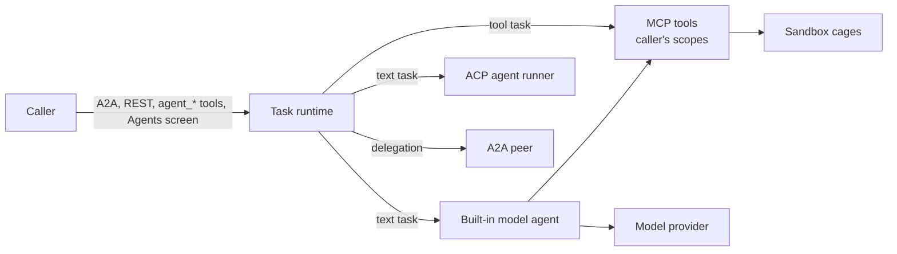

# Agents and sandbox

Coding workspaces, the agent task runtime, the built-in model agent, SlopLord, agent memory, A2A, the ACP bridge and
A2UI surfaces. These need scopes the default grant lacks:

```sh
deno task doctor --new-key coder \
  --scopes mcp:invoke,sandbox:execute,agent:invoke,model:invoke,a2ui:publish,files:read,files:write
```

For accounts, tick the scopes on the **Users** screen (the Agents screen also offers a one-click grant to yourself).



## Coding sandbox

`docker compose up` runs the `sandbox` service beside the gateway: no published port, reachable only on an internal
network, workspaces in the `ttk-code` volume. The gateway waits until the sandbox has built and run a real cage. Outside
Compose, set `TTK_SANDBOX_URL` and `TTK_SANDBOX_TOKEN_FILE` on the gateway.

Each command runs in a fresh bubblewrap cage: new namespaces, no capabilities, empty environment, read-only root and
`.git`, private home (package caches persist), `/tmp` emptied per command, 200 processes, output kept up to 1 MiB.

| Tool                            | Does                                                                                        |
| ------------------------------- | ------------------------------------------------------------------------------------------- |
| `sandbox_create`                | New git workspace from up to 64 text files (256 KiB), or from a file-share folder.          |
| `sandbox_clone`                 | Workspace from git: `url` on an allowed host, or an operator `remote` id.                   |
| `sandbox_list`                  | Your workspaces, or one workspace's files.                                                  |
| `sandbox_read`, `sandbox_write` | UTF-8 files up to 256 KiB.                                                                  |
| `sandbox_exec`                  | A shell command (default 5 min, max 15). `network: "registries"` allows package registries. |
| `sandbox_diff`                  | Patch against the initial commit, new files included.                                       |
| `sandbox_session_*`             | A live line-mode shell (one per workspace; 30 min idle, 4 h total).                         |
| `sandbox_delete`                | Delete a workspace (asks for confirmation).                                                 |

- **Network.** Cages have only loopback. Registries mode allows HTTPS `CONNECT` to npm, JSR/Deno, PyPI, crates.io and
  the Go proxy, on public addresses only.
- **Clones.** Public clones from `TTK_SANDBOX_GIT_HOSTS` (Compose default: GitHub, GitLab, Bitbucket, Codeberg).
  Credentialed remotes: `secrets/ttk_git_remotes` (`[{ "id", "url", "username"?, "token"? }]`); the credential never
  enters a cage. https only; no hooks or submodules; `.git` is read-only afterwards.
- **Budgets.** 1.5 GiB per workspace, 6 GiB per owner, 1 GiB free space kept. Over budget: cleanup-only.
- **Ownership.** A workspace belongs to its creator; others get not-found. 128 per principal.
- **Docker backend.** Hosts that forbid unprivileged user namespaces can run one hardened container per workspace with
  `docker-compose.sandbox-docker.yml` (gives the sandbox service the Docker socket, which is root on the host).

The web app's **Sessions › Workspaces** tab offers a file tree, an editor, diff and shell over these tools.

## Tasks

One owner-isolated runtime serves A2A, `/api/v1/agent/tasks`, the `agent_*` tools and the Agents screen.

| Kind       | Started by                                                                 | Runs                                       |
| ---------- | -------------------------------------------------------------------------- | ------------------------------------------ |
| Tool       | A2A `data` part `{ tool, arguments }`, or `agent_run_tool`                 | One MCP tool with the caller's scopes.     |
| Text       | A2A `text` part, `POST /api/v1/agent/tasks`, `agent_prompt`, Agents screen | The ACP agent or the built-in model agent. |
| Delegation | `agent_delegate`                                                           | A message to an A2A peer.                  |

States: `SUBMITTED` → `WORKING` → `COMPLETED` / `FAILED` / `CANCELED` / `REJECTED`, plus `INPUT_REQUIRED` (ACP
permission request). Limits: 256 tasks kept (32 per owner), 4 running (2 per owner), text tasks
`TTK_AGENT_TASK_TIMEOUT_S` (600 s), finished tasks kept `TTK_AGENT_TASK_RETENTION_S` (24 h). With `TTK_DATA_DIR` tasks
persist in `agents/tasks.json`; unfinished ones come back failed after a restart.

## Model providers

The built-in model agent runs text tasks inside the gateway: it sends the prompt to a provider, runs each tool the model
calls with the caller's current scopes, and stops when the model answers.

| `kind`      | Request                                                                                      |
| ----------- | -------------------------------------------------------------------------------------------- |
| `openai`    | `POST {base_url}/chat/completions` (OpenAI-compatible: OpenAI, Ollama, vLLM, OpenRouter, …). |
| `anthropic` | `POST {base_url}/v1/messages` with `x-api-key`.                                              |

**Add one in the web app** (recommended): System › Agents › Model providers › Add provider, from a preset (OpenAI,
Anthropic, Ollama, vLLM / llama.cpp, OpenRouter, Custom). The key is sealed in `ttk.db` and never shown again; the
reload button lists the provider's models.

**Or seed from a file.** Uncomment `TTK_MODEL_PROVIDERS_FILE` and its two `secrets` lines in `docker-compose.yml`:

```json
{
	"version": 1,
	"default": "openai-main",
	"providers": [
		{
			"id": "openai-main",
			"kind": "openai",
			"base_url": "https://api.openai.com/v1",
			"models": ["gpt-4.1", "text-embedding-3-small"],
			"api_key": "sk-…",
			"max_tokens_param": "max_completion_tokens"
		},
		{ "id": "ollama", "kind": "openai", "base_url": "http://127.0.0.1:11434/v1", "models": ["llama3.1"] }
	]
}
```

The file is copied in once; afterwards the database is the source (`ttk seed --force --only providers` re-copies).

| Field                                            | Rule                                                                                                                 |
| ------------------------------------------------ | -------------------------------------------------------------------------------------------------------------------- |
| `id`                                             | `^[a-z][a-z0-9_-]{0,31}$`                                                                                            |
| `kind`                                           | `openai` or `anthropic`                                                                                              |
| `base_url`                                       | `https:` anywhere; `http:` to loopback; `http:` to a private host or service name only with `allow_http` and no key. |
| `models`, `default_model`                        | 1–64 model names; default the first.                                                                                 |
| `api_key` / `api_key_file`                       | File only; sealed per host. Needs `TTK_DB_KEY_FILE`.                                                                 |
| `headers`                                        | ≤8 non-credential headers.                                                                                           |
| `max_tokens_param`                               | `max_tokens` (default) or `max_completion_tokens`.                                                                   |
| `max_steps`, `max_output_tokens`, `token_budget` | Defaults 24, 4096, 400 000.                                                                                          |

**Routing.** A text task may name `provider` (and `model`). Without one: the ACP agent if configured, else the default
provider for a caller holding `model:invoke`, else `-32004`. Never put a key in the environment; the server does not
read `OPENAI_API_KEY` or `ANTHROPIC_API_KEY`.

## SlopLord

The built-in coding agent: always present, nothing to configure. It runs on the built-in model agent with a fixed prompt
(create or reuse a workspace, write files, run commands, iterate until tests pass) and a fixed tool list (sandbox,
memory and file-share tools), each still filtered by your scopes.

| Needs       | What                                                                                              |
| ----------- | ------------------------------------------------------------------------------------------------- |
| Deployment  | The coding sandbox and a reachable default model provider.                                        |
| Your scopes | `agent:invoke`, `model:invoke`, `mcp:invoke`, `sandbox:execute` (`files:*` for share and memory). |

Reach it as its own A2A agent (`/a2a/agents/sloplord`, card at `…/.well-known/agent-card.json`), with
`metadata: { "agent": "sloplord" }` on `/a2a`, `{ "message", "agent": "sloplord" }` on `POST /api/v1/agent/tasks`, or
**SlopLord (coding)** in the Agents screen's target picker.

## Agent memory

An owner-scoped vector store in `ttk.db` (needs `TTK_DATA_DIR`), as MCP tools for HTTP and stdio callers alike.

| Tool            | Scope         | Does                                                                      |
| --------------- | ------------- | ------------------------------------------------------------------------- |
| `memory_save`   | `files:write` | Upsert up to 32 items `{ id?, text, metadata? }`; creates the collection. |
| `memory_search` | `files:read`  | Best matches first, optional metadata filter.                             |
| `memory_list`   | `files:read`  | Your collections and the default embedder.                                |
| `memory_delete` | `files:write` | Items by id, or the whole collection (asks).                              |

The default embedder `builtin:lexical-512` is offline and lexical (shared words). For semantic search, list an embedding
model (e.g. `text-embedding-3-small`) on an `openai`-kind provider and choose it in System › Agents › Agent memory. A
collection keeps the embedder it was created with.

## A2A

```sh
curl -s http://127.0.0.1:8787/a2a \
  -H "Authorization: Bearer ttk_…" -H "A2A-Version: 1.0" -H "Content-Type: application/json" \
  -d '{"jsonrpc":"2.0","id":1,"method":"SendMessage","params":{"message":{"messageId":"m-1","role":"ROLE_USER",
       "parts":[{"data":{"tool":"browser_navigate","arguments":{"url":"https://example.com"}}}]}}}'
```

- JSON-RPC at `/a2a`, HTTP+JSON under `/a2a/v1` ([routes](../reference/api-endpoints.md#agents-and-a2a)); streaming;
  extended card with one skill per tool the caller could run.
- A repeated `messageId` returns the original task. Streams end after 30 minutes; ending a stream never cancels the
  task.
- **Push notifications** are off unless `TTK_A2A_PUSH_ALLOWED_HOSTS` lists webhook hosts (`https:` only, never private
  addresses).
- **Peers**: `TTK_AGENT_PEERS_FILE` lists other A2A agents (`[{ "id", "url", "token_file"? }]`) for `agent_delegate`.

## The ACP agent bridge

Runs an external coding agent (any ACP executable) in its own container. Put the executable at `/opt/agents/agent` in an
image derived from `docker/Dockerfile.agent-runner`, describe it in `secrets/ttk_agent_commands.json`, then:

```json
[
	{
		"id": "default",
		"executable": "/opt/agents/agent",
		"cwd": "/agent-workspace",
		"env": { "AGENT_API_KEY_FILE": "/run/secrets/agent_key" },
		"mcp_servers": [{ "name": "tykotech", "url": "http://tykotech-mcp:8787/mcp" }]
	}
]
```

```sh
deno eval "console.log(crypto.randomUUID() + crypto.randomUUID())" > secrets/ttk_agent_bridge_token
TTK_AGENT_RUNNER_IMAGE=my-runner:1 docker compose -f docker-compose.yml -f docker-compose.agents.yml up -d --no-build
```

Each prompt gets a delegated MCP token (`ttkd_`, ≤120 s, never `agent:invoke`, `task` or `admin`), offered to the agent
only if its `mcp_servers` entry matches `TTK_AGENT_MCP_URL` exactly. Permission requests put the task in
`INPUT_REQUIRED` for 60 s; answer them on the Agents screen. Editors can speak ACP to the runner through
`deno task acp`.

## A2UI surfaces

Small declarative UIs owned by their publisher, shown under their coding workspace in **Sessions › Workspaces** and,
with MCP Apps, inside the host. Publish one A2UI v0.9 message at a time with `a2ui_publish`; `workspaceId` (optional, a
`sandbox_create` workspace id) says which workspace the surface belongs to:

```json
{
	"version": "v0.9",
	"createSurface": {
		"surfaceId": "build",
		"catalogId": "https://tykotech.eu/a2ui/catalog/v0.9",
		"workspaceId": "2276732b-a79d-436f-9cea-1a80b68a06b2"
	}
}
```

```json
{
	"version": "v0.9",
	"updateComponents": {
		"surfaceId": "build",
		"components": [
			{ "id": "root", "component": "Column", "children": ["title"] },
			{ "id": "title", "component": "Text", "text": "Ready to deploy", "variant": "h2" }
		]
	}
}
```

Components: `Column`, `Row`, `List`, `Card`, `Tabs`, `Modal`, `Divider`, `Text`, `Image`, `Icon`, `Video`,
`AudioPlayer`, `Button`, `TextField`, `CheckBox`, `Slider`, `DateTimeInput`, `ChoicePicker`, `Html` (rendered in a
sandboxed iframe, no scripts). Media are `data:` URLs or `ttk://share/` paths, never remote URLs. Buttons act only
through `cancelTask`, `permissionDecision` or operator actions declared in `TTK_A2UI_ACTIONS`. Limits: 256 components,
32 surfaces per owner.

A text, label or title may be computed on the page from the surface's data model with the v0.9 catalog functions
`formatString` and `formatNumber`, so an input visibly drives the rest of the surface without a round trip:

```json
[
	{ "id": "n", "component": "Slider", "label": "Number", "min": 1, "max": 3999, "value": { "path": "/number" } },
	{
		"id": "out",
		"component": "Text",
		"text": { "call": "formatString", "args": { "value": "${/number} = ${/roman/${/number}}" } }
	},
	{
		"id": "fmt",
		"component": "Text",
		"text": { "call": "formatNumber", "args": { "value": { "path": "/number" }, "decimals": 2 } }
	}
]
```

`${/pointer}` reads the data model; nested expressions resolve first, so a table in the model (`/roman` above, an array
indexed by number) works as a lookup; `\${` is a literal `${`. Nothing else is evaluated: no other functions, and a
value typed into the model is never read as an expression.

In the web app a surface without a workspace is listed under any open workspace with **Attach here**; an attached one
can be detached there (`PATCH /api/v1/a2ui/surfaces/{id}` with `{ "workspaceId": <id> | null }`).

A message may also arrive as JSON text, without `version`, or naming the A2UI basic catalog
(`https://a2ui.org/specification/v0_9/catalogs/basic/catalog.json`, or the older `…/v0_9/basic_catalog.json`); each
means the message above. A refusal names the field (`message.createSurface.catalogId: …`) or the cause
(`you have no A2UI surface "x": create it first …`). In an MCP Apps host the surface renders under the tool call;
**Follow live** keeps it current as later messages publish.

With MCP Apps, `sandbox_session_open` shows a terminal under the tool call: **Attach** streams the session's output and
lets the person type lines into the shell, alongside `sandbox_session_input` / `sandbox_session_read`.

## Troubleshooting

| Symptom                                                                     | Fix                                                                                                         |
| --------------------------------------------------------------------------- | ----------------------------------------------------------------------------------------------------------- |
| `sandbox` never healthy; gateway does not start                             | `docker compose logs sandbox`. The host must allow unprivileged user namespaces, or use the Docker backend. |
| `sandbox_*` tools missing                                                   | `tools_withheld` says why: grant `sandbox:execute`, or the sandbox is unreachable.                          |
| `-32004 Text execution requires a configured ACP agent or a model provider` | Add a provider with a default and grant `model:invoke`.                                                     |
| Saving a key: `409 conflict`                                                | `TTK_DB_KEY_FILE` is not set: run `deno task setup` and restart.                                            |
| Edited providers file has no effect                                         | The database is the source: `ttk seed --force --only providers`, then restart.                              |
| `memory_*` tools missing                                                    | Set `TTK_DATA_DIR`; grant `files:read` / `files:write`.                                                     |
