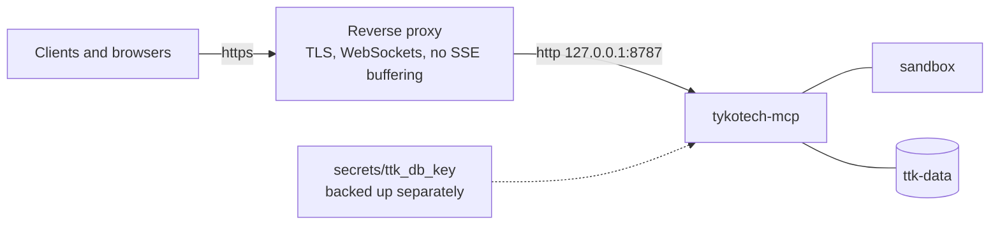

# Deploying to production

One gateway container (plus the sandbox and the A2A peer, neither published) behind a TLS-terminating reverse proxy.
Credentials and the database key come from files; state lives in the `ttk-data` volume.



## 1. Secrets

```sh
deno task setup              # every file in secrets/ (0700 folder, 0644 files the containers can read), and .env
```

The `client` key `setup` prints holds every scope the stack's features need; for production, give each client its own
key with minimal scopes (`deno task doctor --new-key <id> --scopes … --save`) and narrow or remove `client`. Every file,
rotation and permission rule: [secrets/README.md](../../secrets/README.md). API keys and browser secrets can come from
Vault or 1Password instead (`TTK_API_KEYS_REF`, `TTK_SECRETS_REF`).

## 2. Configure

`.env` beside `docker-compose.yml`:

```sh
TTK_BIND=127.0.0.1                        # the proxy connects here
TTK_PUBLIC_URL=https://mcp.example.com    # what clients and browsers use
```

`TTK_PUBLIC_URL` opens the Host and Origin allowlists; with `https` the sign-in cookie becomes `__Host-` and `Secure`,
so serve the web UI only there. Other settings go into `docker-compose.yml` (or a `docker-compose.override.yml`):

| Setting                                                 | Default     | Set it to                                                       |
| ------------------------------------------------------- | ----------- | --------------------------------------------------------------- |
| `TTK_ALLOWED_DOMAINS`                                   | any site    | The sites the browser may reach (also bounds `browser_head`).   |
| `TTK_MAX_SESSIONS`, `TTK_SESSION_TTL_S`                 | `8`, `1800` | What the host can hold; each Chromium needs a few hundred MB.   |
| `TTK_SESSION_OWNERSHIP`                                 | `owner`     | `shared` to let every `mcp:invoke` holder reach every session.  |
| `TTK_OAUTH_ISSUER`                                      | unset       | Your identity provider, instead of or beside API keys.          |
| `TTK_METRICS`                                           | off         | `true` serves `/metrics` to a `metrics:read` key.               |
| `TTK_HUMAN_HANDOFF`, `TTK_SIGNED_LINKS`, `TTK_MCP_APPS` | on          | `false` / `off` to withhold handoff, no-bearer links, MCP Apps. |

Model providers: add them in the web app (System › Agents) or seed them from a file with the
`docker-compose.providers.yml` overlay. Every variable: [Environment variables](../reference/environment-variables.md).

## 3. Start

```sh
docker compose up -d --build
docker compose ps                        # both services healthy
curl -s http://127.0.0.1:8787/healthz
```

Keep the container settings Chromium's sandbox needs: `shm_size: 1gb`, the `seccomp-chromium.json` profile, and **no**
`no-new-privileges`. Never set `TTK_CHROMIUM_NO_SANDBOX`.

## 4. TLS in front

The proxy must pass `Host` unchanged, upgrade WebSockets on `/live/`, not buffer server-sent events, and accept 64 MiB
bodies on `/api/v1/share/file` if you use the file share.

```
# Caddy
mcp.example.com {
	reverse_proxy 127.0.0.1:8787 {
		flush_interval -1
	}
}
```

```nginx
# nginx
location / {
	proxy_pass http://127.0.0.1:8787;
	proxy_http_version 1.1;
	proxy_set_header Host $host;
	proxy_set_header Upgrade $http_upgrade;
	proxy_set_header Connection $connection_upgrade;
	proxy_buffering off;
	proxy_read_timeout 1h;
	client_max_body_size 64m;
}
```

## Scope back egress

The bundled image grants the server unscoped outbound network; the code that dials bounds it (see
[Security model](../concepts/security-model.md#the-browser)). To remove general egress, restate the `CMD` in
`docker-compose.override.yml`:

```yaml
services:
  tykotech-mcp:
    command:
      - deno
      - run
      - --cached-only
      - --deny-ffi
      - --allow-net=0.0.0.0:8787,127.0.0.1,sandbox:8080
      - --allow-run=/usr/bin/chromium,/usr/bin/ffmpeg
      - --allow-read=/app,/data,/tmp,/home/deno,/run/secrets
      - --allow-write=/data,/tmp,/home/deno
      - --allow-env=TTK_*,DENO_DIR,DENO_NO_PROMPT,HOME,TMPDIR,PATH,OTEL_DENO,OTEL_DENO_VSOCK,OTEL_EXPORTER_OTLP_ENDPOINT,OTEL_EXPORTER_OTLP_TRACES_ENDPOINT,OTEL_EXPORTER_OTLP_METRICS_ENDPOINT,OTEL_EXPORTER_OTLP_LOGS_ENDPOINT
      - --unstable-kv
      - packages/cli/mod.ts
      - serve
```

`browser_head` is then withheld, and each model provider, secret provider or OAuth issuer needs its `host:port` added.
The slim image cannot be narrowed.

## Back up

Two things, stored **separately**: the `ttk-data` volume and `secrets/ttk_db_key`. Without the key no stored secret can
be restored; with both in one place the encryption protects nothing.

```sh
docker compose stop tykotech-mcp
docker run --rm -v <project>_ttk-data:/data:ro -v "$PWD":/backup debian:stable-slim tar czf /backup/ttk-data.tgz -C /data .
docker compose start tykotech-mcp
```

## Upgrade

```sh
git pull
deno task setup              # creates only what is missing, repairs modes
docker compose up -d --build
```

Shutdown drains: new work gets `503`, running agent tasks come back failed ("interrupted by restart").

## Checklist

- [ ] `deno task setup` has run since the last pull: `secrets/` is `0700`, its files `0644`.
- [ ] `secrets/ttk_db_key` is backed up apart from `/data`.
- [ ] Every client key has explicit, minimal scopes; only administrators hold `admin`.
- [ ] `TTK_PUBLIC_URL` is the HTTPS URL clients use.
- [ ] `TTK_ALLOWED_DOMAINS` is set on networks with internal services.
- [ ] The proxy passes WebSockets and does not buffer SSE.
- [ ] Health is monitored ([Monitoring](setting-up-monitoring.md)).
