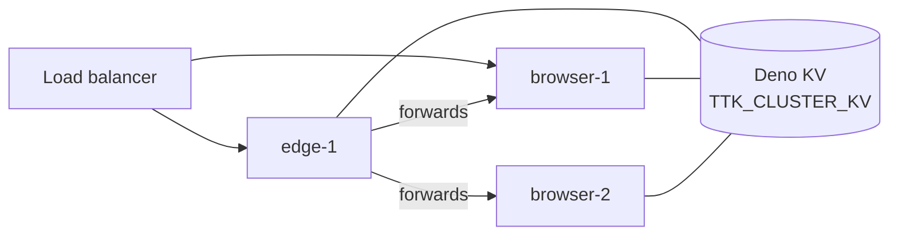

# Running a cluster

Several gateways share one session index in Deno KV. A client may call any node; a request for a browser session is
forwarded to the node that holds it. `edge` nodes host no browsers and front a pool of `browser` nodes.



## Configuration

```sh
# every node
TTK_CLUSTER_KV=/data/cluster/cluster.kv            # a KV file on a shared mount, or a hosted KV URL
TTK_API_KEYS_FILE=/run/secrets/ttk_api_keys        # the same keys everywhere
TTK_SIGNED_LINK_KEY_FILE=/run/secrets/ttk_link_key # the same key everywhere (signed links)

# a browser node
TTK_ROLE=browser
TTK_NODE_ID=browser-1
TTK_NODE_URL=http://browser-1.internal:8787

# an edge node
TTK_ROLE=edge
TTK_NODE_ID=edge-1
```

| `TTK_ROLE`      | Hosts browsers | Needs `TTK_NODE_URL` |
| --------------- | -------------- | -------------------- |
| `all` (default) | yes            | yes                  |
| `browser`       | yes            | yes                  |
| `edge`          | no             | no                   |

Every node runs with `--unstable-kv` (all shipped launchers do) and its own data directory. Each node's
`TTK_ALLOWED_HOSTS` (or `TTK_PUBLIC_URL`) must accept the hostname other nodes use.

## What is shared

| State                                           | Where                               |
| ----------------------------------------------- | ----------------------------------- |
| Node registry, session owners, task locations   | The cluster KV                      |
| Accounts and sign-in sessions                   | The cluster KV (synced within ~2 s) |
| API keys, OAuth settings                        | Each node's config: keep them equal |
| `ttk.db` (providers, sealed secrets, memory)    | **Each node's own**, not replicated |
| Browser sessions, tickets, rate limits, metrics | The node's memory                   |

Seed every node from the same providers file and secrets file, or use `TTK_SECRETS_REF`.

## Routing

| Request                                                    | Served by                                                                 |
| ---------------------------------------------------------- | ------------------------------------------------------------------------- |
| A tool call with a `session_id`                            | The session's owner node                                                  |
| A browser tool without one (`default`)                     | Its owner; else the node that claims it (edge: least-loaded browser node) |
| `browser_navigate { new_session: true }`                   | The receiving node, or (edge) the least-loaded browser node               |
| `browser_list_sessions`, `agent_list_tasks`                | Every node, merged                                                        |
| `agent_get_task`, `agent_cancel_task`                      | The node that recorded the task                                           |
| Session files, events, signed links                        | The session's owner                                                       |
| Live-view tickets, admin routes, A2A and REST agent routes | The receiving node                                                        |

Use a sticky load balancer for the web UI, so a ticket is redeemed where it was minted.

## Features a cluster changes

| Setting                      | In a cluster                                                  |
| ---------------------------- | ------------------------------------------------------------- |
| `TTK_SESSION_OWNERSHIP`      | Defaults to `shared`; `owner` refuses to start.               |
| `TTK_MCP_APPS`               | Defaults to off; `watch` or `control` refuses to start.       |
| `TTK_SIGNED_LINKS`           | Only with `TTK_SIGNED_LINK_KEY_FILE` (same on every node).    |
| `TTK_MCP_STATEFUL`           | Refuses to start.                                             |
| Elicitation, sampling rounds | A retry that lands on another node fails: use sticky routing. |

Nodes register every 5 s and expire after 15 s; a forward to an unreachable node answers `502`.
