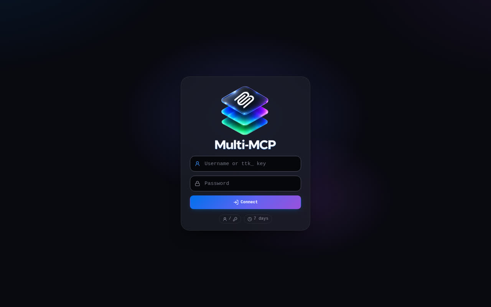
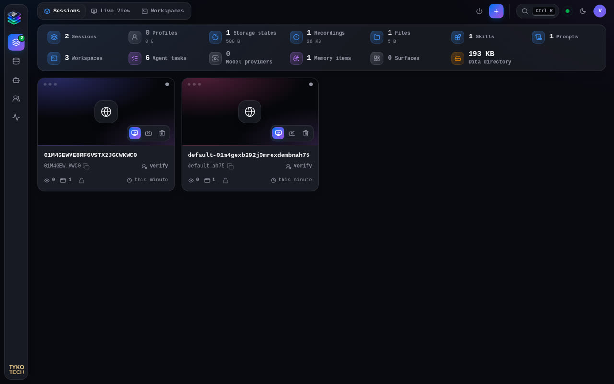
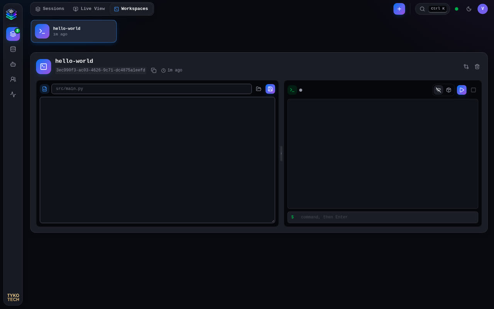
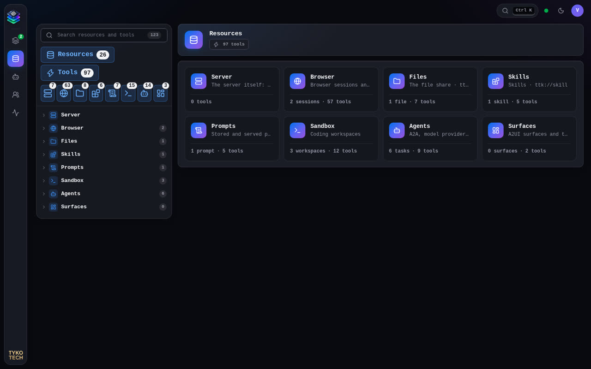
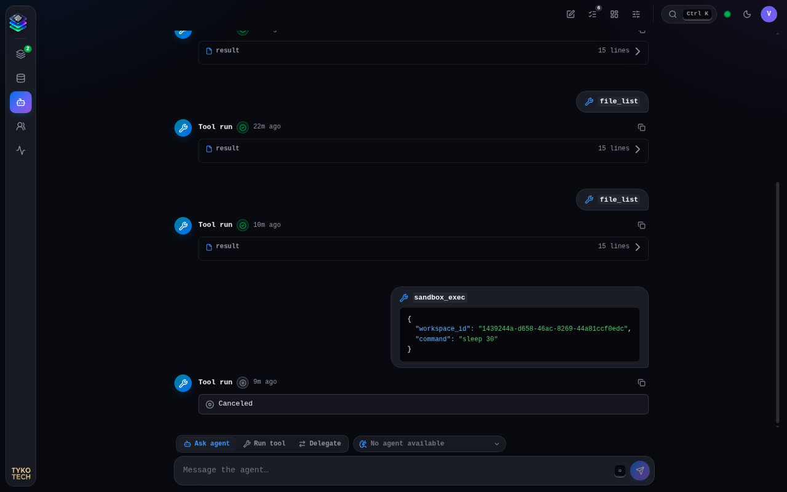
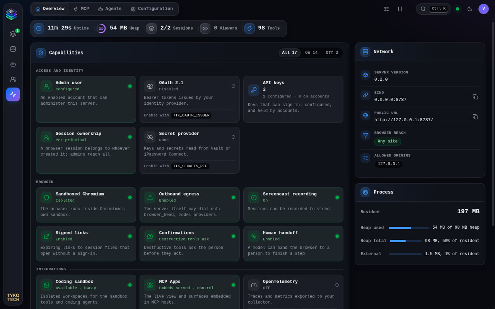

# Web app

The control plane at the server's root URL (`http://127.0.0.1:8787/` by default). One page, no framework; it talks to
the same REST API and live-view socket as any client, with an HttpOnly sign-in cookie.

## Sign in

Sign in with a username and password, or paste an API key (`ttk_…`) into the first field. The session lasts
`TTK_LOGIN_TTL_S` (7 days). What you see afterwards follows your scopes.

## Layout

| Area      | Contents                                                                                     |
| --------- | -------------------------------------------------------------------------------------------- |
| Left rail | **Sessions**, **Resources**, **Agents**, **Users**, **System**.                              |
| Top bar   | The screen's tabs, search and commands (**Ctrl K**), connection status, theme, account menu. |

## Sessions

A strip of counts (sessions, profiles, storage states, recordings, files, skills, prompts, workspaces, tasks, memory,
data directory), then, for an administrator, three memory meters: the **container** (the server plus every browser,
against `TTK_MEMORY_LIMIT`), the **browser sessions** (their Chromium memory against the same limit, and their count
against `TTK_MAX_SESSIONS`) and the **gateway heap** (against its limit, `TTK_GATEWAY_HEAP_MB`). The sessions follow in
two groups: **Active** (watched, held by a person, or used in the last five minutes) and **Idle** (with when the idle
reaper closes each, `TTK_SESSION_TTL_S`; **Close idle sessions** closes them all). Each card shows its browser's private
memory — Chromium's own memory dump, refreshed every 15 seconds — with **Watch**, **Screenshot** and **Close**. **New
session** (`+`) opens one. Tabs: **Sessions**, **Live View**, **Workspaces**.

### Live View

The selected session streamed live, with an address bar and back button. **Take control** (pointer icon) takes the
takeover lock: your mouse and keyboard drive the page, and the model's mutating tools wait with `human-has-control`
until you release it. The **Inspector** panel holds actions (screenshot, state, accessibility tree, …), viewport, tabs,
storage state, downloads, the session's event stream and tool output. A model's `browser_request_human` link opens this
view directly (`#/view/<session>`).

### Workspaces

Your coding workspaces (needs `sandbox:execute`): a file editor beside a live shell, plus diff and delete. The **Files**
tree lists every file and folder in the workspace (folders first, `.git` hidden): click a folder to expand it and a file
to open it. The tree follows saves, shell commands and files added in the background (the screen polls); arrow keys,
Home, End and Enter work in it. Type a path in the field above the editor to create a new file.

An open workspace has two tabs: **Files & shell** (`#/workspaces/<id>`) and **Surfaces** (`#/workspaces/<id>/surfaces`,
with a count): the A2UI surfaces agents published for it, rendered live. The tabs switch in place, so the shell keeps
running and unsaved editor text stays. The task icon in the workspace header counts the agent tasks that used the
workspace and opens them on **Agents › Tasks**, filtered to that workspace with its newest task selected.

## Resources

Everything the server exposes to your credential: resources and tools grouped as Server, Browser, Files, Skills,
Prompts, Sandbox, Agents and Surfaces. Selecting a tool opens a form built from its schema with the result beside it,
the quickest way to try a tool by hand. Files, skills and prompts can be edited here with `files:write`.

## Agents

Two tabs: **Chat** and **Tasks**.

**Chat** is a conversation with the task runtime, one task at a time: **Ask agent** (built-in model agent, SlopLord or
the ACP agent, chosen in the target picker), **Run tool** (one tool as a background task) and **Delegate** (to an A2A
peer). Every request starts a new task with its own id, and the chat moves to it (`#/agents/chat/<task>`); the bar over
the conversation shows the task's state and id, with **Run history**. The pen icon starts a new, empty task. Without
`agent:invoke` the screen offers **Grant agent scopes to my account** to administrators. The settings icon opens agent
settings (admin).

**Tasks** (`#/agents/tasks[/<task>]`) lists every task you own, newest first, searchable by words, id, model or state,
beside the selected task's run history: its facts (id, kind, backend, provider and model, times, duration, steps,
tokens), the request and the answer, artifacts, and the run log — each model provider request with its timing, token
usage and stop reason, each tool call with its arguments and result, and each state change. An unfinished task keeps
updating; **Open in chat** shows it as its conversation. Tasks are kept for a day.

`#/agents/tasks?workspace=<id>` narrows the list to the tasks that touched one workspace; the chip above the list names
it and clears the filter.

A2UI surfaces live with their workspace, on its **Surfaces** tab in **Sessions › Workspaces**, with **New surface**,
Detach, Delete and **Attach here** for surfaces in no workspace.

## Users

Accounts with their scopes, sign-ins and API keys (needs `admin`): create accounts, change scopes, disable, reset
passwords, issue and revoke account keys, sign out everywhere.

## System

Tabs: **Overview** (capabilities on and off, network, process memory), **MCP**, **Agents** (model providers, agent
settings, agent memory embedder) and **Configuration** (every setting with its source; **Compose configuration** drafts
environment and Compose snippets, never secrets). Needs `admin`.
