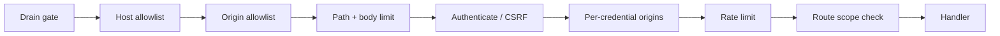

# HTTP API

Every route the gateway serves. JSON bodies; errors are `application/problem+json` with a stable slug
([error reference](error-codes.md)).

## Conventions

| Topic          | Rule                                                                                                                                                                                                                                                                           |
| -------------- | ------------------------------------------------------------------------------------------------------------------------------------------------------------------------------------------------------------------------------------------------------------------------------ |
| Authentication | `Authorization: Bearer <token>`: `ttk_` API key, `ttks_` sign-in session, OAuth access token, or (on `/mcp` only) a `ttkd_` delegated token. The web UI uses an HttpOnly cookie instead.                                                                                       |
| Cookie CSRF    | A cookie-authenticated `POST`/`PUT`/`PATCH`/`DELETE` needs this server's origin in `Origin` and the sign-in's CSRF value in `x-ttk-csrf`, else `403 csrf-failed`.                                                                                                              |
| Public routes  | `/`, `/assets/*`, `/healthz`, `/favicon.ico`, `POST /api/v1/auth/login`, the agent cards, the OAuth well-known documents, `/live/*` (ticket), `/api/v1/links/file` (signed token, while links are on). Everything else, unknown paths included, is `401` without a credential. |
| Rate limit     | `TTK_RATE_RPM` per principal (default 120/min, burst a third). `x-ratelimit-remaining` on every response; `429` with `Retry-After`.                                                                                                                                            |
| Request id     | `x-request-id` is echoed, or a ULID is generated; it appears in every problem body.                                                                                                                                                                                            |
| Body limits    | `/mcp` 4 MiB, sign-in 16 KiB, share upload 64 MiB (streamed), other API routes `TTK_MAX_BODY_KB` (256 KiB). Over: `413`.                                                                                                                                                       |
| Paths          | Dot segments, encoded slashes or backslashes, and `//` are `400` before anything else runs.                                                                                                                                                                                    |
| CORS           | Never sent.                                                                                                                                                                                                                                                                    |

Request pipeline, in order:

## Health and system

| Route                                        | Scope                     | Purpose                                                                                                                                                               |
| -------------------------------------------- | ------------------------- | --------------------------------------------------------------------------------------------------------------------------------------------------------------------- |
| `GET /healthz`                               | public                    | `{ status, version, sessions }`. Answers while draining.                                                                                                              |
| `GET /metrics`                               | `metrics:read` or `admin` | Prometheus text. Only with `TTK_METRICS=true` (else `404`).                                                                                                           |
| `GET /api/v1/overview`                       | any credential            | Counts and byte totals of what the caller can read (sessions, files, skills, memory, tasks …). Sections the caller lacks the scope for are omitted.                   |
| `GET /api/v1/system/diagnostics`             | `admin`                   | Uptime, memory, sessions and the effective configuration (no secrets).                                                                                                |
| `GET /api/v1/system/usage`                   | `admin`                   | Each visible session's browser memory (Chromium's own dump, cached 15 s) and idle time, the gateway heap against its limit, the container limit (`TTK_MEMORY_LIMIT`). |
| `GET`, `PUT /api/v1/system/model-providers`  | `admin`                   | Read or replace the model providers in `ttk.db`. Keys are write-only: `{ mode: "keep" \| "set" \| "none" }`.                                                          |
| `POST /api/v1/system/model-providers/models` | `admin`                   | List the models a saved provider's host serves.                                                                                                                       |
| `GET`, `PUT /api/v1/system/agents`           | `admin`                   | Per-agent settings: default model, A2A, ACP, A2UI and memory switches.                                                                                                |
| `GET`, `PUT /api/v1/system/memory`           | `admin`                   | Default embedder for new memory collections, and totals.                                                                                                              |

## Sign-in

| Route                        | Auth             | Purpose                                                                                                                                                           |
| ---------------------------- | ---------------- | ----------------------------------------------------------------------------------------------------------------------------------------------------------------- |
| `POST /api/v1/auth/login`    | none             | `{ username, password }` or `{ apiKey }` → `{ token: "ttks_…", expires, user }`. `"session": "cookie"` sets the HttpOnly cookie and returns a CSRF value instead. |
| `GET /api/v1/auth/me`        | bearer or cookie | The signed-in principal and its scopes.                                                                                                                           |
| `POST /api/v1/auth/logout`   | bearer or cookie | End the session; clear the cookie. Never rate-limited.                                                                                                            |
| `POST /api/v1/auth/password` | account sign-in  | `{ current, next }`: change your password; your other sessions end.                                                                                               |

Failed sign-ins back off per source (5 free, then 1 s doubling to 15 min) and per username (10 free, up to 60 s).

## Browser sessions and live view

| Route                                      | Scope                          | Purpose                                                                                                          |
| ------------------------------------------ | ------------------------------ | ---------------------------------------------------------------------------------------------------------------- |
| `GET`, `POST /api/v1/sessions`             | `admin`                        | List sessions; create one (`{ session_id?, label?, profile? }`).                                                 |
| `DELETE /api/v1/sessions/{id}`             | `admin`                        | Close a session.                                                                                                 |
| `GET /api/v1/sessions/{id}/events`         | `mcp:invoke`                   | Server-sent event stream; `kinds=a,b` filters, `since=<cursor>` resumes ([kinds](live-view-protocol.md#events)). |
| `GET /api/v1/sessions/{id}/files/{fileId}` | `mcp:invoke`                   | Download a session file; supports `Range`.                                                                       |
| `GET /api/v1/links/file?t=<token>`         | signed link                    | Download through a `browser_file_link` URL, no bearer.                                                           |
| `GET /api/v1/recordings/{name}`            | `view:watch`                   | A WebM recording.                                                                                                |
| `POST /api/v1/live/ticket`                 | `view:watch` or `view:control` | Mint a single-use live-view ticket (`{ session_id?, mode?, ttl_seconds?, origin? }`).                            |
| `GET /live/{id}/ws?ticket=lvt_…`           | the ticket                     | The live-view WebSocket ([protocol](live-view-protocol.md)).                                                     |
| `GET`, `PUT /api/v1/live/origins`          | `admin`                        | Narrow the live-view origins for your own credential (needs `TTK_DATA_DIR`).                                     |

With `TTK_SESSION_OWNERSHIP=owner` (single-node default) these routes see only the caller's sessions; `admin` sees all.

## MCP

| Route                        | Scope        | Purpose                                        |
| ---------------------------- | ------------ | ---------------------------------------------- |
| `POST`, `GET`, `DELETE /mcp` | `mcp:invoke` | Streamable HTTP ([protocol](mcp-protocol.md)). |

## Accounts

All need `admin`; changes need `TTK_DATA_DIR`.

| Route                                       | Purpose                                                                            |
| ------------------------------------------- | ---------------------------------------------------------------------------------- |
| `GET`, `POST /api/v1/users`                 | List accounts; create one (password generated when empty; optional first API key). |
| `PATCH`, `DELETE /api/v1/users/{username}`  | Change scopes or disable; delete.                                                  |
| `POST /api/v1/users/{username}/password`    | Reset a password (generated when omitted).                                         |
| `POST /api/v1/users/{username}/keys`        | Issue an account API key (shown once; ≤25 per account).                            |
| `DELETE /api/v1/users/{username}/keys/{id}` | Revoke an account key; ends its sessions, tasks, streams and links.                |
| `DELETE /api/v1/users/{username}/sessions`  | Sign the account out everywhere.                                                   |

The last enabled `admin` account cannot be removed, disabled or stripped of `admin`.

## File share

Needs `TTK_DATA_DIR`. Paths are relative to `<TTK_DATA_DIR>/share`.

| Route                                   | Scope         | Purpose                            |
| --------------------------------------- | ------------- | ---------------------------------- |
| `GET /api/v1/share?path=`               | `files:read`  | List a folder (≤2000 entries).     |
| `GET /api/v1/share/file?path=`          | `files:read`  | Download a file (≤64 MiB).         |
| `PUT /api/v1/share/file?path=`          | `files:write` | Upload a file (raw body, ≤64 MiB). |
| `POST /api/v1/share/mkdir`              | `files:write` | `{ path }`                         |
| `POST /api/v1/share/move`               | `files:write` | `{ from, to }`                     |
| `DELETE /api/v1/share?path=&recursive=` | `files:write` | Delete a file or folder.           |

## Coding sandbox shells

Need `sandbox:execute` and a configured sandbox. Workspaces and files go through the `sandbox_*` tools.

| Route                                      | Purpose                                            |
| ------------------------------------------ | -------------------------------------------------- |
| `POST /api/v1/sandbox/sessions`            | Open a shell: `{ workspace_id, network? }`.        |
| `POST /api/v1/sandbox/sessions/{id}/input` | Send `{ data }` (≤16 KiB).                         |
| `GET /api/v1/sandbox/sessions/{id}/events` | SSE output (`output`, `end`); `after=<n>` resumes. |
| `DELETE /api/v1/sandbox/sessions/{id}`     | Close the shell.                                   |

## Agents and A2A

| Route                                                    | Scope          | Purpose                                                                                                                                                                   |
| -------------------------------------------------------- | -------------- | ------------------------------------------------------------------------------------------------------------------------------------------------------------------------- |
| `GET /.well-known/agent-card.json`                       | public         | The A2A 1.0 agent card ("Multi-MCP agent").                                                                                                                               |
| `POST /a2a`                                              | `agent:invoke` | A2A JSON-RPC (`A2A-Version: 1.0` header).                                                                                                                                 |
| `/a2a/v1/*`                                              | `agent:invoke` | A2A HTTP+JSON binding (below).                                                                                                                                            |
| `GET /a2a/agents/sloplord/.well-known/agent-card.json`   | public         | SlopLord's card.                                                                                                                                                          |
| `POST /a2a/agents/sloplord`, `/a2a/agents/sloplord/v1/*` | `agent:invoke` | SlopLord over JSON-RPC and HTTP+JSON.                                                                                                                                     |
| `GET`, `POST /api/v1/agent/tasks`                        | `agent:invoke` | List your tasks (`?workspace_id=` keeps those that touched that workspace); start a text task `{ message, provider?, model?, agent? }` (a provider needs `model:invoke`). |
| `GET /api/v1/agent/tasks/{id}`                           | `agent:invoke` | A task and any pending permission request.                                                                                                                                |
| `GET /api/v1/agent/tasks/{id}/log`                       | `agent:invoke` | The run history: `created_at`, `finished_at`, the run log (provider requests, tool calls, states), `truncated`.                                                           |
| `POST /api/v1/agent/tasks/{id}/cancel`                   | `agent:invoke` | Cancel a task.                                                                                                                                                            |
| `POST /api/v1/agent/tasks/{id}/permission`               | `agent:invoke` | Answer an ACP permission request: `{ permissionId, optionId? }`.                                                                                                          |
| `GET /api/v1/agent/tasks/{id}/events`                    | `agent:invoke` | SSE task events.                                                                                                                                                          |
| `GET /api/v1/agent/providers`                            | `agent:invoke` | Providers, models and built-in agents you can target (no keys or URLs).                                                                                                   |

A2A HTTP+JSON binding (same under `/a2a/agents/sloplord/v1`, without `extendedAgentCard`):

| Route                                                     | Operation                          |
| --------------------------------------------------------- | ---------------------------------- |
| `POST /a2a/v1/message:send`                               | `SendMessage`                      |
| `POST /a2a/v1/message:stream`                             | `SendStreamingMessage` (SSE)       |
| `GET /a2a/v1/tasks`, `GET /a2a/v1/tasks/{id}`             | `ListTasks`, `GetTask`             |
| `POST /a2a/v1/tasks/{id}:cancel`                          | `CancelTask`                       |
| `GET`/`POST /a2a/v1/tasks/{id}:subscribe`                 | `SubscribeToTask` (SSE)            |
| `/a2a/v1/tasks/{id}/pushNotificationConfigs[/{configId}]` | Push config create/list/get/delete |
| `GET /a2a/v1/extendedAgentCard`                           | `GetExtendedAgentCard`             |

A2A errors map to `404` (task not found), `409` (not cancelable), `503` (runtime unavailable), else `400`. Streams
re-check the credential every 5 minutes and end after 30.

## A2UI surfaces

| Route                                                      | Scope          | Purpose                                             |
| ---------------------------------------------------------- | -------------- | --------------------------------------------------- |
| `GET /api/v1/a2ui/surfaces`                                | `agent:invoke` | Your surfaces.                                      |
| `POST /api/v1/a2ui/surfaces`                               | `a2ui:publish` | Apply one A2UI v0.9 message.                        |
| `PATCH /api/v1/a2ui/surfaces/{id}`                         | `a2ui:publish` | Attach to a workspace: `{ workspaceId }` or `null`. |
| `DELETE /api/v1/a2ui/surfaces/{id}`                        | `a2ui:publish` | Delete a surface.                                   |
| `GET /api/v1/a2ui/surfaces/{surfaceId}/html/{componentId}` | `agent:invoke` | An `Html` component, served under a sandbox CSP.    |
| `GET /api/v1/a2ui/events`                                  | `agent:invoke` | SSE: the full surface list on every change.         |
| `GET`, `POST /api/v1/a2ui/actions`                         | `agent:invoke` | List bindable action names; press a button.         |

## OAuth metadata

Only with `TTK_OAUTH_ISSUER` (else `404`): `GET /.well-known/oauth-protected-resource` (RFC 9728) and
`GET /.well-known/oauth-authorization-server` (the issuer's metadata).

## Web UI

`GET /` serves the control plane with `frame-ancestors 'none'` and `X-Frame-Options: DENY`; `GET /assets/*` serves its
bundle (`Cache-Control: no-cache`). `503` until `deno task build:web` has run.

## Cluster forwarding

A node forwards `/mcp`, session-file, session-event and signed-link requests to the node that owns the session, adding
`x-ttk-forwarded-by`; answers carry `x-ttk-served-by`. Everything else is served by the receiving node. See
[Running a cluster](../guides/running-a-cluster.md).
