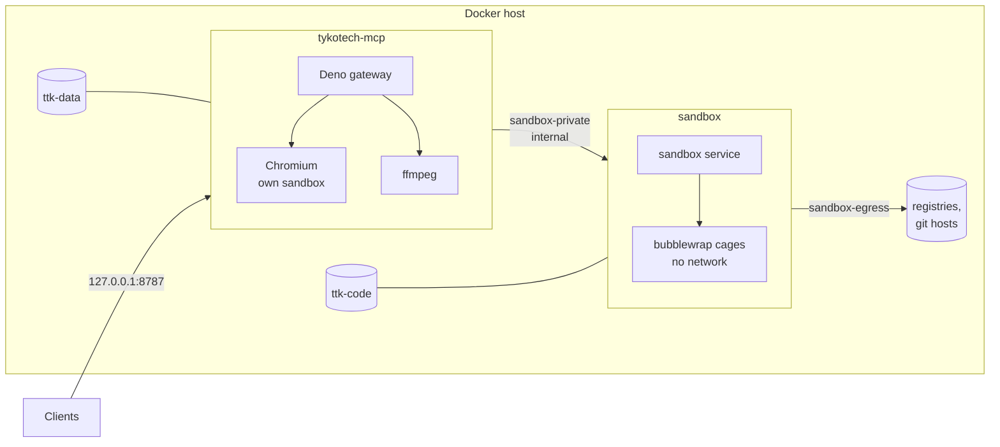

# HTTP API, data and Docker

Every REST route the gateway serves, its problem documents, where state lives, and the images and Compose files. The MCP
endpoint and the live-view socket: [MCP reference](mcp.md).

## Conventions

| Topic          | Rule                                                                                                                                                                                                                                           |
| -------------- | ---------------------------------------------------------------------------------------------------------------------------------------------------------------------------------------------------------------------------------------------- |
| Authentication | `Authorization: Bearer <token>`: `ttk_` API key or `ttks_` sign-in session. The web app uses an HttpOnly cookie instead.                                                                                                                       |
| Cookie CSRF    | A cookie-authenticated `POST`/`PUT`/`PATCH`/`DELETE` needs this server's origin in `Origin` and the sign-in's CSRF value in `x-ttk-csrf`, else `403 csrf-failed`.                                                                              |
| Public routes  | `/`, `/assets/*`, `/healthz`, `/favicon.ico`, `POST /api/v1/auth/login`, the agent cards, `/live/*` (ticket), `/api/v1/links/file` (signed token, while links are on). Everything else, unknown paths included, is `401` without a credential. |
| Anonymous      | With no API key and no account configured, a loopback bind treats every request as the anonymous loopback principal with `TTK_ANON_SCOPES`.                                                                                                    |
| Rate limit     | `TTK_RATE_RPM` per principal (default 120/min, burst a third). `x-ratelimit-remaining` on every authenticated response; `429` with `Retry-After`.                                                                                              |
| Request id     | `x-request-id` is echoed, or a ULID is generated; it appears in every problem body.                                                                                                                                                            |
| Body limits    | `/mcp` 4 MiB, sign-in 16 KiB, share upload 64 MiB (streamed), other API routes `TTK_MAX_BODY_KB` (256 KiB). Over: `413`.                                                                                                                       |
| Paths          | Dot segments, encoded slashes or backslashes, `//`, and percent-encoded unreserved (`A-Z a-z 0-9 - . _ ~`) or control characters are `400` before anything else runs.                                                                          |
| CORS           | Never sent.                                                                                                                                                                                                                                    |

Request pipeline, in order: drain gate → `Host` allowlist → `Origin` allowlist → path and body limit → authenticate /
CSRF → per-credential origins → rate limit → route scope check → handler.

## Routes

### Health and system

| Route                                        | Scope                     | Purpose                                                                                                                                                        |
| -------------------------------------------- | ------------------------- | -------------------------------------------------------------------------------------------------------------------------------------------------------------- |
| `GET /healthz`                               | public                    | `{ status, version, sessions }`. Answers while draining.                                                                                                       |
| `GET /metrics`                               | `metrics:read` or `admin` | Prometheus text. Only with `TTK_METRICS=true` (else `404`).                                                                                                    |
| `GET /api/v1/system/diagnostics`             | `admin`                   | Uptime, memory, sessions and the effective configuration (no secrets).                                                                                         |
| `GET /api/v1/system/usage`                   | `admin`                   | Each visible session's browser memory (Chromium's own dump, cached 15 s) and idle time, the gateway heap against its limit, the limit from `TTK_MEMORY_LIMIT`. |
| `GET`, `PUT /api/v1/system/model-providers`  | `admin`                   | Read or replace the model providers in `ttk.db`: `{ seed, store, default, providers }`. Keys are write-only: `{ mode: "keep" \| "set" \| "none" }`.            |
| `POST /api/v1/system/model-providers/models` | `admin`                   | List the models a saved provider's host serves.                                                                                                                |
| `GET`, `PUT /api/v1/system/agents`           | `admin`                   | Per-agent settings (built-in agent, SlopLord): default model, A2A, A2UI and memory switches; `PUT` needs `TTK_DATA_DIR`. API only.                             |
| `GET`, `PUT /api/v1/system/memory`           | `admin`                   | The default embedder for new memory collections, and totals per embedder. API only; `409` without `TTK_DATA_DIR`.                                              |

### Sign-in

| Route                        | Auth             | Purpose                                                                                                                                                           |
| ---------------------------- | ---------------- | ----------------------------------------------------------------------------------------------------------------------------------------------------------------- |
| `POST /api/v1/auth/login`    | none             | `{ username, password }` or `{ apiKey }` → `{ token: "ttks_…", expires, user }`. `"session": "cookie"` sets the HttpOnly cookie and returns a CSRF value instead. |
| `GET /api/v1/auth/me`        | bearer or cookie | The signed-in principal and its scopes.                                                                                                                           |
| `POST /api/v1/auth/logout`   | bearer or cookie | End the session; clear the cookie. Never rate-limited.                                                                                                            |
| `POST /api/v1/auth/password` | account sign-in  | `{ current, next }`: change your password; your other sessions end.                                                                                               |

Failed sign-ins back off per source (5 free, then 1 s doubling to 15 min) and per username (10 free, up to 60 s); a
wrong current password counts the same way. A successful sign-in is charged to the principal's rate limit.

### Browser sessions and live view

| Route                                                 | Scope                          | Purpose                                                                                                             |
| ----------------------------------------------------- | ------------------------------ | ------------------------------------------------------------------------------------------------------------------- |
| `GET`, `POST /api/v1/sessions`                        | `admin`                        | List sessions; create one (`{ label?, profile? }`; `{ session_id: "default" }` opens the default one).              |
| `DELETE /api/v1/sessions/{id}`                        | `admin`                        | Close a session.                                                                                                    |
| `GET /api/v1/sessions/{id}/events`                    | `mcp:invoke`                   | Server-sent event stream; `kinds=a,b` filters, `since=<cursor>` resumes ([kinds](mcp.md#events)).                   |
| `GET /api/v1/sessions/{id}/files/{fileId}`            | `mcp:invoke`                   | Download a session file; supports `Range`.                                                                          |
| `GET /api/v1/links/file?t=<token>`                    | signed link                    | Download through a `browser_file_link` URL, no bearer.                                                              |
| `GET /api/v1/recordings/{name}`                       | `view:watch`                   | A WebM recording (needs `TTK_DATA_DIR` and ffmpeg).                                                                 |
| `POST /api/v1/live/ticket`                            | `view:watch` or `view:control` | Mint a single-use live-view ticket (`{ session_id?, mode?, ttl_seconds?, origin? }`).                               |
| `GET /live/{id}/ws?ticket=lvt_…`                      | the ticket                     | The live-view WebSocket ([protocol](mcp.md#live-view-socket)).                                                      |
| `GET /live/terminal/{id}/ws`, `/live/surface/{id}/ws` | the ticket                     | MCP Apps embed sockets, while `TTK_MCP_APPS` is on ([MCP Apps](mcp.md#mcp-apps)).                                   |
| `GET`, `PUT /api/v1/live/origins`                     | `admin`                        | Narrow the browser origins accepted for your own credential (≤64; can only narrow; needs `TTK_DATA_DIR`). API only. |

In `owner` mode these routes see only the caller's sessions; `admin` sees all.

### MCP

| Route                        | Scope        | Purpose                                               |
| ---------------------------- | ------------ | ----------------------------------------------------- |
| `POST`, `GET`, `DELETE /mcp` | `mcp:invoke` | Streamable HTTP ([MCP reference](mcp.md#transports)). |

The route exists only when a credential is configured or the bind is loopback.

### Accounts

All need `admin`; changes need `TTK_DATA_DIR`. The last enabled `admin` account cannot be removed, disabled or stripped
of `admin`.

| Route                                       | Purpose                                                                            |
| ------------------------------------------- | ---------------------------------------------------------------------------------- |
| `GET`, `POST /api/v1/users`                 | List accounts; create one (password generated when empty; optional first API key). |
| `PATCH`, `DELETE /api/v1/users/{username}`  | Change scopes or disable; delete.                                                  |
| `POST /api/v1/users/{username}/password`    | Reset a password (generated when omitted).                                         |
| `POST /api/v1/users/{username}/keys`        | Issue an account API key (shown once; ≤25 per account).                            |
| `DELETE /api/v1/users/{username}/keys/{id}` | Revoke an account key; ends its sessions, tasks, streams and links.                |
| `DELETE /api/v1/users/{username}/sessions`  | Sign the account out everywhere.                                                   |

### File share

Needs `TTK_DATA_DIR`. Paths are relative to `<TTK_DATA_DIR>/share`.

| Route                                   | Scope         | Purpose                                                         |
| --------------------------------------- | ------------- | --------------------------------------------------------------- |
| `GET /api/v1/share?path=`               | `files:read`  | List a folder (≤2000 entries).                                  |
| `GET /api/v1/share/file?path=`          | `files:read`  | Download a file (≤64 MiB).                                      |
| `PUT /api/v1/share/file?path=`          | `files:write` | Upload a file (raw body, ≤64 MiB, within `TTK_DISK_BUDGET_MB`). |
| `POST /api/v1/share/mkdir`              | `files:write` | `{ path }`                                                      |
| `POST /api/v1/share/move`               | `files:write` | `{ from, to }`                                                  |
| `DELETE /api/v1/share?path=&recursive=` | `files:write` | Delete a file or folder.                                        |

### Coding sandbox shells

Need `sandbox:execute` and a configured sandbox (else `404`). Workspaces and files go through the `sandbox_*` tools.

| Route                                      | Purpose                                            |
| ------------------------------------------ | -------------------------------------------------- |
| `POST /api/v1/sandbox/sessions`            | Open a shell: `{ workspace_id, network? }`.        |
| `POST /api/v1/sandbox/sessions/{id}/input` | Send `{ data }` (≤16 KiB).                         |
| `GET /api/v1/sandbox/sessions/{id}/events` | SSE output (`output`, `end`); `after=<n>` resumes. |
| `DELETE /api/v1/sandbox/sessions/{id}`     | Close the shell.                                   |

### Agents and A2A

| Route                                                    | Scope          | Purpose                                                                                                        |
| -------------------------------------------------------- | -------------- | -------------------------------------------------------------------------------------------------------------- |
| `GET /.well-known/agent-card.json`                       | public         | The A2A 1.0 agent card ("Multi-MCP agent").                                                                    |
| `POST /a2a`                                              | `agent:invoke` | A2A JSON-RPC (`A2A-Version: 1.0` header).                                                                      |
| `/a2a/v1/*`                                              | `agent:invoke` | A2A HTTP+JSON binding (below).                                                                                 |
| `GET /a2a/agents/sloplord/.well-known/agent-card.json`   | public         | SlopLord's card.                                                                                               |
| `POST /a2a/agents/sloplord`, `/a2a/agents/sloplord/v1/*` | `agent:invoke` | SlopLord over JSON-RPC and HTTP+JSON.                                                                          |
| `GET`, `POST /api/v1/agent/tasks`                        | `agent:invoke` | List your tasks; start a text task `{ message, provider?, model?, agent? }` (a provider needs `model:invoke`). |
| `GET /api/v1/agent/tasks/{id}`                           | `agent:invoke` | A task.                                                                                                        |
| `POST /api/v1/agent/tasks/{id}/cancel`                   | `agent:invoke` | Cancel a task.                                                                                                 |
| `GET /api/v1/agent/providers`                            | `agent:invoke` | Providers, models and built-in agents you can target (no keys or URLs; the host only with `model:invoke`).     |

A2A HTTP+JSON binding (the same under `/a2a/agents/sloplord/v1`, without `extendedAgentCard`):

| Route                                                     | Operation                          |
| --------------------------------------------------------- | ---------------------------------- |
| `POST /a2a/v1/message:send`                               | `SendMessage`                      |
| `POST /a2a/v1/message:stream`                             | `SendStreamingMessage` (SSE)       |
| `GET /a2a/v1/tasks`, `GET /a2a/v1/tasks/{id}`             | `ListTasks`, `GetTask`             |
| `POST /a2a/v1/tasks/{id}:cancel`                          | `CancelTask`                       |
| `GET`/`POST /a2a/v1/tasks/{id}:subscribe`                 | `SubscribeToTask` (SSE)            |
| `/a2a/v1/tasks/{id}/pushNotificationConfigs[/{configId}]` | Push config create/list/get/delete |
| `GET /a2a/v1/extendedAgentCard`                           | `GetExtendedAgentCard`             |

Both bindings need the `A2A-Version: 1.0` header. Streams re-check the credential every 5 minutes and end after 30;
`-32000` is the terminal event of a stream the server ended (`unauthorized`, `stream-expired`, `server-shutdown`).

Errors follow A2A 1.0 and say the same thing everywhere: one code, the runtime's own message (for example
`Task cannot be canceled: it has already ended (completed)`), and the status of the spec's error table.

- **JSON-RPC** answers `{ code, message, data }` in a `200` response; `data` holds a `google.rpc.ErrorInfo` (`reason`
  such as `TASK_NOT_CANCELABLE`, `domain: a2a-protocol.org`) for the A2A errors.
- **HTTP+JSON** answers the status with a `google.rpc.Status` body,
  `{ "error": { "code", "status", "message", "details": [ErrorInfo] } }`. So do both bindings for a refusal before the
  operation: `403 PERMISSION_DENIED` without `agent:invoke`, `404` for a path that is no operation.
- **`/api/v1/agent/tasks`** answers the same status as a problem document with the message as `detail` (`not-found`,
  `forbidden-scope`, `service-unavailable`, else `invalid-request`).

| Code     | Meaning                                                                                  | HTTP status |
| -------- | ---------------------------------------------------------------------------------------- | ----------- |
| `-32001` | Task not found (or not yours).                                                           | 404         |
| `-32002` | The task has already ended, so it cannot be canceled.                                    | 400         |
| `-32003` | Push notifications are not offered.                                                      | 400         |
| `-32004` | Unsupported here: no model provider, provider unreachable, subscribing to an ended task. | 400         |
| `-32005` | Unsupported content (only text and structured tool data).                                | 400         |
| `-32007` | No extended card is configured.                                                          | 400         |
| `-32009` | Missing `A2A-Version: 1.0`.                                                              | 400         |
| `-32600` | A scope or credential the task needs is missing (JSON-RPC also: a malformed request).    | 403         |
| `-32601` | Unknown method.                                                                          | 404         |
| `-32602` | Invalid parameters.                                                                      | 400         |
| `-32603` | The runtime cannot take the work now: task capacity, subscriber limit, shutdown.         | 503         |

### A2UI surfaces

| Route                                                      | Scope          | Purpose                                          |
| ---------------------------------------------------------- | -------------- | ------------------------------------------------ |
| `GET /api/v1/a2ui/surfaces`                                | `agent:invoke` | Your surfaces.                                   |
| `POST /api/v1/a2ui/surfaces`                               | `a2ui:publish` | Apply one A2UI v0.9 message.                     |
| `DELETE /api/v1/a2ui/surfaces/{id}`                        | `a2ui:publish` | Delete a surface.                                |
| `GET /api/v1/a2ui/surfaces/{surfaceId}/html/{componentId}` | `agent:invoke` | An `Html` component, served under a sandbox CSP. |
| `GET /api/v1/a2ui/events`                                  | `agent:invoke` | SSE: the full surface list on every change.      |
| `POST /api/v1/a2ui/actions`                                | `agent:invoke` | Press a surface button.                          |

### Web app

`GET /` serves the control plane (`packages/web/static/index.html`); `GET /assets/*` serves its bundle
(`packages/web/dist`, written by `deno task build:web`, else `404`) and static assets, never an HTML file or an MCP Apps
embed. Both send `frame-ancestors 'none'`, `X-Frame-Options: DENY` and `Cache-Control: no-cache`.

## Problem documents

```json
{
	"type": "https://tykotech.eu/problems/forbidden-scope",
	"title": "Insufficient scope",
	"status": 403,
	"x-request-id": "01J…",
	"detail": "…"
}
```

| Slug                                                  | Status | Typical cause                                                                                              |
| ----------------------------------------------------- | ------ | ---------------------------------------------------------------------------------------------------------- |
| `unauthenticated`                                     | 401    | Failed sign-in or current-password check; a bad signed link; a duplicated or malformed cookie.             |
| `forbidden-scope`                                     | 403    | Missing scope.                                                                                             |
| `origin-forbidden`                                    | 403    | `Origin` not allowed, or a bound ticket redeemed elsewhere.                                                |
| `csrf-failed`                                         | 403    | Cookie request without own origin or `x-ttk-csrf`.                                                         |
| `host-forbidden`                                      | 400    | `Host` not in the allowlist (set `TTK_PUBLIC_URL`).                                                        |
| `rate-limited`                                        | 429    | Rate limit, sign-in backoff, viewer or stream caps. Carries `Retry-After`.                                 |
| `unknown-session`                                     | 404    | The session does not exist or is not yours.                                                                |
| `ticket-expired`, `ticket-consumed`, `ticket-invalid` | 403    | Live-view ticket problems.                                                                                 |
| `payload-too-large`                                   | 413    | Body over its limit, a share file over 64 MiB, or a share write past `TTK_DISK_BUDGET_MB`.                 |
| `not-found`                                           | 404    | Unknown route or object; no sandbox configured.                                                            |
| `invalid-request`                                     | 400    | Malformed body, policy refusal, non-canonical path.                                                        |
| `persistence-required`                                | 409    | Needs `TTK_DATA_DIR`.                                                                                      |
| `conflict`                                            | 409    | Duplicate, last-admin or self protection, target exists, sandbox busy, no `TTK_DB_KEY_FILE` to seal a key. |
| `service-unavailable`                                 | 503    | Draining for shutdown; a provider that does not list its models; an agent runtime `-32603`.                |
| `internal`                                            | 500    | Unhandled error or failed store write.                                                                     |

Other shapes: a missing or rejected credential on any authenticated route answers the SDK's OAuth body
(`{ "error": "invalid_token", … }`) with a `WWW-Authenticate: Bearer` challenge; unparseable JSON is plain
`400 Invalid JSON`.

## Data

Without `TTK_DATA_DIR` everything is in memory, and writes that need storage answer `409 persistence-required`.

```
<TTK_DATA_DIR>/                    (/data in the image; the ttk-data volume in Compose)
├── ttk.db (+ -wal, -shm)          SQLite: model providers, sealed secrets, settings, agent memory   (0600)
├── users.json                     accounts: PBKDF2 password hashes, account-key hashes
├── logins.json                    sign-in sessions (token hashes)
├── origins.json                   per-credential origin lists (narrowing only)
├── agents/tasks.json              agent tasks and push webhooks                           (0600)
├── agents/surfaces.json           A2UI surfaces                                           (0600)
├── mcp/sessions.json              stateful MCP sessions and their initialize parameters   (0600)
├── profiles/<name>/               named Chromium profiles (cookies survive restarts)
├── storage/<name>.json            saved storage states (shared mode)
├── storage/owners/<digest>/<name>.json   saved storage states per owner (owner mode)
├── sessions/<id>.json             scratch state of an unprofiled session (removed on close)
├── downloads/<id>-<ulid>/         session downloads and printed files (removed on close)
├── recordings/<name>.webm         recordings
├── share/                         the file share
├── skills/<name>/                 SKILL.md plus files
└── prompts/                       prompt templates
```

JSON stores are written to a temporary file and renamed. The share and the recordings together are held to
`TTK_DISK_BUDGET_MB` (2048 MiB by default). Profiles, storage states, the share, memory and task files are **not
encrypted**: protect the volume and its backups.

**`ttk.db`** is SQLite via Deno's built-in `node:sqlite` (no FFI): WAL, `secure_delete`, `STRICT` tables, schema
versioned by `PRAGMA user_version`; `serve` and a local `stdio` process can open it at once. How its secrets are sealed:
[Security › Data at rest](../security.md#data-at-rest).

| Table                | Holds                                                                                  |
| -------------------- | -------------------------------------------------------------------------------------- |
| `settings`           | Seed markers, the default provider, the default memory embedder, the agent settings.   |
| `secrets`            | Provider keys, browser secrets and the generated link-signing key, AES-256-GCM sealed. |
| `model_providers`    | Providers in force, in order; `origin` is `seed` or `admin`; no key in the row.        |
| `memory_collections` | One row per collection: owner, name, embedder, dimensions.                             |
| `memory_items`       | Items: text, JSON metadata, Float32 embedding; cascade-deleted with the collection.    |

**Seeding.** `TTK_MODEL_PROVIDERS_FILE` and `TTK_SECRETS(_FILE)` are copied in once, when never seeded and empty, at
`serve`, `stdio` or `seed`. Afterwards the database is the source; a changed file is logged, not applied, until
`seed --force`. Nothing is written back to a source file. `TTK_SECRETS_REF` is never seeded.

**Agent memory.**

| Rule      | Value                                                                                                            |
| --------- | ---------------------------------------------------------------------------------------------------------------- |
| Owner     | The principal (e.g. `api-key:ci-bot`); stdio and loopback development share one owner.                           |
| Limits    | 64 collections per owner, 10 000 items per collection, text ≤16 KiB, metadata ≤4 KiB.                            |
| Embedders | `builtin:lexical-512` (offline, lexical) or `provider:<id>/<model>` (an `openai`-kind provider's `/embeddings`). |
| Search    | Cosine similarity over one collection. A collection keeps the embedder it was created with.                      |

**Accounts.** `users.json` holds username, PBKDF2-SHA256 hash (100 000 iterations, 16-byte salt), scopes, disabled flag
and up to 25 account API keys (SHA-256 plus an 8-character prefix); it is seeded once from `TTK_ADMIN_USER(_FILE)` and
is the authority afterwards. `logins.json` holds the SHA-256 of each `ttks_` token, its backing and expiry; scopes are
re-derived on every request. `origins.json` holds up to 64 origins per credential.

**Read-only inputs:** `TTK_API_KEYS_FILE` (`[{ id, sha256, scopes?, label? }]`, watched, edits apply live),
`TTK_ADMIN_USER_FILE`, `TTK_DB_KEY_FILE`, `TTK_MODEL_PROVIDERS_FILE` and `TTK_SECRETS_FILE` (seeds; used directly
without `TTK_DATA_DIR`), `TTK_SANDBOX_TOKEN_FILE`, `TTK_AGENT_PEERS_FILE`, `TTK_SIGNED_LINK_KEY_FILE`, and the
secret-provider files (`TTK_VAULT_TOKEN_FILE`, `TTK_OP_CONNECT_TOKEN_FILE`, `TTK_SECRET_PROVIDER_CA_FILE`).

**In memory only:** browser sessions; per session, the event ring (512 records), the network log (500 requests) and the
audit ledger (200 entries); live-view tickets, rate-limit counters and A2UI button actions. All start empty.

**Sandbox storage:** the sandbox service's own volume (`ttk-code` at `/work`) holds one git checkout per workspace, a
private home (package caches) and `/tmp` per workspace, and an owner record with the SHA-256 of the owner. Workspaces
survive restarts; shells do not.

## Docker

| File                                  | Builds or runs                                                                |
| ------------------------------------- | ----------------------------------------------------------------------------- |
| `Dockerfile`                          | `tykotech-mcp:0.2.0`: Deno, the source, Chromium, ffmpeg.                     |
| `docker/Dockerfile.sandbox`           | `tykotech-sandbox:0.2.0`: the coding-sandbox service.                         |
| `docker/Dockerfile.sandbox-workspace` | `tykotech-sandbox-workspace:0.2.0`: per-workspace container (Docker backend). |
| `docker/ttk`                          | The image's maintenance command.                                              |
| `docker-compose.yml`                  | The full stack: gateway and coding sandbox (the start scripts run it).        |
| `docker-compose.sandbox-docker.yml`   | Optional overlay: one Docker container per workspace (mounts the socket).     |



### The gateway image

`tykotech-mcp:0.2.0` holds Deno 2.9.7, the source, Chromium and ffmpeg, and runs as `deno` (uid 1993) under `dumb-init`.
It sets `TTK_HOST=0.0.0.0`, `TTK_PORT=8787`, `TTK_BROWSER_PATH=/usr/bin/chromium`, `TTK_FFMPEG=/usr/bin/ffmpeg`,
`TTK_DATA_DIR=/data`, `TTK_HEADLESS=true`, `TTK_LOG_FORMAT=json`, carries the label
`io.modelcontextprotocol.server.name=eu.tykotech/tykotech-mcp`, and probes `scripts/healthcheck.ts` every 30 s. Every
image's base is an `ARG` (`DENO_IMAGE`, and `RUNTIME_IMAGE` where there is a second base) defaulting to a pinned digest,
so a mirror is one `--build-arg` away. The build strips every setuid and setgid bit except Chromium's sandbox helper
(`/usr/lib/chromium/chrome-sandbox`) and fails if another remains. `ttk` (`docker/ttk`) runs the CLI with no network, no
subprocess, writing `/data` only.

`CMD` (narrow it with a Compose `command:` override, `--deny-ffi` first and the env list verbatim;
[example](../guide.md#scope-back-egress)):

```
deno run --cached-only --deny-ffi
  --allow-net
  --allow-run=/usr/bin/chromium,/usr/bin/ffmpeg
  --allow-read=/app,/data,/tmp,/home/deno,/run/secrets
  --allow-write=/data,/tmp,/home/deno
  --allow-env=TTK_*,DENO_DIR,DENO_NO_PROMPT,HOME,TMPDIR,PATH
  packages/cli/mod.ts serve
```

### Chromium sandbox

Chromium runs with its own sandbox (only `TTK_CHROMIUM_NO_SANDBOX`, never set in the images, turns it off). In a
container that needs the setuid helper, `seccomp:./docker/seccomp-chromium.json`, `shm_size: 1gb`, and **no**
`no-new-privileges`. The seccomp profile denies by default and lists the system calls the server and browser make, plus
`inotify_init1` for the API-key file watcher (without it the gateway logs `cannot watch the API key file` and a new key
waits for a restart).

### Sandbox AppArmor profile

bubblewrap builds each cage's root with mounts inside the cage's own user namespace. Docker's default AppArmor profile
denies every mount, so on an AppArmor host (Ubuntu, Debian, SUSE) the service would exit with
`bwrap: Failed to make / slave: Permission denied`. The sandbox therefore runs under `apparmor=tykotech-sandbox`:
`docker-default` with only that denial lifted ([`docker/apparmor-sandbox`](../../docker/apparmor-sandbox)). The service
holds no capability, so the kernel still allows it to mount only inside a cage. Its other settings:
`seccomp:./docker/seccomp-sandbox.json` (Docker's default plus the namespace calls) and `systempaths=unconfined` (each
cage puts Docker's `/proc` masks back).

`start.sh` (when Docker lists AppArmor) and `deno task setup` (when `aa-enabled` says it is on) install and load the
profile through `sudo` when the installed copy differs or is not loaded. `start.sh` prints the two commands before it
runs them, `setup` when they fail:

```sh
sudo install -m 0644 docker/apparmor-sandbox /etc/apparmor.d/tykotech-sandbox
sudo apparmor_parser -r /etc/apparmor.d/tykotech-sandbox
```

`deno task setup --only apparmor` does only this step (`--force`: reinstall and reload). Until the profile is loaded the
container is refused with `unable to apply apparmor profile`. A host without AppArmor (Fedora, RHEL, Docker Desktop), or
with the kernel module but not its tools, needs nothing: there the sandbox runs without the profile.

### Compose

| Service        | Key settings                                                                                                                                                                                                                                                                                                |
| -------------- | ----------------------------------------------------------------------------------------------------------------------------------------------------------------------------------------------------------------------------------------------------------------------------------------------------------- |
| `tykotech-mcp` | Port `${TTK_BIND:-127.0.0.1}:8787`; user `1993:1993`; volume `ttk-data:/data`; `mem_limit` `${TTK_GATEWAY_MEMORY:-1536m}`, heap `${TTK_GATEWAY_HEAP_MB:-1024}` MiB, `pids_limit: 4096`; secrets `ttk_api_keys`, `ttk_admin_user`, `ttk_db_key`, `ttk_secrets`, `ttk_sandbox_token`; no `command:` override. |
| `sandbox`      | No port; read-only root; all capabilities dropped; `no-new-privileges`; own seccomp and AppArmor profiles; 1 GiB, 2 CPUs, 512 PIDs; volume `ttk-code:/work`; secrets `ttk_sandbox_token`, `ttk_git_remotes`; public clones from `github.com`, `gitlab.com`, `bitbucket.org`, `codeberg.org`.                |

Every secret file comes from `setup` ([secrets/README.md](../../secrets/README.md)). `.env` (from `.env.example`) holds
`TTK_BIND`, `TTK_PUBLIC_URL`, `TTK_ALLOWED_DOMAINS` and `TTK_GATEWAY_MEMORY`; Compose also reads `TTK_ALLOWED_HOSTS`,
`TTK_ALLOWED_ORIGINS` and `TTK_GATEWAY_HEAP_MB` from it when you add them.

The gateway does not wait for the sandbox (no `depends_on`). A sandbox that is down, slow or cannot start costs only its
tools: the gateway probes it every 30 s and offers them while it answers. Both services read one bearer,
`secrets/ttk_sandbox_token`, at `/run/secrets/ttk_sandbox_token`. Rotate it with
`deno task setup --only sandbox-token --force && docker compose up -d --force-recreate tykotech-mcp sandbox`.

### Overlays

| Overlay                             | Adds                                                                                   | Needs, beyond `setup`                                                                                                                                                            |
| ----------------------------------- | -------------------------------------------------------------------------------------- | -------------------------------------------------------------------------------------------------------------------------------------------------------------------------------- |
| `docker-compose.sandbox-docker.yml` | `TTK_SANDBOX_BACKEND=docker`: one hardened container per workspace via the Engine API. | `docker build -f docker/Dockerfile.sandbox-workspace -t tykotech-sandbox-workspace:0.2.0 .`; the socket's group in `TTK_SANDBOX_DOCKER_GID`. **The socket is root on the host.** |

```sh
docker compose -f docker-compose.yml -f docker-compose.sandbox-docker.yml up -d --build
```

Or set `COMPOSE_FILE=docker-compose.yml:docker-compose.sandbox-docker.yml` (`;` on Windows) in `.env`, and every
`docker compose` command, the start scripts' included, uses both.

### Maintenance

```sh
docker compose run --rm --no-deps tykotech-mcp ttk doctor          # what the server would parse
docker compose run --rm --no-deps tykotech-mcp ttk seed --force    # re-copy providers file and browser secrets
docker compose restart tykotech-mcp                                # a running server keeps what it loaded
```
