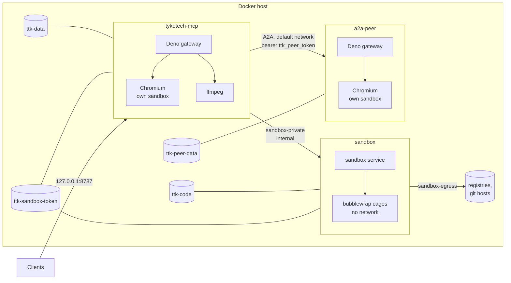

# Docker

| File                                  | Builds or runs                                                                |
| ------------------------------------- | ----------------------------------------------------------------------------- |
| `Dockerfile`                          | `tykotech-mcp:0.2.0`: Deno, the source, Chromium, ffmpeg (bundled image).     |
| `Dockerfile.slim`                     | `tykotech-mcp:slim`: the compiled binary on Debian slim, Chromium, ffmpeg.    |
| `docker/Dockerfile.sandbox`           | `tykotech-sandbox:0.2.0`: the coding-sandbox service.                         |
| `docker/Dockerfile.sandbox-workspace` | `tykotech-sandbox-workspace:0.2.0`: per-workspace container (Docker backend). |
| `docker/Dockerfile.agent-runner`      | `tykotech-agent-runner:0.2.0`: base for the ACP agent runner.                 |
| `docker/ttk`                          | The bundled image's maintenance command.                                      |
| `docker-compose.yml`                  | The full stack: gateway, coding sandbox, A2A peer.                            |
| `docker-compose.providers.yml`        | Overlay: seed model providers from `secrets/ttk_model_providers.json`.        |
| `docker-compose.sandbox.yml`          | Overlay: an operator-held sandbox token file.                                 |
| `docker-compose.sandbox-docker.yml`   | Overlay: one Docker container per workspace (mounts the Docker socket).       |
| `docker-compose.agents.yml`           | Overlay: the ACP agent runner.                                                |

Every image's base is an `ARG` (`DENO_IMAGE`, and `RUNTIME_IMAGE` where there is a second base) whose default is the
pinned digest, so a mirror or an air-gapped registry is one `--build-arg` away.



## Images

|               | Bundled `tykotech-mcp:0.2.0`                                  | Slim `tykotech-mcp:slim`                 |
| ------------- | ------------------------------------------------------------- | ---------------------------------------- |
| Contents      | Deno 2.9.7, source, Chromium, ffmpeg                          | Compiled binary, Chromium, ffmpeg        |
| User          | `deno` (uid 1993)                                             | `ttk` (uid 1000)                         |
| Permissions   | The `CMD` below; narrow it with a Compose `command:` override | Baked at compile time; cannot be changed |
| `ttk`         | `docker/ttk`: no network, no subprocess, writes `/data` only  | The binary                               |
| OpenTelemetry | Supported                                                     | Refused                                  |
| Health check  | `scripts/healthcheck.ts` every 30 s                           | `tykotech-mcp healthcheck` every 30 s    |

Both set `TTK_HOST=0.0.0.0`, `TTK_PORT=8787`, `TTK_BROWSER_PATH=/usr/bin/chromium`, `TTK_FFMPEG=/usr/bin/ffmpeg`,
`TTK_DATA_DIR=/data`, `TTK_HEADLESS=true`, `TTK_LOG_FORMAT=json`, run `dumb-init` as PID 1, and carry the label
`io.modelcontextprotocol.server.name=eu.tykotech/tykotech-mcp`. Both serve the same tools. Base images are pinned by
digest.

Bundled `CMD`:

```
deno run --cached-only --deny-ffi
  --allow-net
  --allow-run=/usr/bin/chromium,/usr/bin/ffmpeg
  --allow-read=/app,/data,/tmp,/home/deno,/run/secrets
  --allow-write=/data,/tmp,/home/deno
  --allow-env=TTK_*,DENO_DIR,DENO_NO_PROMPT,HOME,TMPDIR,PATH,OTEL_DENO,OTEL_DENO_VSOCK,OTEL_EXPORTER_OTLP_ENDPOINT,OTEL_EXPORTER_OTLP_TRACES_ENDPOINT,OTEL_EXPORTER_OTLP_METRICS_ENDPOINT,OTEL_EXPORTER_OTLP_LOGS_ENDPOINT
  --unstable-kv
  packages/cli/mod.ts serve
```

`--allow-net` is unscoped so `browser_head`, model providers, secret providers, OAuth and A2A push work. The code bounds
each: `browser_head` refuses private address literals and follows `TTK_ALLOWED_DOMAINS`; model calls go only to saved
providers; push only to `TTK_A2A_PUSH_ALLOWED_HOSTS`. To remove general egress, restate the whole command with a
narrower `--allow-net` (`--deny-ffi` first, env list verbatim); see
[Deploying](../guides/deploying-to-production.md#scope-back-egress).

## Chromium sandbox

Chromium always runs with its own sandbox. In a container that needs the `chromium-sandbox` setuid helper,
`seccomp:./docker/seccomp-chromium.json`, `shm_size: 1gb`, and **no** `no-new-privileges`. No image sets
`TTK_CHROMIUM_NO_SANDBOX`, and `TTK_BROWSER_ARGS` refuses sandbox-weakening switches.

The profile denies by default and lists what the server and browser were measured to call, plus `inotify_init1`, which
the gateway's API-key file watcher needs: without it the gateway logs `cannot watch the API key file` and a key added to
`secrets/ttk_api_keys.json` waits for a restart.

## `docker-compose.yml`

| Service        | Key settings                                                                                                                                                                                                                                              |
| -------------- | --------------------------------------------------------------------------------------------------------------------------------------------------------------------------------------------------------------------------------------------------------- |
| `tykotech-mcp` | Port `${TTK_BIND:-127.0.0.1}:8787`; user `1993:1993`; volume `ttk-data:/data`; secrets `ttk_api_keys`, `ttk_admin_user`, `ttk_db_key`, `ttk_secrets`, `ttk_agent_peers`, `ttk_peer_token`; waits for a healthy sandbox.                                   |
| `sandbox`      | No port; read-only root; all capabilities dropped; `no-new-privileges`; own seccomp profile; 1 GiB, 2 CPUs, 512 PIDs; volume `ttk-code:/work`; secret `ttk_git_remotes`; public clones from `github.com`, `gitlab.com`, `bitbucket.org`, `codeberg.org`.  |
| `a2a-peer`     | No port; the gateway image (built once, by `tykotech-mcp`); user `1993:1993`; volume `ttk-peer-data:/data`; secret `ttk_peer_api_keys` only; `TTK_PUBLIC_URL=http://a2a-peer:8787`; Chromium sandbox settings as the gateway's; `${TTK_PEER_MEMORY:-1g}`. |

Every secret file comes from `deno task setup` ([secrets/README.md](../../secrets/README.md)). Environment passed from
`.env`: `TTK_PUBLIC_URL`, `TTK_ALLOWED_HOSTS`, `TTK_ALLOWED_ORIGINS` (empty = derived), `TTK_ALLOWED_DOMAINS` (gateway
and peer; empty = unrestricted), and the memory sizes. The gateway does not wait for the peer: `agent_delegate` fails
while it is down, nothing else does. `docker compose up -d tykotech-mcp sandbox` runs without it.

The sandbox generates its bearer token on first start into the `ttk-sandbox-token` volume (gateway read-only). Rotate:
`docker compose down && docker volume rm <project>_ttk-sandbox-token && docker compose up -d`.

## Overlays

| Overlay                             | Adds                                                                                   | Needs, beyond `deno task setup`                                                                                                                                                  |
| ----------------------------------- | -------------------------------------------------------------------------------------- | -------------------------------------------------------------------------------------------------------------------------------------------------------------------------------- |
| `docker-compose.providers.yml`      | `TTK_MODEL_PROVIDERS_FILE`: model providers seeded from a file.                        | `secrets/ttk_model_providers.json`, which you write ([format](../../secrets/README.md#model-providers-file)).                                                                    |
| `docker-compose.sandbox.yml`        | An operator-held token, `secrets/ttk_sandbox_token` (`setup` writes one).              | Nothing.                                                                                                                                                                         |
| `docker-compose.sandbox-docker.yml` | `TTK_SANDBOX_BACKEND=docker`: one hardened container per workspace via the Engine API. | `docker build -f docker/Dockerfile.sandbox-workspace -t tykotech-sandbox-workspace:0.2.0 .`; the socket's group in `TTK_SANDBOX_DOCKER_GID`. **The socket is root on the host.** |
| `docker-compose.agents.yml`         | `agent-runner` service and the gateway's bridge settings.                              | A runner image with your agent (`TTK_AGENT_RUNNER_IMAGE`), and `secrets/ttk_agent_commands.json` edited to match it.                                                             |

```sh
docker compose -f docker-compose.yml -f docker-compose.agents.yml up -d --build
```

Overlays combine in any order; none overrides the gateway's command.

## Maintenance

```sh
docker compose run --rm --no-deps tykotech-mcp ttk doctor          # what the server would parse
docker compose run --rm --no-deps tykotech-mcp ttk seed --force    # re-copy providers file and browser secrets
docker compose restart tykotech-mcp                                # a running server keeps what it loaded
```
