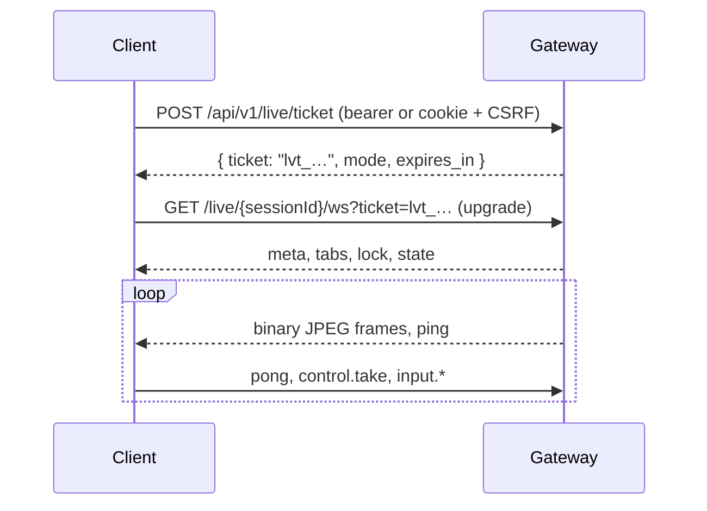

# Live-view protocol

A WebSocket that streams a session's screen and carries human input back. The contract is the Zod schemas in
`packages/wire/src/messages.ts`, shared by the gateway and the web UI.



## Tickets

| Rule     | Value                                                                                          |
| -------- | ---------------------------------------------------------------------------------------------- |
| Scope    | `view:watch` or `view:control`; `mode` is `view`/`watch` or `control` (never above the scope). |
| Use      | Single use, bound to principal, session and mode. The bearer never appears in a URL.           |
| Lifetime | 30 s default; at most 300 s for watching, 60 s for control. Over 30 s it must be origin-bound. |
| Owner    | In `owner` mode only for your own session (or any with `admin`).                               |

Upgrade refusals: `426` (not an upgrade, ticket kept),
`403 ticket-invalid|ticket-expired|ticket-consumed|origin-forbidden`, `404 unknown-session`, `429` (viewer cap
`TTK_MAX_VIEWERS`, or 8 long-lived connections per principal), `503` (draining).

## Frames

Text frames carry JSON both ways. Screen frames are binary, server to client:

```
[ u32 big-endian metadata length ][ UTF-8 JSON { type: "frame", seq, ts, w, h, targetId, scale? } ][ JPEG ]
```

One CDP screencast per session feeds every viewer and the recorder (JPEG quality `TTK_CAST_QUALITY`, within 1280×720).
The last frame is cached for late joiners and `live.keyframe`.

## Server → client

| `type`     | Fields                                                                                 | When                                                         |
| ---------- | -------------------------------------------------------------------------------------- | ------------------------------------------------------------ |
| `meta`     | `sessionId`, `viewerId`, `mode`, `viewport`, `tabs`, `lock`, `version`, `frame_scale?` | On open                                                      |
| `tabs`     | `tabs: [{ tabId, url, title, focused }]`                                               | Tabs change                                                  |
| `lock`     | `lock: { holder, principal, takenAt, holderName? }` or `null`                          | Lock taken or released                                       |
| `state`    | `url`, `title`, `frames?`                                                              | Navigation or focus change                                   |
| `event`    | `event` (event record)                                                                 | After `events.subscribe`                                     |
| `hover`    | `id`, `element`, `frame_id`                                                            | Reply to `live.hover`                                        |
| `quality`  | `scale`, `jpeg_quality`, `max_fps`                                                     | Reply to `live.quality`                                      |
| `viewport` | `w`, `h`, `frame_scale`                                                                | Frame size changes                                           |
| `error`    | `code`, `message`, `reason?`                                                           | A refused message ([codes](error-codes.md#live-view-socket)) |
| `ping`     | —                                                                                      | Every 15 s                                                   |
| `bye`      | `reason`: `session-closed`, `server-shutdown`, `idle-timeout`                          | Before close                                                 |

URLs on this socket are origin plus path only: no query, no fragment.

## Client → server

| `type`                                   | Fields                                                                  | Requires            |
| ---------------------------------------- | ----------------------------------------------------------------------- | ------------------- |
| `pong`                                   | —                                                                       | —                   |
| `control.take`, `control.release`        | —                                                                       | Control-mode ticket |
| `input.mouse`                            | `kind` (`move`/`down`/`up`/`click`), `x`, `y`, `button?`, `clickCount?` | The lock            |
| `input.key`                              | `kind` (`down`/`up`/`press`), `key`, `code?`, `text?`, `modifiers?`     | The lock            |
| `input.wheel`                            | `x`, `y`, `deltaX`, `deltaY`                                            | The lock            |
| `input.composition`                      | `kind` (`update`/`commit`/`cancel`), `text`                             | The lock            |
| `navigate`                               | `url` (allowlist applies)                                               | The lock            |
| `tab.switch`                             | `tabId`                                                                 | The lock            |
| `events.subscribe`, `events.unsubscribe` | `kinds?`, `since?`                                                      | —                   |
| `live.hover`                             | `id`, `x`, `y`                                                          | —                   |
| `live.keyframe`                          | —                                                                       | —                   |
| `live.quality`                           | `scale?`, `jpeg_quality?`, `max_fps?`                                   | Control mode        |
| `live.highlight`                         | `index` or `bounds`, `ttl_ms?`                                          | Control mode        |

`modifiers` is a CDP bitmask (alt 1, ctrl 2, meta 4, shift 8) or names. A socket that never answered `pong` is closed
after 300 s of silence; after its first `pong`, after 45 s.

## Takeover lock

One holder per session. `control.take` succeeds when the lock is free; only the holder releases it, or its socket
closing does. While held, mutating MCP tools answer `human-has-control` and read-only tools keep working. A session with
a viewer is never closed for idleness.

## Events

Records are `{ kind, seq, at, tab_id, payload }`, the same as the SSE stream at `/api/v1/sessions/{id}/events`.

| Kind                                                                                                                            | Socket | SSE |
| ------------------------------------------------------------------------------------------------------------------------------- | ------ | --- |
| `navigation`, `dom.settled`, `network.idle`, `download.started`, `download.done`, `download.failed`, `dialog`, `tab`, `control` | yes    | yes |
| `focus`, `input`, `console`                                                                                                     | no     | yes |

The ring holds 512 records or 256 KiB; a reader that falls behind gets a `gap` record. Cursors are `<epoch>:<seq>`.
Subscribing to `dialog` switches dialogs to manual handling so `browser_handle_dialog` can answer them; with no
subscriber the server answers dialogs itself.
