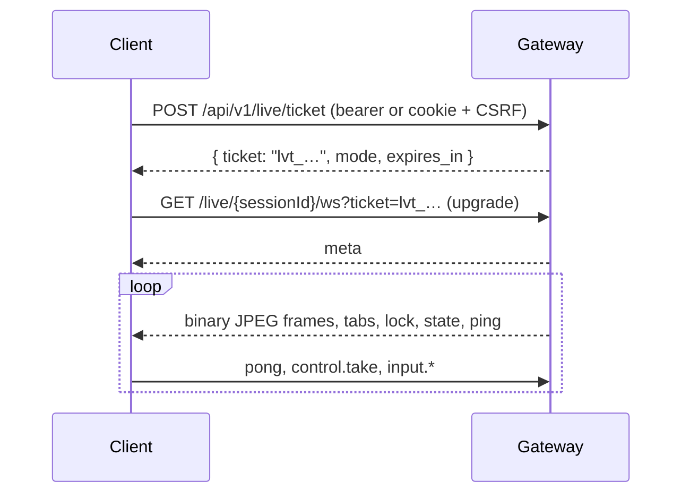

# MCP reference

The MCP surface: identity and transports, every tool, browser sessions, resources, notifications, errors, MCP Apps and
the live-view socket. REST routes, problem documents and the data model: [HTTP API](api.md).

## Identity

| Item              | Value                                                                                                                |
| ----------------- | -------------------------------------------------------------------------------------------------------------------- |
| Name / title      | `tykotech-mcp` / `Multi-MCP` (registry name `eu.tykotech/tykotech-mcp`, see `server.json`)                           |
| Description       | "Browser control with a live view, a coding sandbox and agents over MCP"                                             |
| Version           | `0.2.0`                                                                                                              |
| Website, icon     | `TTK_PUBLIC_URL` origin and `/assets/brand/icon-192.png`; omitted on stdio and on a wildcard public URL (`0.0.0.0`). |
| SDK               | `@modelcontextprotocol/server` 2.4.0 with the `@modelcontextprotocol/hono` 2.0.2 adapter                             |
| Protocol versions | `2026-07-28` (stateless), `2025-11-25`, `2025-06-18`, `2025-03-26`, `2024-11-05`, `2024-10-07`                       |
| `instructions`    | ≤2 KiB, built from the caller's scopes; never contains configuration values.                                         |

## Transports

| Transport       | Endpoint                                 | Model                                                                                                                 |
| --------------- | ---------------------------------------- | --------------------------------------------------------------------------------------------------------------------- |
| Streamable HTTP | `POST`/`GET`/`DELETE /mcp`               | Stateless: one server per request, built from the caller's scopes. Browser state lives in sessions.                   |
| Stateful HTTP   | `/mcp`, 2025-era clients (default on)    | `Mcp-Session-Id` sessions (≤64, 30 min idle; an open stream is not idle); adds `resources/subscribe` and change push. |
| stdio           | `tykotech-mcp stdio` / `deno task stdio` | One server per connection; logs to stderr; scopes from `TTK_ANON_SCOPES`.                                             |

`/mcp` is mounted only when a credential is configured or the bind is loopback. It takes one of this server's own bearer
credentials; a missing or invalid one answers `401` with `WWW-Authenticate: Bearer`; one without `mcp:invoke` answers
`403 forbidden-scope`. The server publishes no OAuth metadata, verifies no third-party tokens, issues no tokens and
registers no clients. stdio has no live view, event streams, recorder, signed links, handoff or MCP Apps.

## Capabilities

| Capability              | When                                                                |
| ----------------------- | ------------------------------------------------------------------- |
| `tools.listChanged`     | always                                                              |
| `resources.listChanged` | always                                                              |
| `resources.subscribe`   | 2025-era connections: stateful HTTP and stdio                       |
| `prompts`               | the library holds a prompt or skill and the caller has `files:read` |
| `completions`           | the caller has a resource template                                  |
| `tykotech`              | always (vendor block, scope-filtered)                               |

The `tykotech` block is also served as resource `ttk://capabilities` and in `browser_health`; SDK clients strip unknown
capability keys, so read the resource. Keys: `version`, `live_view`, `events`, `fields`, `state_token`, `tools_withheld`
(`[{ name, reason }]`, reason `scope-required` or `feature-unavailable`), `browser.sandboxed`, `sessions.ownership`,
`sandbox.backend`, `model`, and on a grouped connection `tool_groups`. The block is built when the connection opens;
`tools/list` follows later changes.

## Tools

The server defines **101 tools**: **57 browser tools**, 18 library tools and 26 extension tools. Each caller sees only
what its scopes and the deployment allow; the rest of what the deployment composes is listed in `tools_withheld` with
its reason, `scope-required` or `feature-unavailable`. A service that is not configured at all (no `TTK_DATA_DIR`, no
sandbox, no peers) adds no tools. The takeover lock never withholds a tool: it is answered per call with
`human-has-control`.

| Credential                                | Tools in the default Compose stack |
| ----------------------------------------- | ---------------------------------- |
| Default grant (no `scopes` named)         | 65                                 |
| `setup`'s `client` key (the stack scopes) | 97                                 |
| Every scope                               | 100                                |

The one never offered by default is `agent_delegate`, which needs A2A peers in `TTK_AGENT_PEERS_FILE`; with one listed,
the two counts with `agent:invoke` grow by one. Without `TTK_DB_KEY_FILE` (a plain `docker run`) signed links are off
and the default grant sees 64.

**Legend.** ✎ mutates the page or state: refused with `human-has-control` while a person holds the live-view lock,
except `browser_close_session`, `browser_close_all` and a `browser_storage_state` save. Scope: needed in addition to
`mcp:invoke`; blank = none. Most browser tools take an optional `session_id` (default: your `default` session).
Index-based tools take `index` plus the `state_token` from `browser_get_state`.

### Tool groups

The counts above are the flat list, which the stateless mount and the web app serve. On a connection that keeps one
server for its life — stdio, and a 2025-era `Mcp-Session-Id` session — `tools/list` starts instead with one entry tool
per group the credential holds an available tool in (`TTK_MCP_TOOL_GROUPS`, default on):

| Entry tool    | Adds to the list                   |
| ------------- | ---------------------------------- |
| `use_browser` | every `browser_*` tool             |
| `use_library` | `file_*`, `skill_*` and `prompt_*` |
| `use_sandbox` | `sandbox_*`                        |
| `use_agent`   | `agent_*`                          |
| `use_memory`  | `memory_*`                         |
| `use_a2ui`    | `a2ui_*`                           |

- An entry tool takes no arguments. It adds its group's tools to the connection's list, sends one
  `notifications/tools/list_changed`, and returns `{ group, tools: [{ name, title, description }] }`. Calling it again
  announces nothing unless the group's availability changed.
- Grouping decides what is listed, never what may be called: every tool answers `tools/call` by name, and such a call
  does not open its group. The MCP Apps tickets are never grouped.
- Opened groups last as long as the connection. A session rebuilt after a scope change, or restored after a restart,
  starts with every group closed and is told to re-list.
- A client that does not re-list on `tools/list_changed` never sees an opened group: set `TTK_MCP_TOOL_GROUPS=false`.

### Browser: navigation and interaction

| Tool                       | Scope      |   | Does                                                                                                                                               |
| -------------------------- | ---------- | - | -------------------------------------------------------------------------------------------------------------------------------------------------- |
| `browser_navigate`         |            | ✎ | Load a URL in the focused tab. `new_session: true` opens a new session, on a named `profile` if given.                                             |
| `browser_go_back`          |            | ✎ | Back one history entry.                                                                                                                            |
| `browser_wait_for`         |            |   | Wait for `navigation`, `selector`, `text`, `network_idle`, `download`, `dialog` or `state_token_changes`. A timeout is `met: false`, not an error. |
| `browser_click`            |            | ✎ | Click by index or viewport coordinates.                                                                                                            |
| `browser_double_click`     |            | ✎ | Double-click by index or coordinates.                                                                                                              |
| `browser_right_click`      |            | ✎ | Right-click (context menu).                                                                                                                        |
| `browser_hover`            |            | ✎ | Move the pointer onto an element, for hover menus and tooltips.                                                                                    |
| `browser_type`             |            | ✎ | Type into an element, or the focused one. `<secret>name</secret>` types a server-held secret.                                                      |
| `browser_press_key`        |            | ✎ | Key or chord (`Enter`, `Control+a`), optionally into an element.                                                                                   |
| `browser_fill`             |            | ✎ | Replace a field's contents.                                                                                                                        |
| `browser_select_option`    |            | ✎ | Choose a `<select>` option by value, label or position.                                                                                            |
| `browser_upload_file`      |            | ✎ | Put a file this session downloaded onto a file input; arbitrary paths are refused.                                                                 |
| `browser_drag`             |            | ✎ | Press, move, release: sliders, sortable lists, drag-and-drop.                                                                                      |
| `browser_scroll`           |            | ✎ | Scroll by viewport heights.                                                                                                                        |
| `browser_scroll_to`        |            | ✎ | Scroll to absolute CSS-pixel coordinates.                                                                                                          |
| `browser_scroll_into_view` |            | ✎ | Bring one element into view.                                                                                                                       |
| `browser_handle_dialog`    |            | ✎ | Answer a held JavaScript dialog by `dialog_id` (needs a `dialog` event subscriber).                                                                |
| `browser_fill_secret`      |            | ✎ | Fill a secret into a text or password field; checked against the frame's origin and audited.                                                       |
| `browser_evaluate`         | `evaluate` | ✎ | Run a JavaScript expression in a frame (1 s, 64 KiB result, audited by size and digest).                                                           |
| `browser_run_task`         | `task`     | ✎ | Complete a task autonomously with **your** model via MCP sampling; `resume` continues a paused run.                                                |

### Browser: perception

| Tool                             | Does                                                                                                                                                                                                 |
| -------------------------------- | ---------------------------------------------------------------------------------------------------------------------------------------------------------------------------------------------------- |
| `browser_get_state`              | URL, title, tabs and the indexed interactive elements, with a `state_token`. `fields` picks element detail (`minimal`, `core`, `full`, …); `include_hidden` adds off-screen elements.                |
| `browser_find`                   | Rank elements by role, accessible name, text, CSS, `href` pattern or nearness to a point. `href_pattern` refuses patterns that can backtrack catastrophically and skips hrefs over 2 048 characters. |
| `browser_element_at`             | The topmost interactive element at a viewport point.                                                                                                                                                 |
| `browser_get_frames`             | Every frame (out-of-process ones too) with its URL and box.                                                                                                                                          |
| `browser_locator_candidates`     | Ranked locators for one element, each with its match count.                                                                                                                                          |
| `browser_verify_locator`         | What a locator matches on the live page.                                                                                                                                                             |
| `browser_get_html`               | Raw HTML of a document (≤200 000 characters). A frame of another origin needs `evaluate` and is audited.                                                                                             |
| `browser_screenshot`             | PNG of the focused tab; `full_page` optional.                                                                                                                                                        |
| `browser_extract_content`        | Answer a question about the page with **your** model via MCP sampling.                                                                                                                               |
| `browser_accessibility_snapshot` | The accessibility tree (roles, names, states), nested and as an outline.                                                                                                                             |
| `browser_performance`            | Core Web Vitals and runtime counters.                                                                                                                                                                |

### Browser: sessions

| Tool                          | Scope   |   | Does                                                                                           |
| ----------------------------- | ------- | - | ---------------------------------------------------------------------------------------------- |
| `browser_get_session`         |         |   | Profile, timestamps, viewport, tabs, lock holder, idle timeout, viewers, files.                |
| `browser_list_sessions`       |         |   | Sessions you can reach, with who holds control.                                                |
| `browser_set_viewport`        |         | ✎ | Emulate a viewport for every tab.                                                              |
| `browser_set_session_options` |         | ✎ | Viewport, locale, timezone, user agent, `accept_downloads`, idle timeout.                      |
| `browser_list_tabs`           |         |   | Open tabs.                                                                                     |
| `browser_switch_tab`          |         | ✎ | Focus a tab.                                                                                   |
| `browser_close_tab`           |         | ✎ | Close a tab.                                                                                   |
| `browser_storage_state`¹      |         | ✎ | Save or load cookies and origin storage by name. Returns counts, never the document.           |
| `browser_record`²             |         |   | Start, stop or check a WebM recording.                                                         |
| `browser_close_session`       |         | ✎ | Close one session.                                                                             |
| `browser_close_all`           | `admin` | ✎ | Close every session. Asks for confirmation.                                                    |
| `browser_health`              |         |   | Server and browser health plus the capability block.                                           |
| `browser_audit`               |         |   | The session's secret fills, evaluations and cross-origin frame reads: yours, all with `admin`. |

### Browser: files, network and media

| Tool                     | Scope          |   | Does                                                                                  |
| ------------------------ | -------------- | - | ------------------------------------------------------------------------------------- |
| `browser_download`       |                | ✎ | Start a download by clicking an element or loading a URL; returns its `file_id`.      |
| `browser_list_files`     |                |   | Downloads and server-made files of the session, with status.                          |
| `browser_get_file`       |                |   | A file inline (≤1 MiB), as a resource link, or as an HTTP stream with `Range`.        |
| `browser_file_policy`    |                |   | The file limits this deployment enforces.                                             |
| `browser_head`³          |                |   | Cookie-less `HEAD` from the server, not the browser: status, type, length, final URL. |
| `browser_pdf`            |                |   | Print the tab to PDF, inline or kept as a session file.                               |
| `browser_file_link`⁴     |                |   | A no-bearer download URL for one file, valid 10–3600 s.                               |
| `browser_network_log`    |                |   | The session's requests. Full URLs and response bodies need `network:read`.            |
| `browser_console_log`    |                |   | Console output and uncaught exceptions.                                               |
| `browser_har_export`     |                |   | The request log as HAR 1.2 (≤1 MiB).                                                  |
| `browser_request_human`⁵ | `view:control` |   | Ask a person to take over (CAPTCHA, sign-in, a decision) via a live-view link.        |
| `browser_live_view`⁶     | `view:watch`   |   | Show the session live inside an MCP Apps host.                                        |
| `browser_live_ticket`⁶   | `view:watch`   |   | Mint the embed's single-use live-view ticket (app-only: hidden from the model).       |

Availability: ¹ `TTK_DATA_DIR`. ² `TTK_DATA_DIR` and `TTK_FFMPEG`. ³ outbound network grant, no browser proxy. ⁴
`TTK_SIGNED_LINKS` on. ⁵ `TTK_HUMAN_HANDOFF` on, HTTP only. ⁶ `TTK_MCP_APPS` `watch` or `control`, HTTP only.

### Library

Needs `TTK_DATA_DIR`. Reads need `files:read` (default grant); writes need `files:write`. Results arrive inside
`{ result }`. A missing or oversized item is `file-unavailable`; any other refused path, name or argument is
`invalid-arguments`.

| Tool                                                   | Does                                                                     |
| ------------------------------------------------------ | ------------------------------------------------------------------------ |
| `file_list`, `file_stat`, `file_read`                  | Browse and read the file share (UTF-8 text ≤1 MiB).                      |
| `file_write`, `file_mkdir`, `file_move`, `file_delete` | Change the file share. `file_delete` asks for confirmation.              |
| `skill_list`, `skill_get`, `skill_read_file`           | Read skills (`SKILL.md` with frontmatter plus files).                    |
| `skill_put`, `skill_delete`                            | Create, replace or delete a skill. `skill_delete` asks.                  |
| `prompt_list`, `prompt_get`, `prompt_render`           | Read and render prompt templates (`{{argument}}`).                       |
| `prompt_put`, `prompt_delete`                          | Create, replace or delete a template. `prompt_delete` asks.              |
| `browser_save_to_share`                                | Copy a session file into the share (≤64 MiB) so it outlives the session. |

Stored prompts and skills are also served as MCP prompts (`skill:<name>` for skills).

### Extension tools

Results arrive inside `{ result }`. Behaviour and limits:
[Guide › Coding sandbox and agents](../guide.md#coding-sandbox-and-agents).

| Tool                                                                                             | Scope             | Does                                                                       |
| ------------------------------------------------------------------------------------------------ | ----------------- | -------------------------------------------------------------------------- |
| `sandbox_create`, `sandbox_clone`                                                                | `sandbox:execute` | New workspace from files or the share, or from a git repository.           |
| `sandbox_list`, `sandbox_read`, `sandbox_write`, `sandbox_diff`                                  | `sandbox:execute` | List workspaces and files, read and write files, diff against the start.   |
| `sandbox_exec`                                                                                   | `sandbox:execute` | Run a command in a fresh cage (no network unless `network: "registries"`). |
| `sandbox_session_open`, `sandbox_session_input`, `sandbox_session_read`, `sandbox_session_close` | `sandbox:execute` | A live line-mode shell.                                                    |
| `sandbox_delete`                                                                                 | `sandbox:execute` | Delete a workspace. Asks.                                                  |
| `agent_run_tool`                                                                                 | `agent:invoke`    | Run one tool call as a background task you own.                            |
| `agent_get_task`, `agent_list_tasks`, `agent_cancel_task`                                        | `agent:invoke`    | Follow, list and cancel your tasks.                                        |
| `agent_peers`, `agent_delegate`                                                                  | `agent:invoke`    | List A2A peers; delegate a message to one.                                 |
| `a2ui_publish`, `a2ui_delete`                                                                    | `a2ui:publish`    | Publish or delete an A2UI v0.9 surface. `a2ui_delete` asks.                |
| `sandbox_session_ticket`⁷                                                                        | `sandbox:execute` | Mint the terminal embed's single-use socket ticket (app-only).             |
| `a2ui_surface_ticket`⁷                                                                           | `a2ui:publish`    | Mint the surface embed's single-use socket ticket (app-only).              |
| `memory_search`, `memory_list`                                                                   | `files:read`      | Similarity search over your memory collections.                            |
| `memory_save`, `memory_delete`                                                                   | `files:write`     | Save up to 32 items; delete items or a collection. `memory_delete` asks.   |

Sandbox tools need the sandbox service (`TTK_SANDBOX_URL`) and are withheld while it is unreachable; `sandbox_clone`
needs `TTK_SANDBOX_GIT_HOSTS` or `TTK_SANDBOX_GIT_REMOTES_FILE` on the sandbox service. Memory tools need
`TTK_DATA_DIR`. ⁷ `TTK_MCP_APPS` `watch` or `control`, HTTP only; hosts keep these from the model.

**Delegation.** `agent_delegate` takes `message` (text) or `parts` (1–64 `{ text }` or `{ data }` parts). The peer sees
only the operator's peer token, so every caller is one principal there. A `{ data }` part (a tool call) is judged before
it leaves, at submission and again when the peer is dialled: it needs `mcp:invoke`, may name only `browser_head`,
`browser_health` or `browser_file_policy`, may not pass `session_id`, `task_id`, `workspace_id` or `surface_id`, and
must be a tool the caller could run here as a task. Text parts pass unchanged.

### Common behaviour

- **Argument spellings**: a value refused only because it arrived as JSON text (`{"limit": "5"}`, a stringified object)
  is read as the value it spells and validated again; anything still wrong is refused with the field named.
  `a2ui_publish` also accepts a message without `version` (read as `v0.9`) and the A2UI basic catalog's ids.
- **Output**: every tool returns `structuredContent` matching its `outputSchema`, plus text. Images:
  `browser_screenshot`, `browser_get_state` with `include_screenshot`. Embedded resources or resource links:
  `browser_get_file`, `browser_pdf`, `browser_har_export`.
- **Confirmations**: the seven tools marked "asks" request `{ confirm: true }` through form elicitation when the client
  supports it and `TTK_CONFIRM_DESTRUCTIVE` is on. Declining answers `user-declined`.
- **Annotations**: read-only tools carry `readOnlyHint`; mutating ones state `destructiveHint` and `idempotentHint`;
  every tool states `openWorldHint`.
- **Progress**: a request with a `progressToken` gets a notification every second. `browser_run_task`, `sandbox_exec`,
  `browser_wait_for` and `browser_download` report a total.
- **Cancellation**: a cancelled call aborts tools that wait and answers `browser-unavailable`.
- **Not runnable as a background task** (`agent_run_tool`, A2A, A2UI buttons): the sampling tools,
  `browser_request_human`, `browser_live_view`, the three MCP Apps ticket tools, `browser_file_link`, `agent_run_tool`
  and the confirmation set.

## Browser sessions

A session is one Chromium process and its tabs, owned by the session registry. Browser tools, the live view and the
session routes all act on sessions.

| Event      | Behaviour                                                                                                                       |
| ---------- | ------------------------------------------------------------------------------------------------------------------------------- |
| First use  | A tool without `session_id` uses your `default` session, created on first use; log and file reads never create one.             |
| New        | `browser_navigate { new_session: true }` or `POST /api/v1/sessions`. Unknown ids are never created implicitly.                  |
| Limit      | `TTK_MAX_SESSIONS` (default 8).                                                                                                 |
| Idle close | After `TTK_SESSION_TTL_S` (default 1800 s); never while a viewer is watching.                                                   |
| Close      | `browser_close_session`, `browser_close_all` (admin), `DELETE /api/v1/sessions/{id}`, crash or shutdown. Downloads are deleted. |

**Ownership** (`TTK_SESSION_OWNERSHIP`): `owner` (default) binds a session to its creator; others get `unknown-session`;
`admin` reaches all. `shared` lets every `mcp:invoke` holder reach every session.

**Perceive, then act.** `browser_get_state` merges the DOM, layout and accessibility tree and numbers each interactive
element. `fields` chooses detail: `minimal`, `core` (default: bounds, visible, enabled, focused, frame_id), `full`, or
single fields (`input`, `attrs`, `text`, `locators`, …). Pass the returned `state_token` back with an index: if the page
changed underneath, the tool answers `element-not-found` (reason `stale-token`) instead of acting on the wrong element.
Read state again after the page changes, and wait with `browser_wait_for` rather than polling. Password values are never
reported; secrets are typed by name (`<secret>name</secret>` or `browser_fill_secret`).

**Dialogs.** JavaScript dialogs are answered automatically (prompts dismissed) unless something subscribes to `dialog`
events. Then the dialog is held for up to 20 s, mutating tools answer `dialog-open`, and `browser_handle_dialog` answers
it.

**Human handoff.** `browser_request_human` hands out `<TTK_PUBLIC_URL>/#/view/<session>`; the person signs in and takes
control. While they hold the lock, mutating tools answer `human-has-control` and read-only tools keep working.

**Navigation allowlist.** `TTK_ALLOWED_DOMAINS` (a host matches itself and its subdomains) is enforced by the server and
inside Chromium: an off-list document request is refused before it is sent, off-list pop-ups are closed, and the attempt
is logged as a `navigation` event with `blocked: true`. `TTK_ALLOWED_DOMAINS_SCOPE=all` extends this to every request
and turns WebRTC off. It is not a network boundary.

**Files.**

| Item   | Rule                                                                                             |
| ------ | ------------------------------------------------------------------------------------------------ |
| Start  | `browser_download`, or any download a page starts.                                               |
| Limits | 100 MiB per file, 500 MiB and 100 files per session, 5 min per transfer (`browser_file_policy`). |
| Read   | `browser_get_file`: inline ≤1 MiB, resource link, or HTTP stream with `Range`.                   |
| Share  | `browser_file_link` mints a no-bearer URL (10–3600 s) when signed links are on.                  |
| Keep   | Files die with the session; `browser_save_to_share` copies one into the file share.              |

**Persistence** (needs `TTK_DATA_DIR`): named **profiles** keep a Chromium user-data directory across restarts (one live
session each, shared by every caller); **storage states** save and load cookies and origin storage by name (per owner in
`owner` mode); **recordings** (`browser_record`, needs `TTK_FFMPEG`) encode the screencast to WebM. Recordings and the
file share draw on one disk budget, `TTK_DISK_BUDGET_MB`: a recording does not start once it is spent and stops when
usage reaches it.

**Events and logs.** Each session keeps a ring of 512 events, readable over SSE (`/api/v1/sessions/{id}/events`) or the
live-view socket ([kinds](#events)). `browser_network_log` and `browser_har_export` read the last 500 requests
(credential headers redacted; full URLs and bodies need `network:read`); `browser_console_log` reads console output.

## Resources

| URI                                        | Content                                                          | Needs                        |
| ------------------------------------------ | ---------------------------------------------------------------- | ---------------------------- |
| `ttk://capabilities`                       | The capability block (JSON).                                     | `/mcp` access                |
| `ttk://session/{sessionId}/{kind}`         | `state`, `screenshot` (PNG) or `page`. Never launches a browser. | `mcp:invoke`                 |
| `ttk://session/{sessionId}/files/{fileId}` | A session file, base64, ≤1 MiB.                                  | `mcp:invoke`                 |
| `ttk://share/{+path}`                      | A file-share file, ≤1 MiB.                                       | `files:read`, `TTK_DATA_DIR` |
| `ttk://skill/{name}`                       | A skill's `SKILL.md`.                                            | `files:read`, `TTK_DATA_DIR` |
| `ui://tykotech/live-view`                  | MCP Apps live-view embed.                                        | `mcp:invoke`, `TTK_MCP_APPS` |
| `ui://tykotech/a2ui-surface`               | MCP Apps read-only A2UI surface embed, followed live on a click. | `mcp:invoke`, `TTK_MCP_APPS` |
| `ui://tykotech/terminal`                   | MCP Apps terminal embed for a live sandbox shell session.        | `mcp:invoke`, `TTK_MCP_APPS` |

`completion/complete` completes the template arguments (`sessionId`, `kind`, `fileId`, `path`, skill `name`), ≤100
values.

## Notifications

| Notification                           | When                                                                                                                                                        |
| -------------------------------------- | ----------------------------------------------------------------------------------------------------------------------------------------------------------- |
| `notifications/tools/list_changed`     | The sandbox becomes reachable or unreachable (30 s probe); after a deploy; when the caller's scopes change; once when a `use_<group>` tool opens its group. |
| `notifications/resources/list_changed` | A session or its file list changes.                                                                                                                         |
| `notifications/resources/updated`      | A session's page changes (subscribed URIs on 2025-era connections).                                                                                         |
| `notifications/progress`               | Every second for a call that sent a `progressToken`.                                                                                                        |

Stateless clients receive notifications over `subscriptions/listen`. A 2025-era client hears `tools/list_changed` on its
session's standalone `GET /mcp` stream and re-lists:

- **After a deploy.** With `TTK_DATA_DIR`, each session's id, principal and the client's `initialize` parameters (never
  a token, credential or scope) are kept in `<TTK_DATA_DIR>/mcp/sessions.json`. The client's next request with that id
  restores the session for the same principal, and both list-changed notifications are pushed as its stream opens.
- **When scopes change.** An edited account, a reloaded key file, a removed key or an ended sign-in makes every session
  re-read its credential: a session whose scopes moved is rebuilt under the same id and told to re-list; one whose
  credential is gone is closed.

A session answers only the principal that opened it; another credential presenting its id gets `404 Session not found`.

## Sampling and elicitation

The server hosts no model for `browser_extract_content` (one question about ≤24 000 characters of page text) and
`browser_run_task` (one action per step: `navigate`, `click`, `type`, `press_key`, `scroll`, `go_back`, `switch_tab`,
`done`); they borrow the client's through sampling, and a client declaring `sampling.tools` gets the actions as tools. A
spent budget parks a run; `resume: true` continues it. Without client sampling both answer `invalid-arguments`.

Elicitation is asked only of clients that declared the mode:

| Use           | Mode | When                                                                               |
| ------------- | ---- | ---------------------------------------------------------------------------------- |
| Confirmation  | form | Before the seven destructive tools, while `TTK_CONFIRM_DESTRUCTIVE` is on.         |
| Secret choice | form | `browser_fill_secret` named a secret that is unknown or not permitted on the page. |
| Human handoff | url  | `browser_request_human`, while `TTK_HUMAN_HANDOFF` is on.                          |

Declining is `user-declined`. On `2026-07-28` these run as `input_required` rounds whose `requestState` is HMAC-sealed
per process for 600 s; a forged, expired or foreign one (a retry after a restart included) is JSON-RPC `-32602`.

## Tool errors

A failed tool call is a result, not a JSON-RPC error; the only JSON-RPC errors are an unknown tool and an invalid
`requestState`. Codes are stable: branch on them, not on message text. Messages never quote a secret or an upstream
body.

```json
{
	"isError": true,
	"content": [{ "type": "text", "text": "Error: human-has-control: a live-view user has taken control of session …" }],
	"structuredContent": { "error": { "code": "human-has-control", "message": "…" } }
}
```

Checks run in this order: unknown tool (JSON-RPC error) → `scope-required` → `feature-unavailable` → `invalid-arguments`
→ confirmation (`user-declined`) → handler → output-schema check.

| Code                       | Meaning                                                                                                                                                               | Extra fields                     |
| -------------------------- | --------------------------------------------------------------------------------------------------------------------------------------------------------------------- | -------------------------------- |
| `unknown-session`          | No such session, or another principal's in `owner` mode.                                                                                                              |                                  |
| `session-limit`            | `TTK_MAX_SESSIONS` reached, or the named profile is already open.                                                                                                     |                                  |
| `human-has-control`        | A person holds the takeover lock: every mutating tool except closing is refused, read-only tools work. Wait, then retry.                                              |                                  |
| `navigation-blocked`       | Scheme not http/https, host outside `TTK_ALLOWED_DOMAINS` (`browser_head`: also a private address or unlisted port), or a secret not permitted on the frame's origin. |                                  |
| `timeout`                  | An operation exceeded its deadline.                                                                                                                                   |                                  |
| `unknown-tab`              | No such tab in the session.                                                                                                                                           |                                  |
| `unknown-index`            | The element table has no such index.                                                                                                                                  | `index`                          |
| `element-not-found`        | `state_token` does not match the current table, or there is no table yet.                                                                                             | `reason`, `state_token`, `index` |
| `element-not-interactable` | The element cannot take the action (wrong tag, disabled, no box).                                                                                                     | `index`, `tag`                   |
| `dialog-open`              | A held JavaScript dialog blocks the page; answer it with `browser_handle_dialog`.                                                                                     | `dialog_id`, `dialog_kind`       |
| `download-failed`          | The download was refused when it started.                                                                                                                             | `file_id`, `reason`              |
| `browser-crashed`          | The browser process died.                                                                                                                                             |                                  |
| `browser-unavailable`      | Generic browser or server failure, a cancelled call, or a secret refused on a zoomed viewport (`viewport-scaled`).                                                    | `reason`                         |
| `browser-error`            | A remote failure for `browser_head` (`dns`, `refused`, `reset`, `tls`, …).                                                                                            |                                  |
| `invalid-arguments`        | Arguments invalid by schema or by meaning (e.g. no sampling support, a finished task).                                                                                |                                  |
| `unknown-file`             | `file_id` never tracked by this session.                                                                                                                              |                                  |
| `file-unavailable`         | A session file not deliverable now, a library item missing or too large (past `TTK_DISK_BUDGET_MB` included), or a missing memory collection.                         |                                  |
| `scope-required`           | The credential lacks a scope. The message never names it.                                                                                                             |                                  |
| `feature-unavailable`      | The deployment cannot offer the tool now (no data dir, no ffmpeg, no egress, service down, switch off).                                                               | `feature`                        |
| `user-declined`            | The client's user declined a confirmation, handoff or secret choice.                                                                                                  |                                  |

Extension tools map service failures by status: 400 → `invalid-arguments`, 404 → `file-unavailable`, else
`feature-unavailable`, in fixed words.

## MCP Apps

On while `TTK_MCP_APPS` is `watch` or `control` (default `control`; never on stdio).

- `browser_live_view`, `a2ui_publish` and `sandbox_session_open` link their results to the three `ui://` embeds; the
  ticket tools `browser_live_ticket`, `a2ui_surface_ticket` and `sandbox_session_ticket` are app-only.
- Each embed is one self-contained HTML document with a hash-pinned inline script and style and a `default-src 'none'`
  CSP whose only connect source is the gateway's WebSocket origin. Add the host's sandbox hostname to
  `TTK_ALLOWED_ORIGINS`; `TTK_MCP_APPS_ORIGINS` narrows which origins a ticket may be bound to.
- The live-view embed connects only after the user presses Watch. The terminal's **Attach** and the surface's **Follow
  live** open `/live/terminal/{session}/ws` (`sandbox:execute`) and `/live/surface/{surface}/ws` (`a2ui:publish`). The
  terminal replays the output the session still holds, streams the rest and feeds typed lines to the shell; the surface
  sends every new revision, read-only, and ends when the surface is removed.
- The embed sockets take the live view's ticket rules (30 s, single use, bound to the embed's origin, the kind and the
  target), re-check the credential every 300 s and on every key change, end after 1800 s, and hold one of the
  principal's long-lived connection slots. Messages are JSON text: `meta`, `output {seq, data, gap}`,
  `end {exit_code, killed}`, `surface {surface}`, `removed {surface_id}`, `ping`, `error {code, message}` and
  `bye {reason}` from the server; `input {data}` (terminal only) from the embed.

## Live-view socket

A WebSocket that streams a session's screen and carries human input back. The contract is the Zod schemas in
`packages/wire/src/messages.ts`, shared by the gateway and the web app.



### Tickets

| Rule     | Value                                                                                          |
| -------- | ---------------------------------------------------------------------------------------------- |
| Scope    | `view:watch` or `view:control`; `mode` is `view`/`watch` or `control` (never above the scope). |
| Use      | Single use, bound to principal, session and mode. The bearer never appears in a URL.           |
| Lifetime | 30 s default; at most 300 s for watching, 60 s for control. Over 30 s it must be origin-bound. |
| Owner    | In `owner` mode only for your own session (or any with `admin`).                               |

The upgrade re-checks the credential that minted the ticket: one holding only `view:watch` opens a watch-only viewer;
one holding neither view scope, or gone, is refused. Upgrade refusals: `426` (not an upgrade, ticket kept),
`403 ticket-invalid|ticket-expired|ticket-consumed|origin-forbidden`, `403 forbidden-scope`, `404 unknown-session`,
`429` (viewer cap `TTK_MAX_VIEWERS`, or 8 long-lived connections per principal), `503` (draining).

An open socket re-checks its credential every 300 s and on every credential change: losing `view:control` makes it
watch-only and releases the lock; losing both view scopes, or the credential, closes it with 4001 `unauthorized`. A
ticket with no credential to re-check closes after 1800 s (1000 `stream-expired`). A client frame over 64 KiB closes the
socket with 1009, and one `live.hover` per viewer is in flight at a time.

### Frames and messages

Text frames carry JSON both ways. Screen frames are binary, server to client:

```
[ u32 big-endian metadata length ][ UTF-8 JSON { type: "frame", seq, ts, w, h, targetId, scale? } ][ JPEG ]
```

One CDP screencast per session feeds every viewer and the recorder (JPEG quality `TTK_CAST_QUALITY`, within 1280×720).
The last frame is cached for late joiners and `live.keyframe`. URLs on this socket are origin plus path only.

| Server → client | Fields                                                                                 | When                                                       |
| --------------- | -------------------------------------------------------------------------------------- | ---------------------------------------------------------- |
| `meta`          | `sessionId`, `viewerId`, `mode`, `viewport`, `tabs`, `lock`, `version`, `frame_scale?` | On open                                                    |
| `tabs`          | `tabs: [{ tabId, url, title, focused }]`                                               | Tabs change                                                |
| `lock`          | `lock: { holder, principal, takenAt, holderName? }` or `null`                          | Lock taken or released                                     |
| `state`         | `url`, `title`, `frames?`                                                              | Navigation or focus change                                 |
| `event`         | `event` (event record)                                                                 | After `events.subscribe`                                   |
| `hover`         | `id`, `element`, `frame_id`                                                            | Reply to `live.hover`                                      |
| `quality`       | `scale`, `jpeg_quality`, `max_fps`                                                     | Reply to `live.quality`; to subscribed sockets on a change |
| `viewport`      | `w`, `h`, `frame_scale`                                                                | First frame and size changes, to subscribed sockets        |
| `error`         | `code`, `message`, `reason?`                                                           | A refused message (below)                                  |
| `ping`          | —                                                                                      | Every 15 s                                                 |
| `bye`           | `reason`: `session-closed`, `server-shutdown`, `idle-timeout`                          | Before close                                               |

| Client → server                          | Fields                                                                                                                    | Requires            |
| ---------------------------------------- | ------------------------------------------------------------------------------------------------------------------------- | ------------------- |
| `pong`                                   | —                                                                                                                         | —                   |
| `control.take`, `control.release`        | —                                                                                                                         | Control-mode ticket |
| `input.mouse`                            | `kind` (`move`/`down`/`up`/`click`), `x`, `y`, `button?`, `clickCount?`                                                   | The lock            |
| `input.key`                              | `kind` (`down`/`up`/`press`), `key`, `code?`, `text?`, `modifiers?`, `windowsVirtualKeyCode?`, `location?`, `autoRepeat?` | The lock            |
| `input.wheel`                            | `x`, `y`, `deltaX`, `deltaY`                                                                                              | The lock            |
| `input.composition`                      | `kind` (`update`/`commit`/`cancel`), `text`, `selectionStart?`, `selectionEnd?`                                           | The lock            |
| `navigate`                               | `url` (allowlist applies)                                                                                                 | The lock            |
| `tab.switch`                             | `tabId`                                                                                                                   | The lock            |
| `events.subscribe`, `events.unsubscribe` | `kinds?`, `since?`                                                                                                        | —                   |
| `live.hover`                             | `id`, `x`, `y`                                                                                                            | —                   |
| `live.keyframe`                          | —                                                                                                                         | —                   |
| `live.quality`                           | `scale?`, `jpeg_quality?`, `max_fps?`                                                                                     | Control mode        |
| `live.highlight`                         | `index` or `bounds`, `ttl_ms?`                                                                                            | Control mode        |

`modifiers` is a CDP bitmask (alt 1, ctrl 2, meta 4, shift 8) or names. A socket that never answered `pong` is closed
after 300 s of silence; after its first `pong`, after 45 s.

| Error code           | Meaning                                                                                                                    |
| -------------------- | -------------------------------------------------------------------------------------------------------------------------- |
| `not-holder`         | Input or control message without the lock, or on a watch socket.                                                           |
| `lock-held`          | Another viewer holds the lock.                                                                                             |
| `bad-message`        | Failed schema validation (`reason: schema`), or unknown tab.                                                               |
| `navigation-blocked` | `navigate` URL or a redirect hop off the allowlist.                                                                        |
| `input-rejected`     | Input the server cannot carry out; `reason`: `out-of-range`, `unsupported-key`, `session-not-connected`, `no-focused-tab`. |
| `not-ready`          | `live.keyframe` before a frame is cached.                                                                                  |
| `browser-crashed`    | The browser died; the socket closes.                                                                                       |
| `internal`           | Input injection failed.                                                                                                    |

### Takeover lock

One holder per session. `control.take` succeeds when the lock is free; only the holder releases it, or its socket
closing does. While held, mutating MCP tools answer `human-has-control` (closing the session still works) and read-only
tools keep working. A session with a viewer is never closed for idleness.

### Events

Records are `{ kind, seq, at, tab_id, payload }`, the same as the SSE stream at `/api/v1/sessions/{id}/events`
(`kinds=a,b` filters, `since=<cursor>` resumes).

| Kind                                                                                                                            | Socket | SSE |
| ------------------------------------------------------------------------------------------------------------------------------- | ------ | --- |
| `navigation`, `dom.settled`, `network.idle`, `download.started`, `download.done`, `download.failed`, `dialog`, `tab`, `control` | yes    | yes |
| `focus`, `input`, `console`                                                                                                     | no     | yes |

The ring holds 512 records or 256 KiB; a reader that falls behind gets a `gap` record. Cursors are `<epoch>:<seq>`.
Subscribing to `dialog` switches dialogs to manual handling so `browser_handle_dialog` can answer them.

## Not implemented

MCP tasks (`tasks/*`; use `agent_run_tool`), prompt-argument completions, roots, `logging/setLevel`, OAuth 2.1
authorization and its step-up challenges.
