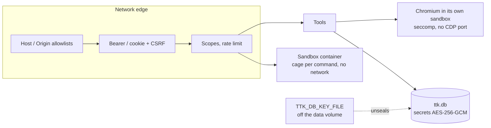

# Security

The server loads untrusted pages for a model, lets a person take over the same browser, runs code in workspaces, and
keeps credentials at rest. This page lists what guards each boundary, where the guard ends, and how secrets reach the
processes. How to report a vulnerability: [SECURITY.md](../SECURITY.md).

## Threats and defences

| Threat                               | Defences                                                                                                                                                                                                                            |
| ------------------------------------ | ----------------------------------------------------------------------------------------------------------------------------------------------------------------------------------------------------------------------------------- |
| Unauthenticated network callers      | A non-loopback bind refuses to start without API keys or an account. Every non-public route needs a credential.                                                                                                                     |
| A malicious page                     | Chromium's sandbox in a hardened container; CDP bound to loopback, never published; password values never reported.                                                                                                                 |
| A model or client exceeding its role | Per-credential scopes, ten held only when named (administration, metrics, full request data, page JavaScript, browser tasks, code, agents, surfaces, writes, models); owner-bound sessions, workspaces, tasks, surfaces and memory. |
| DNS rebinding, cross-site requests   | `Host` and `Origin` allowlists; no CORS headers; one `SameSite=Strict` HttpOnly cookie plus CSRF on changes.                                                                                                                        |
| Credential leakage                   | Keys and passwords hashed; stored secrets sealed; secrets never in the process environment; tickets, not tokens, in URLs; values never logged.                                                                                      |
| A stolen data volume                 | Sealed secrets need `TTK_DB_KEY_FILE`, kept off the volume.                                                                                                                                                                         |
| Code run in a workspace              | Separate container; a fresh bubblewrap cage per command; no network by default; disk budgets; a fair share per owner.                                                                                                               |
| Filling the data volume              | One disk budget (`TTK_DISK_BUDGET_MB`) for the file share and recordings: an upload past it answers `413 payload-too-large`, a recording stops at it.                                                                               |
| A revoked credential lingering       | Sign-ins, tasks, streams, live-view sockets and signed links are re-checked and end when the credential is revoked.                                                                                                                 |

## Authentication and authorization

| Credential                | Rules                                                                                        |
| ------------------------- | -------------------------------------------------------------------------------------------- |
| API key (`ttk_`)          | Stored as SHA-256, compared in constant time. The key file reloads on change.                |
| Password account          | PBKDF2-SHA256, 100 000 iterations. Equal-time failures; per-source and per-username backoff. |
| Sign-in session (`ttks_`) | Hashed; expires after `TTK_LOGIN_TTL_S`; scopes re-derived on every request.                 |
| Anonymous                 | Only on a loopback bind with no credentials configured, with `TTK_ANON_SCOPES`.              |

One bearer gate runs a verifier chain (sign-in session → API key → loopback anonymous). The web app's cookie is
`HttpOnly; SameSite=Strict` (`__Host-` and `Secure` on https), set only by a JSON sign-in from the server's own origin,
read only without an `Authorization` header, and never on the live-view socket; a duplicated or malformed one is refused
and cleared. Every cookie-authenticated change needs the own origin and `x-ttk-csrf`.

14 scopes ([table](guide.md#scopes)): four make the default grant, the other ten are held only when named. A tool
outside the caller's scopes is not registered and is listed as withheld; REST routes answer `403 forbidden-scope`.
Allowlists and per-credential origins can only be narrowed by clients.

## Network posture

- Binds `127.0.0.1` by default. The image binds `0.0.0.0` inside its container, so it starts only with a credential;
  Compose publishes it on loopback unless `TTK_BIND` says otherwise.
- Foreign `Host`: `400`. Foreign `Origin`: `403`. No CORS. TLS is the reverse proxy's job.
- The web app is served with a strict CSP, `frame-ancestors 'none'` and `X-Frame-Options: DENY`.
- Non-canonical paths are refused and bodies capped before authentication and routing
  ([limits](reference/api.md#conventions)); each principal is rate-limited (`TTK_RATE_RPM`).

## The browser

- **Sandbox.** Chromium needs its setuid helper, the shipped seccomp profile, 1 GB shared memory and **no**
  `no-new-privileges`. The gateway image strips the setuid and setgid bits from every other file, and Compose caps the
  gateway at 4096 processes. `--no-sandbox` is possible only with `TTK_CHROMIUM_NO_SANDBOX=true` (never set in the
  images; loud warning). `TTK_BROWSER_ARGS` refuses switches that weaken the sandbox or site isolation, move the
  DevTools endpoint or profile, or run another program.
- **What reaches the model.** Password values are masked and excluded from the state token. Secrets are substituted by
  name inside the server, checked against the origin of the frame receiving them, and audited. A field a secret was
  filled into is masked like a password field, and every tool result and session resource has stored secret values
  replaced by `[secret]`, so a value the page echoes into a URL, title or other field does not return. Pages get no
  clipboard access. Storage-state documents never leave the server. Request logs redact credential headers and never
  read bodies; full URLs need `network:read`.
- **Allowlist.** `TTK_ALLOWED_DOMAINS` is enforced by the server and inside Chromium (off-list document requests are
  refused before they are sent). `TTK_ALLOWED_DOMAINS_SCOPE=all` covers every request, and WebRTC: pages get no
  `RTCPeerConnection` or other RTC API, and Chromium sends no WebRTC UDP and opens no WebRTC TCP connection to an
  off-list host. It is not a network boundary: for one, use a network that reaches only allowed sites.
- **Page JavaScript.** `browser_evaluate` needs `evaluate`; 1 s budget, 64 KiB result, audited by size and digest.
- **Server-side requests.** `browser_head` sends cookie-less `HEAD` requests hop by hop, refusing loopback, private and
  link-local literals and non-default ports unless `TTK_ALLOWED_DOMAINS` names that exact host (or `host:port`); it does
  not resolve names for that check, so set `TTK_ALLOWED_DOMAINS` on networks with internal services. It refuses while
  `TTK_BROWSER_ARGS` routes Chromium through a proxy, since its own request would follow `HTTP(S)_PROXY`. A2A push goes
  only over https to `TTK_A2A_PUSH_ALLOWED_HOSTS`, and every attempt re-resolves the host and refuses a private,
  loopback or link-local address.

## Live view and MCP Apps

Sockets open with single-use tickets bound to principal, session and mode, valid 30 s by default (at most 300 s to
watch, 60 s to control; a longer one must be bound to an origin). Watching and controlling are separate scopes; input
needs the takeover lock. A socket re-checks the credential that minted its ticket periodically and on every credential
change, narrowing to watch or closing. Viewers per session and long-lived connections per principal are capped. MCP Apps
embeds are hash-pinned documents whose only connect source is the gateway's socket origin. The terminal and surface
embed sockets take the same kind of ticket, minted only for a session or surface the caller owns; the surface stream is
read-only, and the terminal accepts input only because its ticket needs `sandbox:execute`.

## Coding workspaces

The sandbox is another container on an internal network, reached with the token `setup` writes, mounted read-only into
it and the gateway only; the service reads the token and the git remotes once, then gives up its read grant on both.
Each command runs in a fresh cage: new namespaces, no capabilities, read-only root and `.git`, 200 processes, a cleared
environment, no network unless it asks for package registries (HTTPS `CONNECT` to a fixed list on public addresses only,
with the TLS SNI naming the `CONNECT` host). Git credentials never enter a cage. The service holds no capability; its
AppArmor profile is Docker's default with only `mount` and `pivot_root` allowed, which bubblewrap needs to build a
cage's root inside the cage's own user namespace. Disk is budgeted per workspace and owner, and each owner gets a fair
share of the command and session slots. The opt-in Docker backend gives the sandbox service, never the gateway, the
Docker socket, which is root-equivalent on the host.

## Agents

Tasks run with the caller's current scopes, re-checked before every tool call. No task, and no `TTK_A2UI_ACTIONS`
button, may run the confirmation set, the sampling tools, the handoff, the live-view and stream-ticket tools,
`browser_file_link` or `agent_run_tool`. Model providers are named only by the operator (seed file) or an administrator;
the gateway dials only their `base_url` (never a link-local address; plain `http:` only to loopback, or with
`allow_http` to a private address or a name), without redirects; a provider key is sealed, bound to its host, never
returned and redacted from task output.

## Secrets

Secrets are files, resolved from `*_FILE` variables and threaded by argument: none enters `Deno.env`, a log line or a
response, and provider keys stay out of the compose files and the tasks. `deno task setup` (which the start scripts run
inside the image) creates every file a shipped Compose file mounts; [secrets/README.md](../secrets/README.md) describes
each file, its `--only` name and how to rotate it.

- **Permissions.** `secrets/` is `0700` and every file in it `0644`, applied on every run. Compose file secrets are bind
  mounts that keep the host's owner and mode, and the containers run as uid 1993: the directory gives confidentiality on
  the host, and `0644` lets the service read the mounted file with rootless Docker and Docker Desktop too. Windows has
  no POSIX modes.
- **Placeholders.** An empty browser-secrets document (`{}`) and an empty git-remotes list (`[]`) configure nothing, so
  both are mounted by default and filling one in is the whole opt-in. Model providers have no placeholder (a providers
  file must name at least one); add them in the web app, or mount a file with an override of your own.
- **The sandbox token** is the one bearer the gateway and the sandbox share, mounted read-only into both. Because it
  comes from the host, the gateway needs nothing from the sandbox to start.
- **Local defaults.** The checkout's `dev`, `stdio`, `doctor` and `seed` tasks pass `--local-defaults`: each unset
  `TTK_DB_KEY_FILE`, `TTK_API_KEYS_FILE` (not `stdio`, `seed`), `TTK_SECRETS_FILE` and, beside `TTK_SANDBOX_URL`,
  `TTK_SANDBOX_TOKEN_FILE` points at what `setup` wrote, when the file exists, and with the database key an unset
  `TTK_DATA_DIR` becomes `data`. The values go into the record the configuration is parsed from, never into `Deno.env`;
  an explicit variable wins.
- **The first key.** `setup`'s `client` key holds the stack scopes (`STACK_SCOPES` in `packages/mcp/src/scopes.ts`):
  `mcp:invoke, view:watch, view:control, files:read, files:write, sandbox:execute, agent:invoke, model:invoke, a2ui:publish`.
  The administrator holds the same plus `admin`. `task`, `evaluate`, `metrics:read` and `network:read` are never granted
  by default.
- **External stores.** API keys and browser secrets can come from Vault or 1Password instead (`TTK_API_KEYS_REF`,
  `TTK_SECRETS_REF`), read once at start-up and never copied into `ttk.db`.

## Process permissions

Every launcher — task, image `CMD`, test tier — names its Deno permissions, `--deny-ffi` first and `--allow-run` as
absolute paths. `gate:tasks` (`scripts/check_tasks.ts`) enforces this for every task; its `MATRIX_EXEMPTIONS` excuse a
few tooling tasks from named rules, each with its reason, and never a shipped task or a helper one reaches
([tasks](development.md#tasks)). `tests/unit/images_test.ts` pins the image `CMD`s.

The gateway image grants unscoped `--allow-net` so `browser_head`, model providers, secret providers, A2A peers and push
work; the code that dials bounds each (above), and a Compose `command:` override can narrow it
([how](guide.md#scope-back-egress)). The `dev` and `stdio` tasks grant loopback only. The sandbox's `CMD` grants
unscoped `--allow-net` too; its registry proxy and git transports, the only parts that dial out, reach only fixed or
operator-named hosts on public addresses. The gateway's `CMD` reads `/run/secrets`; the sandbox's reads only its token
and `/run/secrets/ttk_git_remotes`.

Chromium and ffmpeg start with the inline secret variables, the `OTEL_*` exporter variables and `ANTHROPIC_API_KEY`,
`OPENAI_API_KEY` and `TTK_MODEL_API_KEY` set empty. The server reads none of the `OTEL_*` or model-key names (no
`OTEL_*` name is granted) and exports no telemetry. `CHROMIUM_FLAGS` and `CHROMIUM_USER_FLAGS` are blanked too, so
Debian's `chromium` wrapper cannot pass switches `TTK_BROWSER_ARGS` would refuse.

## Data at rest

| Data                                                                                        | Protection                                                                                                |
| ------------------------------------------------------------------------------------------- | --------------------------------------------------------------------------------------------------------- |
| Provider keys, browser secrets, generated link key                                          | Sealed in `ttk.db` (AES-256-GCM, key from `TTK_DB_KEY_FILE`).                                             |
| A2A push webhook tokens                                                                     | Sealed in `agents/tasks.json` with a key derived from `TTK_DB_KEY_FILE`; without it, kept in memory only. |
| API keys, passwords, sign-ins                                                               | SHA-256 / PBKDF2 hashes.                                                                                  |
| Profiles, storage states, downloads, recordings, file share, task files; memory in `ttk.db` | **Not encrypted.**                                                                                        |

Each sealed value has a fresh nonce, and its additional data binds the row name and context, so a row copied elsewhere
or a key moved to another host does not decrypt. On load, a provider whose `base_url` is not its key's host is refused,
and keeping a key across a host or scheme change is refused. Sealed rows: `vault/check` (proves the key is right),
`model-provider/<id>`, `browser-secrets`, `link-signing-key`.

The key is 32 bytes from `TTK_DB_KEY_FILE` (base64url, base64 or hex), outside the data volume: start-up refuses a key
file inside `TTK_DATA_DIR`. Without it the vault is locked: nothing secret can be stored, and a database that already
holds sealed rows refuses start-up. Back the key up apart from `/data`: losing or replacing it loses every stored
secret, and there is no rotation command. A backup of `/data` holds cookies, files and memory in the clear.

## Known limits

- With `TTK_SESSION_OWNERSHIP=shared`, sessions are shared among `mcp:invoke` holders; named profiles are shared in
  every mode. Saved storage states are per owner in `owner` mode.
- A2A peers see one identity: every local owner reaches a peer with the operator's single peer token. A delegated data
  part may name only `browser_head`, `browser_health` or `browser_file_policy`, and no session, task, workspace or
  surface id, but a delegated text message runs the peer's agent as that shared principal.
- A signed link is a bearer credential until it expires (≤3600 s), its session closes or its credential changes.
- The domain allowlist is not a network boundary.
- Behind a reverse proxy, per-source sign-in backoff sees the proxy's address.
- The audit ledger lives in memory, per session.

## How it is checked

- CI (`.github/workflows/ci.yml`, read-only token, actions pinned by commit): fmt, lint, types, `gate:tasks` and the
  unit tier on Linux, Windows and macOS; the browser and stdio tiers; the coverage gate over the unit, agents and
  browser tiers; the image verifier; `deno audit`. The sandbox and Compose tiers run by hand.
- `packages/cli/setup_test.ts`: every file a compose file mounts is written `0644` in a `0700` folder, kept and repaired
  on a second run, and replaced by unit; the scopes; the AppArmor unit; `.env` equals `.env.example`.
- `tests/unit/images_test.ts`: digest-pinned bases, the image `CMD`s (no compose file restates the gateway's), the
  setuid strip, the sandbox's hardening and its AppArmor profile.
- `deno task gate:tasks` (`tests/unit/check_tasks_test.ts`): exact permissions in every task.
- `tests/container/verify_container.ts`: the image from outside — tools, Chromium's sandbox flags, the allowlist.
- `deno task test:compose --tag <t>`: the default stack end to end, with scratch secrets only.
